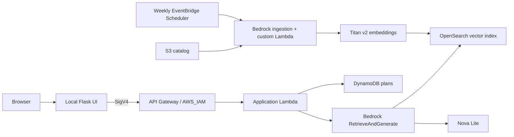

# AI Career Coach

AI Career Coach generates career-development plans grounded in an internal course catalog. Users submit their current role and career goal; Amazon Bedrock retrieves relevant course evidence, generates a plan and returns citations. Successful requests and plans are stored in DynamoDB.

The repository includes the Flask interface, AWS infrastructure, course-aware ingestion Lambda, first-time setup automation and configurable weekly knowledge refresh. The supplied dataset contains **40 synthetic courses across ten tracks**. CloudFormation is the infrastructure implementation used by this project.

## Architecture



The request path and ingestion path are separate. Custom ingestion preserves each course and its metadata as one evidence unit; it runs during Sync, not when a user asks for a plan. Default parser + built-in NONE + the transformation hook produce 40 course units and two catalog contexts. Titan v2 uses FLOAT32/1024-dimensional embeddings; OpenSearch stores the vectors, text and metadata. This is retrieval-augmented generation, not model training.

The main CloudFormation stack owns application, ingestion and conditional Scheduler resources. A companion RAG stack creates a new KB/OpenSearch environment; an already configured KB can be reused. Scheduler runs independently of the local computer. [Complete architecture, ownership and diagrams](docs/architecture.md) · [Knowledge pipeline](docs/knowledge-pipeline.md) · [Chunking decision](docs/decisions/course-aware-chunking.md).

## Quick start

Requirements: Python 3.12, AWS CLI v2, an IAM user/role profile with the [deployment permissions](docs/security.md), and a Region supporting the selected Bedrock models/KB and OpenSearch resources. Do not use root. Examples use Bash/WSL and Ohio (`us-east-2`); replace YOUR_PROFILE with your authenticated profile. OpenSearch can incur persistent charges even with zero requests: review the [cost model](docs/costs.md) before provisioning.

```bash
git clone https://github.com/r-khaled/AI-career-coach.git
cd AI-career-coach
python3 -m venv .venv
source .venv/bin/activate
python -m pip install -r requirements-dev.txt
# SSO profiles: aws sso login --profile YOUR_PROFILE
aws sts get-caller-identity --profile YOUR_PROFILE --region us-east-2
python -m unittest discover -s tests -v
cfn-lint CloudFormation.yaml infrastructure/*.json

# Read-only preview: inspect the destination account and existing resources.
python -m ingestion.setup_lab setup --profile YOUR_PROFILE --region us-east-2
# Provision/reconcile, upload source, initialize the KB, check retrieval and enable weekly refresh.
python -m ingestion.setup_lab setup --profile YOUR_PROFILE --region us-east-2 --apply --enable-schedule
```

Use `--expected-account YOUR_12_DIGIT_ACCOUNT_ID` as an account guard. Use a distinct stack name for another environment with `--stack-name`; S3 names include account/stack but not Region. In PowerShell activate the environment with its Windows activation script and set environment variables using PowerShell syntax.

First setup bootstraps two private versioned buckets, uploads the verified ingestion ZIP, provisions application infrastructure, creates/reuses the KB, binds its invoke permission, creates/validates the source, runs initial Sync and a filtered Retrieve smoke check, then binds Scheduler in the main stack. The initial Sync happens immediately through the CLI; Scheduler refreshes the already prepared source later. No GitHub Actions pipeline or manual Console wizard is required for this path. [Full deployment procedure](docs/deployment.md).


## Deployment order and existing stacks

**Start with the setup CLI after cloning/authenticating; do not deploy the full CloudFormation template first.** Setup invokes CloudFormation itself: fresh bucket bootstrap → ZIP preparation/upload → full main-stack change sets → KB/source binding → initial Sync/Retrieve → Scheduler binding. CloudFormation does not execute the local setup Python file.

The full template requires `IngestionCodeS3Key` and `IngestionCodeS3ObjectVersion`. A direct fresh deployment without those parameters fails validation; supplied parameters pointing to a missing ZIP can fail Lambda creation/roll back. With a valid ZIP, the main stack can deploy while the KB/source are still unconfigured; optional Scheduler resources remain absent until both IDs are bound. Main-stack success alone is not a complete knowledge setup.

For a compatible existing stack, rerun the same setup commands with its exact account/profile, Region and `--stack-name`. Setup reuses verified artifacts and a validated configured KB, updates the existing stack and completes supported remaining steps. It does not create a second environment unless a different stack name is chosen. The read-only preview is an application plan, **not** a prepared CloudFormation change set. During `--apply`, the CLI saves/prints/checks and executes change sets automatically; it does not pause for a human review.

Reconciliation is repeatable within the supported configuration, not universal recovery: reruns still perform Sync/Retrieve; existing source/intermediate buckets must already have the expected names, Region and versioning; mismatched/unbound external KBs, failed/in-progress stacks and arbitrary missing/drifted resources require inspection. An older baseline missing the intermediate bucket is not automatically upgraded by the current wrapper's bucket preflight. See [resume behavior and limits](docs/deployment.md#existing-stacks-and-repeated-setup).

## Run the application locally

Grant the caller `execute-api:Invoke` on ApiInvokeArn from the main stack. Read ApiEndpoint from Outputs rather than copying an endpoint from another account:

```bash
export AWS_PROFILE=YOUR_PROFILE
export AWS_DEFAULT_REGION=us-east-2
export API_URL="$(aws cloudformation describe-stacks --stack-name career-coach-lab --profile "$AWS_PROFILE" --region "$AWS_DEFAULT_REGION" --query "Stacks[0].Outputs[?OutputKey=='ApiEndpoint'].OutputValue | [0]" --output text)"
python app.py
```

Open `http://localhost:5001`. The form accepts current role and career goal. Flask signs the cloud request server-side; credentials never belong in browser JavaScript. Restart Flask when API_URL changes. The cloud API is `POST /prod/generate-plan`, not a browser GET endpoint. [API/persistence contract](docs/api.md) · [Access configuration](docs/security.md).

## Keep knowledge current

After editing `internal_courses.md`, rerun setup to validate/upload/Sync it. To Sync only the objects already uploaded to S3:

```bash
python -m ingestion.setup_lab sync --profile YOUR_PROFILE --region us-east-2 --apply
python -m ingestion.setup_lab status --profile YOUR_PROFILE --region us-east-2
```

Scheduler is defined in `CloudFormation.yaml` with its own execution role, group and encrypted delivery-failure queue. It becomes a main-stack resource after real KB/source IDs are bound. New schedules default DISABLED; `--enable-schedule` opts in. The default is Sunday 03:00 Africa/Cairo; change it with `--schedule-expression` and `--schedule-timezone`. Existing settings remain unless explicitly overridden.

Scheduler submits StartIngestionJob; it does not upload local edits, provision the KB or generate plans. Its delivery DLQ does not report document failures inside accepted jobs. Require COMPLETE **and zero failed documents**, then evaluate Retrieve before generation. [Operating procedures and schedule verification](docs/operations.md).

## Cost profile

This topology mixes token/request/duration charges with persistent search capacity. The documented Ohio minimum-capacity scenario is about **$175.63/month for 1,000 plan requests**, before credits/free tiers/tax and with the stated workload assumptions. The $175.20 search-capacity component dominates; this is an estimate, not a measured invoice or capacity guarantee. A two-hour/100-request scenario is about $0.53 if resources are actually retired afterward. Optional GPU acceleration, transfer and capacity growth are excluded.

[Service-by-service costs, scenarios and controls](docs/costs.md) · [Reproducible inputs](docs/cost-model.json).

```bash
python scripts/estimate_cost.py --requests 1000
```

## Implementation and validation

`app.py` handles the local UI/SigV4 client; the backend handler is inline in CloudFormation and packaged as `index.py`. The separate `ingestion/` package provides schema validation, the Bedrock/S3 adapter, deterministic ZIP generation and setup/Sync/status commands. Tests cover local request behavior/signing, whole-course extraction, transformation contracts, ZIP contents and guarded deployment logic. [Complete module reference](docs/code-reference.md).

The reference deployment verified real ingestion into 42 records and initial retrieval/filter cases. New-account setup and Scheduler must be accepted in the destination account; code inclusion is not proof of deployment. The reference stack check on 2026-11-26 found 14 resources and no deployed Scheduler. Generation/citation persistence and end-to-end UI acceptance remain separate checks. Exact-level, strict-track, duration/prerequisite plan enforcement, employee authentication and out-of-scope refusal are not implemented in the current app. [Deployment acceptance](docs/deployment.md#6-application-acceptance).

## Documentation

[Documentation index](docs/README.md) links architecture, code, deployment, knowledge contracts, security, operations, cost analysis and the chunking decision. Private archived material and deployment evidence are excluded from Git.

The initial application concept/reference implementation is based on [crafting-the-cloud/aws-ai-powered-application](https://github.com/crafting-the-cloud/aws-ai-powered-application); this repository documents its current infrastructure, ingestion and operational implementation.
