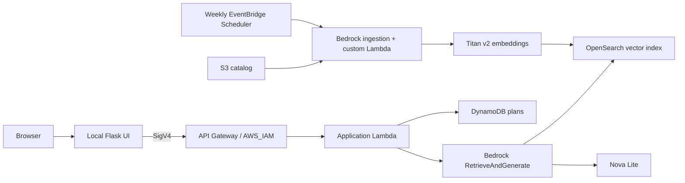
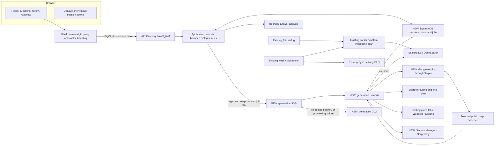

# AI Career Coach

> **Current cloud status (2026-11-26):** The reference project infrastructure was destroyed at the user's request. Earlier live results and resource diagrams below are historical. Code, contracts and local artifacts remain available; no reference API is running. See [stopping point and next steps](docs/implementation/next-steps.md).

> **Historical live deployment (2026-11-26, subsequently destroyed):** The reference stack reached UPDATE_COMPLETE with 31 resources and a successful live API-to-worker plan journey. External search, real React UI, cross-model and full cost acceptance remain pending. See [recorded live results](docs/implementation/live-deployment.md). Earlier statements below are dated implementation/design snapshots.


## Current implementation and first-time setup

Version anchors: [`old-architecture`](https://github.com/r-khaled/AI-career-coach/tree/old-architecture), [`guided-redesign-v1`](https://github.com/r-khaled/AI-career-coach/tree/guided-redesign-v1), [`react-contract-v1`](https://github.com/r-khaled/AI-career-coach/tree/react-contract-v1). See [version history and acceptance](docs/implementation/version-history.md).

The legacy form works with the existing `POST /generate-plan` API. The guided backend, Flask proxy and structured plan worker are implemented and tested offline; their CloudFormation resources passed a limited historical live journey before the reference infrastructure was destroyed; full acceptance remains incomplete. React screens are not included. `GuidedEnabled` defaults to `false`, so creating the stack does not enable the guided routes or queue/stream consumers.

The setup command uses **CloudFormation**, not Terraform. For a fresh target, `setup --apply` bootstraps the buckets, uploads independent ingestion, application and worker ZIPs, applies the main template, creates or reuses a compatible knowledge base, binds its data source, runs Sync and checks one Retrieve result. It also binds the optional schedule, which is disabled unless explicitly enabled. This workflow is locally tested with mocks; a fresh redesigned bootstrap in another account/Region has not been verified live; the historical guided update reused the existing KB. `--apply` executes change sets automatically and initiates paid resources and Sync: review the target, costs and authorization first. A preview without `--apply` reads AWS state and prints a plan; it does not create a reviewable AWS change set.

Before guided activation, review and configure `IntakeModelId`, `PlannerModelId`, inference-profile destination permissions if applicable, and an existing `SerperSecretArn`. The setup CLI does not expose flags for all of these settings, does not create the secret, and does not automatically enable `GuidedEnabled`. Review a separate CloudFormation update and obtain authorization for activation and paid trials. The existing knowledge base and ingestion settings are retained where compatible. Real React acceptance, external search, cross-model comparison and full cost/latency acceptance remain pending; one historical journey is recorded separately.

For offline checks after cloning, create a Python 3.12 environment, install `requirements-dev.txt`, then run `python -m unittest discover -s tests -v` and `cfn-lint CloudFormation.yaml infrastructure/*.json`. The release builder may download pinned wheels on its first run; an existing verified wheelhouse supports offline builds. See [deployment](docs/deployment.md), [operations](docs/operations.md), [costs](docs/costs.md) and [React integration](docs/react-integration.md).

### Code structure

- `app.py`, `web_guided.py`: legacy Flask form and same-origin guided proxy.
- `career_coach/handler.py`, `sessions.py`, `store.py`, `wizard.py`: routes, anonymous session persistence, claims and dialogue.
- `career_coach/retrieval.py`, `external.py`, `planning.py`, `plan_validation.py`: evidence, bounded external search and validated roadmap generation.
- `career_coach/jobs.py`, `worker.py`, `plans.py`, `downloads.py`: asynchronous jobs, immutable revisions and structured downloads.
- `career_coach/schemas/`, `fixtures/`, `definitions/`, `config.py`: contracts, examples and reviewed settings.
- `ingestion/`, `infrastructure/`, `CloudFormation.yaml`: knowledge pipeline, setup and declarative AWS resources.
- `scripts/package_application.py`, `scripts/evaluate_retrieval.py`, `tests/`: artifact builds and offline verification.

The diagrams and older explanations below preserve the historical baseline and design discussion; this section and the linked runtime record reflect the current local implementation.


AI Career Coach generates career-development plans grounded in an internal course catalog. Users submit their current role and career goal; Amazon Bedrock retrieves relevant course evidence, generates a plan and returns citations. Successful requests and plans are stored in DynamoDB.

The repository includes the Flask interface, AWS infrastructure, course-aware ingestion Lambda, first-time setup automation and configurable weekly knowledge refresh. The supplied dataset contains **40 synthetic courses across ten tracks**. CloudFormation is the infrastructure implementation used by this project.

## Architecture



The request path and ingestion path are separate. Custom ingestion preserves each course and its metadata as one evidence unit; it runs during Sync, not when a user asks for a plan. Default parser + built-in NONE + the transformation hook produce 40 course units and two catalog contexts. Titan v2 uses FLOAT32/1024-dimensional embeddings; OpenSearch stores the vectors, text and metadata. This is retrieval-augmented generation, not model training.

The main CloudFormation stack owns application, ingestion and conditional Scheduler resources. A companion RAG stack creates a new KB/OpenSearch environment; an already configured KB can be reused. Scheduler runs independently of the local computer. [Complete architecture, ownership and diagrams](docs/architecture.md) · [Knowledge pipeline](docs/knowledge-pipeline.md) · [Chunking decision](docs/decisions/course-aware-chunking.md).


<!-- REDESIGN_DETAIL_START -->
**After redesign — agreed target, not implemented (2026-11-26):** The existing diagram above is the implemented baseline. The following is the agreed target, not deployed behavior:


<!-- REDESIGN_DETAIL_END -->

## Quick start

Requirements: Python 3.12, AWS CLI v2, an IAM user/role profile with the [deployment permissions](docs/security.md), and a Region supporting the selected Bedrock models/KB and OpenSearch resources. Do not use root. Examples use Bash/WSL and Ohio (`us-east-2`); replace YOUR_PROFILE with your authenticated profile. OpenSearch can incur persistent charges even with zero requests: review the [cost model](docs/costs.md) before provisioning.

```bash
git clone https://github.com/r-khaled/AI-career-coach.git
cd AI-career-coach
python3 -m venv .venv
source .venv/bin/activate
python -m pip install -r requirements-dev.txt
# SSO profiles: aws sso login --profile YOUR_PROFILE
aws sts get-caller-identity --profile YOUR_PROFILE --region us-east-2
python -m unittest discover -s tests -v
cfn-lint CloudFormation.yaml infrastructure/*.json

# Read-only preview: inspect the destination account and existing resources.
python -m ingestion.setup_lab setup --profile YOUR_PROFILE --region us-east-2
# Provision/reconcile, upload source, initialize the KB, check retrieval and enable weekly refresh.
python -m ingestion.setup_lab setup --profile YOUR_PROFILE --region us-east-2 --apply --enable-schedule
```

Use `--expected-account YOUR_12_DIGIT_ACCOUNT_ID` as an account guard. Use a distinct stack name for another environment with `--stack-name`; S3 names include account/stack but not Region. In PowerShell activate the environment with its Windows activation script and set environment variables using PowerShell syntax.

First setup bootstraps two private versioned buckets, uploads the verified ingestion ZIP, provisions application infrastructure, creates/reuses the KB, binds its invoke permission, creates/validates the source, runs initial Sync and a filtered Retrieve smoke check, then binds Scheduler in the main stack. The initial Sync happens immediately through the CLI; Scheduler refreshes the already prepared source later. No GitHub Actions pipeline or manual Console wizard is required for this path. [Full deployment procedure](docs/deployment.md).


<!-- REDESIGN_DETAIL_START -->
**Current update:** Setup builds all three artifacts and prepares the guided resources with `GuidedEnabled=false`. Model/profile permissions, secret configuration, live acceptance and deliberate activation remain separate steps.
<!-- REDESIGN_DETAIL_END -->

## Deployment order and existing stacks

**Start with the setup CLI after cloning/authenticating; do not deploy the full CloudFormation template first.** Setup invokes CloudFormation itself: fresh bucket bootstrap → ZIP preparation/upload → full main-stack change sets → KB/source binding → initial Sync/Retrieve → Scheduler binding. CloudFormation does not execute the local setup Python file.

The full template requires the ingestion, application and worker S3 key and exact object-version parameters. A direct fresh deployment without those parameters fails validation; supplied parameters pointing to a missing ZIP can fail Lambda creation/roll back. With a valid ZIP, the main stack can deploy while the KB/source are still unconfigured; optional Scheduler resources remain absent until both IDs are bound. Main-stack success alone is not a complete knowledge setup.

For a compatible existing stack, rerun the same setup commands with its exact account/profile, Region and `--stack-name`. Setup reuses verified artifacts and a validated configured KB, updates the existing stack and completes supported remaining steps. It does not create a second environment unless a different stack name is chosen. The read-only preview is an application plan, **not** a prepared CloudFormation change set. During `--apply`, the CLI saves/prints/checks and executes change sets automatically; it does not pause for a human review.

Reconciliation is repeatable within the supported configuration, not universal recovery: reruns still perform Sync/Retrieve; existing source/intermediate buckets must already have the expected names, Region and versioning; mismatched/unbound external KBs, failed/in-progress stacks and arbitrary missing/drifted resources require inspection. An older baseline missing the intermediate bucket is not automatically upgraded by the current wrapper's bucket preflight. See [resume behavior and limits](docs/deployment.md#existing-stacks-and-repeated-setup).


<!-- REDESIGN_DETAIL_START -->
**After redesign — agreed target, not implemented (2026-11-26):** Keep the existing KB/source and ownership. The current wrapper provides `app-release` and `worker-release` for function-only artifact changes without Sync. Initial additive infrastructure changes require a separately reviewed deployment; verify retrieval and generation before intentional activation.
<!-- REDESIGN_DETAIL_END -->

## Run the application locally

Grant the caller `execute-api:Invoke` on ApiInvokeArn from the main stack. Read ApiEndpoint from Outputs rather than copying an endpoint from another account:

```bash
export AWS_PROFILE=YOUR_PROFILE
export AWS_DEFAULT_REGION=us-east-2
export API_URL="$(aws cloudformation describe-stacks --stack-name career-coach-lab --profile "$AWS_PROFILE" --region "$AWS_DEFAULT_REGION" --query "Stacks[0].Outputs[?OutputKey=='ApiEndpoint'].OutputValue | [0]" --output text)"
python app.py
```

Open `http://localhost:5001`. The form accepts current role and career goal. Flask signs the cloud request server-side; credentials never belong in browser JavaScript. Restart Flask when API_URL changes. The cloud API is `POST /prod/generate-plan`, not a browser GET endpoint. [API/persistence contract](docs/api.md) · [Access configuration](docs/security.md).


<!-- REDESIGN_DETAIL_START -->
**After redesign — agreed target, not implemented (2026-11-26):** Current: Jinja form → Flask → signed generation POST → text result. Target: React → same-origin Flask/cookie proxy → versioned intake/review → 202 plan job → status polling → authorized structured plan/download. Existing credentials remain server-side; the target UI/proxy integration is not implemented.
<!-- REDESIGN_DETAIL_END -->

## Keep knowledge current

After editing `internal_courses.md`, rerun setup to validate/upload/Sync it. To Sync only the objects already uploaded to S3:

```bash
python -m ingestion.setup_lab sync --profile YOUR_PROFILE --region us-east-2 --apply
python -m ingestion.setup_lab status --profile YOUR_PROFILE --region us-east-2
```

Scheduler is defined in `CloudFormation.yaml` with its own execution role, group and encrypted delivery-failure queue. It becomes a main-stack resource after real KB/source IDs are bound. New schedules default DISABLED; `--enable-schedule` opts in. The default is Sunday 03:00 Africa/Cairo; change it with `--schedule-expression` and `--schedule-timezone`. Existing settings remain unless explicitly overridden.

Scheduler submits StartIngestionJob; it does not upload local edits, provision the KB or generate plans. Its delivery DLQ does not report document failures inside accepted jobs. Require COMPLETE **and zero failed documents**, then evaluate Retrieve before generation. [Operating procedures and schedule verification](docs/operations.md).


<!-- REDESIGN_DETAIL_START -->
**After redesign — agreed target, not implemented (2026-11-26):** Retain upload/Sync for changed knowledge. Skill/question wording or application prompt changes require an app/configuration release, not automatic re-ingestion. Metadata extraction, chunking or embedding changes need their own verified reprocessing/migration plan.
<!-- REDESIGN_DETAIL_END -->

## Cost profile

This topology mixes token/request/duration charges with persistent search capacity. The documented Ohio minimum-capacity scenario is about **$175.63/month for 1,000 plan requests**, before credits/free tiers/tax and with the stated workload assumptions. The $175.20 search-capacity component dominates; this is an estimate, not a measured invoice or capacity guarantee. A two-hour/100-request scenario is about $0.53 if resources are actually retired afterward. Optional GPU acceleration, transfer and capacity growth are excluded.

[Service-by-service costs, scenarios and controls](docs/costs.md) · [Reproducible inputs](docs/cost-model.json).

```bash
python scripts/estimate_cost.py --requests 1000
```


<!-- REDESIGN_DETAIL_START -->
**After redesign — agreed target, not implemented (2026-11-26):** The historical amounts above remain baseline estimates. A wizard journey includes intake/outline/final/repair inference, multiple API calls/polls, session/job writes, external search and worker duration, plus retained search capacity. See the before/after workload formulas in docs/costs.md; no redesigned total has been measured.
<!-- REDESIGN_DETAIL_END -->

## Implementation and validation

`app.py` handles the local UI/SigV4 client; the backend handler is inline in CloudFormation and packaged as `index.py`. The separate `ingestion/` package provides schema validation, the Bedrock/S3 adapter, deterministic ZIP generation and setup/Sync/status commands. Tests cover local request behavior/signing, whole-course extraction, transformation contracts, ZIP contents and guarded deployment logic. [Complete module reference](docs/code-reference.md).

The reference deployment verified real ingestion into 42 records and initial retrieval/filter cases. New-account setup must be accepted in the destination account; code inclusion is not proof of deployment. An authorized setup run on 2026-11-26 updated the reference stack to UPDATE_COMPLETE with 18 resources, verified initial Sync with zero document failures and a filtered Retrieve result, and enabled weekly Scheduler (Sunday 03:00 Africa/Cairo). The live target IDs, scoped role and encrypted DLQ were checked; the future weekly execution has not yet been observed. Generation/citation persistence and end-to-end UI acceptance remain separate checks. Exact-level, strict-track, duration/prerequisite plan enforcement, employee authentication and out-of-scope refusal are not implemented in the current app. [Deployment acceptance](docs/deployment.md#6-application-acceptance).


<!-- REDESIGN_DETAIL_START -->
**After redesign — agreed target, not implemented (2026-11-26):** Preserve existing regressions, then add contract/question-budget/session-claim/expiry tests, equal-k retrieval and prerequisite checks, bounded web-evidence tests, asynchronous dispatch/worker recovery and plan reference/time validation. Model-output schema validity and roadmap usefulness are separate acceptance concerns.
<!-- REDESIGN_DETAIL_END -->

## Documentation

[Documentation index](docs/README.md) links architecture, code, deployment, knowledge contracts, security, operations, cost analysis and the chunking decision. Private archived material and deployment evidence are excluded from Git.

The initial application concept/reference implementation is based on [crafting-the-cloud/aws-ai-powered-application](https://github.com/crafting-the-cloud/aws-ai-powered-application); this repository documents its current infrastructure, ingestion and operational implementation.

<!-- REDESIGN_DETAIL_START -->
**After redesign — agreed target, not implemented (2026-11-26):** The docs index now lists concrete before/after examples across API, code structure, knowledge, deployment, operations, security and costs. The canonical Guided Career Planning Redesign is the agreed design; existing code and command behavior remain the implemented baseline.
<!-- REDESIGN_DETAIL_END -->
