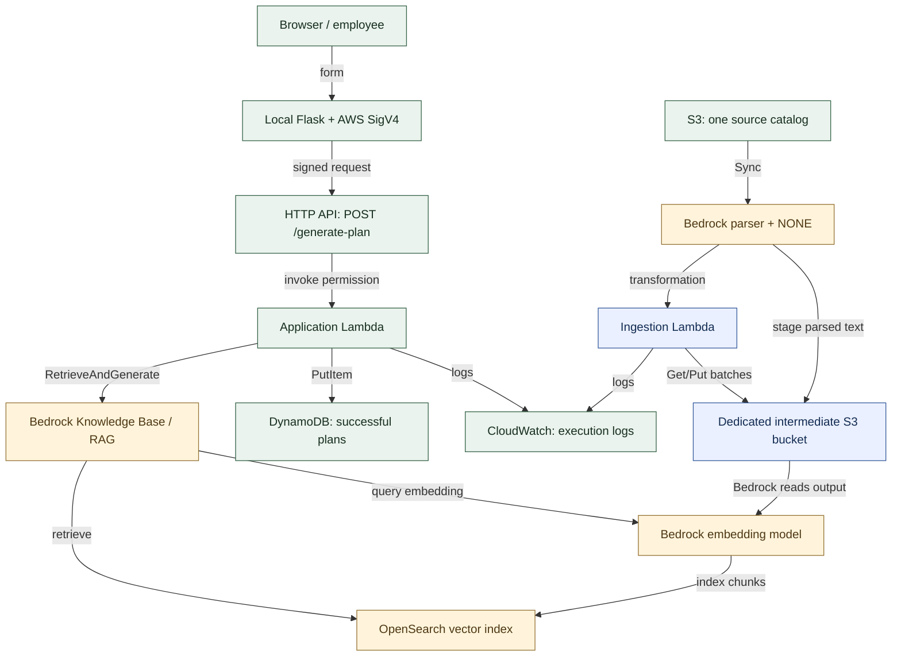
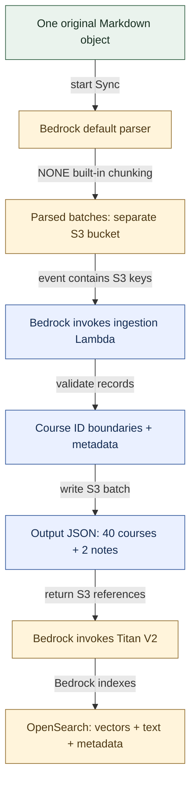
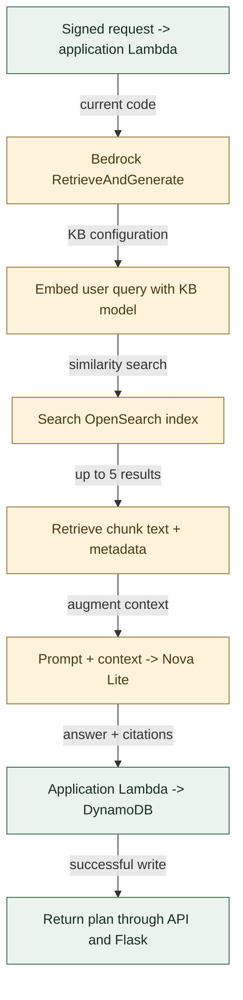
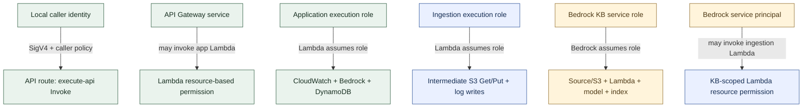
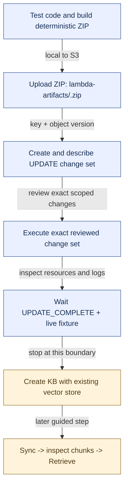
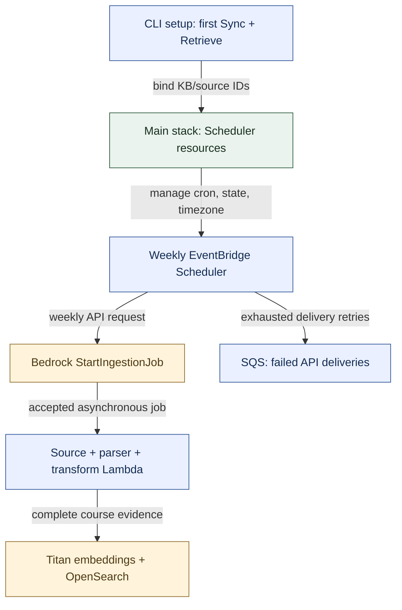

# Architecture: AI Career Coach

[README](../README.md) · [Chunking decision](decisions/course-aware-chunking.md) · [Deployment runbook](ingestion-deployment-plan.md)

## 1. Purpose, scope and verified state

The demo accepts a current role and career goal, uses a synthetic catalog of 40 courses across ten tracks, and generates a learning plan. This is a Markdown catalog, not an ERP API. There is no employee directory, enrollment, progress tracking, verified employee identity, or promotion guarantee.

The Ohio stack is UPDATE_COMPLETE with fourteen resources, including the separate intermediate bucket and KB-scoped Bedrock invoke permission. The first ingestion attempt rolled back on missing caller iam:TagRole; after the administrator fixed that grant, a new reviewed UPDATE succeeded. The deployed fixture matched all 40 course records and two contexts against local output. Original resource IDs and catalog version/bytes were preserved. The user subsequently delegated completion after Console provisioning failed; KB/data-source setup reuses the existing collection/index and is managed outside this stack. A declared resource, a deployed resource, a successful ingestion, and validated retrieval are four different states.

Diagram legend: green = baseline resource; blue = this ingestion addition; amber = KB/vector resources configured outside this CloudFormation stack (color is ownership, not readiness). Model boxes represent managed Bedrock services, not models hosted in Lambda or OpenSearch. AWS account/profile identifiers and cloud execution evidence stay in ignored local records; public examples use stack Outputs.

## 2. Complete system and trust boundaries



The browser only talks to local Flask; AWS credentials remain server-side. Flask signs requests with the AWS credential provider chain and the API Region. API Gateway is an HTTP API with `POST /generate-plan`, a `prod` stage, AWS_IAM authorization, v2 Lambda proxy payloads, and automatic stage deployment. The stage name does not establish production readiness. There is no EC2 host or deployed frontend in this stack.

The application Lambda builds the prompt, calls Bedrock, saves a successful request/plan/citations item, and returns JSON. The ingestion Lambda operates only during document preparation and never handles a user's question. Both belong to this project but have independent lifecycles and permissions.

## 3. Knowledge ingestion: preparation during Sync



1. The source remains one `internal_courses.md` object in a private, versioned, AES256-encrypted S3 bucket.
2. The KB data source selects only that object. `kb-intermediate/` and `lambda-artifacts/` must be outside its inclusion scope; selecting the whole bucket would ingest processing/deployment artifacts.
3. A user starts Sync. Bedrock's default parser extracts text; built-in chunking is `NONE`.
4. Bedrock stages parsed content in intermediate S3 and invokes our `POST_CHUNKING` transformation with source identity and batch keys. `NONE` disables built-in splitting, not the custom splitting that follows.
5. The ingestion function validates the source/bucket/prefix, reads parsed batches, identifies `### Course ID: ...` boundaries, validates all nine fields and prerequisite references, and emits one intact course per chunk plus two separate catalog-context chunks.
6. The function writes a JSON batch containing 42 `fileContents` records and returns its S3 key. Forty chunks do not require forty source files or a cron job.
7. Bedrock resumes: Titan Text Embeddings V2 computes vectors and Bedrock writes vectors, associated chunk text and metadata into the vector index. OpenSearch stores/searches these representations; it does not host this embedding model.

The hook does not call a generation/embedding model, OpenSearch or DynamoDB. It does not read the original catalog directly: Bedrock supplies parsed intermediate content. Its source URI setting validates which original document it will accept. The real parser preserved all headings/fields. Its observed PLAIN_TEXT type is accepted alongside fixture TEXT, and the adapter preserves the incoming type. All 42 real output units matched the local text/metadata.

### Separate intermediate bucket and invocation boundary

CreateDataSource rejected the earlier same-bucket/prefix-only design: custom transformation intermediate storage must use a DIFFERENT bucket from the source. The source bucket retains internal_courses.md and lambda-artifacts/. IngestionIntermediateBucket stores parsed input/output under kb-intermediate/; the Lambda environment and Get/Put policy reference that bucket. Old source-bucket fixture objects are historical test artifacts, not the active ingestion path.

The KB role permits this function and its exact $LATEST ARN. Real Sync additionally required a resource-based Lambda permission for bedrock.amazonaws.com, scoped to this account and the exact KB ARN. This is distinct from the KB role's identity policy and from the API Gateway permission on the application Lambda. Ingestion jobs can report COMPLETE while numberOfDocumentsFailed is nonzero; inspect statistics/failureReasons before claiming success.

### Chunking, batching and metadata

Chunking chooses evidence boundaries. Batching groups records into transport objects. The selected unit is a course, with variable size and zero cross-course overlap; there is no fixed 90-word or 300-token target. Source metadata is embedded in text and can be extracted deterministically. The decision and measurements are in the [architecture decision record](decisions/course-aware-chunking.md).

Each course record has `record_type=course`, `course_id`, `course_name`, `track`, exact `level`, numeric `level_rank`, numeric `duration_hours`, boolean `has_prerequisites`, optional prerequisite ID list, catalog version and parsed-source hash. Catalog notes use `record_type=catalog_context` and a context kind, without inventing a course level/ID. File metadata is preserved; conflicting preexisting chunk metadata is rejected pending a deliberate merge policy.

The parser supports this nine-field schema, not generic Markdown. Records/context blocks above 6,000 characters fail pending a within-course subdivision design; parsed input is bounded at 2 MB per source and 20 batches. These guards are neither token counts nor embedding-model limits. There is no proven 10,000-course capacity claim. Malformed/duplicate IDs, missing fields, invalid durations, unknown prerequisite IDs, wrong source/prefix and unsupported content fail visibly rather than silently dropping text.

### Model and index configuration

The selected embedding model is `amazon.titan-embed-text-v2:0`; use 1024 dimensions and floating-point vectors for this lab, with matching index mappings. The generation model remains the separate CloudFormation `FoundationModelId`, currently Nova Lite. A model ARN references a managed regional model; no model weights are downloaded, trained, or changed here.

The KB connects parser/chunking/transformation settings, embedding model and vector store. OpenSearch Serverless has a collection containing an index; its vector dimensions, text/metadata fields, engine and KB field mappings must agree. Record actual mappings, collection/index identifiers, encryption, network and data-access configuration when created. These resources are not provisioned by this update.

## 4. User question: retrieval, context and generation



The current application calls `bedrock-agent-runtime.retrieve_and_generate`. Bedrock embeds the query using the KB embedding configuration, searches the vector index, obtains chunk text/metadata, constructs augmented model context, and invokes the generation model. The application Lambda receives the answer/citations and persists the successful result. The ingestion Lambda is absent from this path; ingestion is not rerun for each question.

Current settings request up to five retrieval results and at most 800 output tokens. Five results are evidence units, not a guarantee of five distinct courses or a complete career roadmap. No separately configured reranker exists. Real Sync indexed the single catalog with zero failed documents and 42 records. Fourteen Retrieve-only cases ran: all thirteen labelled cases found their expected IDs in top five; metadata-filter tests passed. Generation and full UI behavior remain untested.

Strict exact-level matching, strict track matching, per-course duration and total-plan duration remain requirements for the next application iteration. Metadata enables filters but does not apply them automatically. Total-plan hours need deterministic summation of distinct selected courses. Unmet prerequisites outside the chosen level/track must be reported rather than silently recommended. Numeric hour caps are not agreed yet. The current UI/API has only current role/goal and does not enforce these constraints.

RAG supplies text at inference time; it does not update weights or learn from DynamoDB automatically. The prompt also permits external resources, so catalog-only recommendation validity is not enforced. Review citations and add deterministic validation before claiming this behavior.

## 5. IAM: three service roles and two invocation permissions



### Local caller identity

Flask uses resolved AWS credentials (an IAM user or assumed role, not an automatically created Flask role). SigV4 proves the caller's request identity; `execute-api:Invoke` on the exact route ARN grants authorization. The browser receives no AWS keys. CORS does not authenticate callers. The deployment identity is another responsibility: it needs resource-management permissions and scoped `iam:PassRole`; `CAPABILITY_NAMED_IAM` is an acknowledgement, not a permission grant.

### Application Lambda execution role: `LambdaExecutionRole`

Trust permits `lambda.amazonaws.com` to assume this IAM role. It has three policy groups, not three separate roles:

- `AWSLambdaBasicExecutionRole`: CloudWatch execution/error logs.
- `DynamoDBAccess`: `dynamodb:PutItem` on the career-plan table for successful request fields, plan and citations. This is business data, not an automatic archive of all execution logs or every failed request.
- `BedrockAccess`: invoke the selected generation model, Retrieve scoped to the configured KB, and RetrieveAndGenerate (currently `Resource: '*'` because the action lacks resource-level scope).

### API Gateway invocation permission: `LambdaApiPermission`

This is `AWS::Lambda::Permission`, a resource-based policy on the application function. It allows `apigateway.amazonaws.com` to invoke that function from the exact API/stage/POST/path. It is not an API Gateway execution role and is not the function's outbound execution role. The integration chooses the target; authorization checks the caller; the permission allows invocation.

### Ingestion Lambda execution role: `IngestionLambdaExecutionRole`

Trust permits Lambda. Scoped inline policies allow only S3 GetObject/PutObject under `kb-intermediate/*` and CreateLogStream/PutLogEvents in the explicitly created ingestion log group. CloudFormation creates that group with seven-day retention first; runtime does not need CreateLogGroup. No DynamoDB, model invocation, source-object read or vector-store access is granted to this role. There is no public endpoint or S3-upload trigger on this function.

### Bedrock KB service role: created during Console setup

Trust permits `bedrock.amazonaws.com`, scoped to this account and Knowledge Bases; narrow the source ARN to the real KB after creation. Grant source-object read and appropriately scoped bucket listing; intermediate S3 read/write/cleanup/list; invocation of the exact ingestion function ARN; invocation of the chosen embedding model; and access to the chosen vector collection/index. The prepared transformation policy is an addition to the KB role, not a replacement for its source/model/store permissions.

For OpenSearch Serverless, IAM collection access (including scoped `aoss:APIAccessAll` as required by Bedrock) does not replace collection/index data-access policies or network access. The KB role must be recognized by those controls. SSE-KMS with a customer-managed key would add key permissions; this update creates no customer-managed KMS key. Keep artifact uploads outside KB source access.

See [KB role permissions](https://docs.aws.amazon.com/bedrock/latest/userguide/kb-permissions.html) and the [AWS transformation permissions example](https://github.com/aws-samples/amazon-bedrock-samples/blob/main/rag/knowledge-bases/features-examples/utils/knowledge_base.py).

## 6. Infrastructure deployment and ownership



CloudFormation now owns fourteen resources: the original nine plus the ingestion function, its role/log group, a separate private versioned IngestionIntermediateBucket and a KB-scoped IngestionBedrockPermission. The initial twelve-resource release was extended after real integration exposed these requirements. It does not own the KB, KB role, data source, embedding settings, OpenSearch collection/index/policies or Sync job, which were completed through API after the user delegated the Console remainder. Record these manual resources for cleanup and the later Terraform rebuild.

Application Lambda code remains inline (`index.lambda_handler`). The ingestion code is a ZIP containing `ingestion/` at its root, with handler `ingestion.transform.lambda_handler`, Python 3.12, x86_64, 256 MB and 60 seconds. The runtime supplies boto3; a future reproducible release can package a pinned SDK.

Build locally, upload under `lambda-artifacts/<sha256>.zip` in the existing versioned bucket, and pass `IngestionCodeS3Key` plus `IngestionCodeS3ObjectVersion`. The template derives bucket/source/intermediate values from its own references; the packaging helper derives examples from selected Region/stack and actual Outputs. No account or credentials are embedded in the public template. Changing a ZIP at a fixed key alone does not trigger a code update; pin key/version explicitly.

This is an UPDATE to an existing baseline. A new account needs a bootstrap/source bucket before uploading its deployment artifact; the current template cannot create its own not-yet-uploaded artifact in a single step. The optional [automation wrapper](automation.md) now performs that bootstrap explicitly; the main template alone still cannot do it. The fresh-account automation path has local validation only. No CI/CD pipeline is required.

Two independent lifecycles remain: change infrastructure/code through reviewed CloudFormation updates; update source documents and Sync to refresh knowledge. Deploying Lambda does not create a KB, start Sync or validate retrieval.

## 7. API contract, persistence and failure behavior

Browser GET `/` renders Flask; POST `/` submits `current_role` and `goal`. Flask signs JSON POST `/prod/generate-plan` with SigV4. The cloud handler optionally accepts `user_id`; otherwise it creates a UUID, which is not verified employee identity.

```json
{"current_role":"Cloud Engineer","goal":"AI/ML Solutions Architect"}
```

API Gateway supplies a v2 event with a JSON string in `body`. The current handler does not handle all shapes, including base64-encoded bodies. Success returns `user_id`, request fields, `career_plan`, `citations` and `timestamp`. Flask renders plan text, without a dedicated citation viewer. UTC timestamps currently have no timezone suffix.

The DynamoDB partition/sort keys are `user_id` and `timestamp`. Streams are enabled without a consumer. Bedrock failure returns an error before persistence; DynamoDB failure after generation can return an error after model charges. The handler has no idempotency or employee authorization layer. Citation-number serialization has not been tested end to end.

The API integration timeout is 30 seconds while application Lambda timeout is 60; a client error can leave work running. Do not blindly retry. The ingestion Lambda independently logs errors and fails ingestion; it never writes a partial business plan. API access logging, request-log S3 archival, comprehensive alarms, budgets and production authentication are not supplied by this update. Only the new ingestion log group has explicit seven-day retention.

## 8. Evidence and next boundary

Local schema/contract tests and ZIP validation establish local readiness. A deployed fixture invocation establishes handler/package/S3-role behavior. Only a real Sync can establish parser compatibility and indexed coverage. Only Retrieve evaluations can establish evidence quality. Only the connected API/UI test can establish the complete application path.

After the user delegated the remainder, KB creation/data-source setup, real Sync and retrieval checks were completed using the existing vector store. The actual configuration uses the output ARN and separate intermediate bucket. The application KB parameter is connected; generation and strict UI/backend constraints remain pending. Inspect actual parser output and 40 course IDs/metadata, then run unfiltered and strict-filter Retrieve tests before generation. Record actual settings without retroactively declaring planned steps complete.

[Learning plan](00-learning-plan.md) · [Code walkthrough](02-code-walkthrough.md)

## 9. Reproducible setup and scheduled knowledge refresh

The setup command provisions the first environment and runs its initial Sync/filtered Retrieve check synchronously. EventBridge Scheduler does **not** create the KB or run infrastructure migrations on its first Sunday: it calls StartIngestionJob against resources already prepared by setup. Together, the setup entry point and recurring schedule provide first-use initialization and subsequent knowledge refresh. No extra driver Lambda or GitHub Actions pipeline is required.

Scheduler is defined **inside the main `CloudFormation.yaml`**, along with its execution role, schedule group and encrypted SQS DLQ. The main stack keeps its fourteen baseline resources until `KnowledgeBaseId` and `KnowledgeBaseDataSourceId` are bound; then its four conditional Scheduler resources bring it to eighteen. `SyncScheduleState` defaults DISABLED; `--enable-schedule` opts in. `SyncScheduleExpression` defaults to Sunday 03:00 and `SyncScheduleTimezone` defaults Africa/Cairo; the setup command can change either and preserves existing settings unless explicitly overridden. An existing enabled schedule remains active during later setup runs; disable it deliberately for maintenance if needed.

The role trusts Scheduler for this account/schedule-group ARN only, starts ingestion on this KB only, and sends failed target deliveries to its DLQ. The KB service role still performs source/intermediate/model/vector-store work. The transformation role is unchanged. Scheduled API acceptance does not prove documents indexed successfully: inspect ingestion job statistics as well as delivery metrics/DLQ. No generation is scheduled.

Existing Console/API KB resources stay external; a new account can create KB/role/source/OpenSearch through the separate `infrastructure/knowledge-base.json` RAG stack. This separation handles the sequence KB → bind main-stack permission → create source → initial Sync → bind main-stack Scheduler. It does not import the existing lab KB into CloudFormation. See the [automation runbook](automation.md) for exact commands, ownership and cleanup.

No new cloud resources or schedules were created while publishing this automation. New templates were schema-validated and wrapper behavior tested locally; fresh-account provisioning and the scheduled target still require live acceptance testing.



## 10. Model invocation portability

The working handler and its IAM/model selection are preserved. MODEL_ARN currently references an AWS-owned foundation-model ARN built from the stack Region and FoundationModelId, with an empty account field. KB ARNs instead contain the destination account via AWS::AccountId. This is not a literal owner account embedded in the model ARN. A future inference-profile-based model choice may need a destination-account profile ARN and additional model/profile IAM grants; make that a deliberate parameterized change and retest generation. Do not copy an old-account profile ARN or treat a profile ARN as the current FoundationModelId. See [account migration notes](automation.md#8-moving-to-a-different-account-or-region-modelkb-binding).
