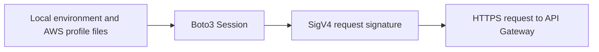
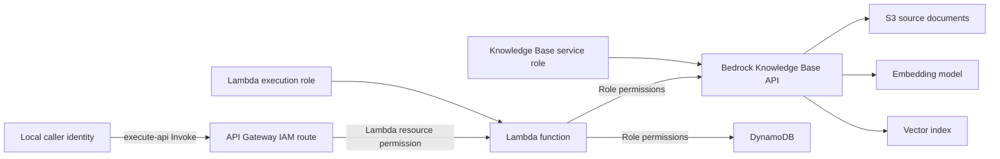

<div dir="ltr" lang="en">

# 03. AWS access, credentials, profiles, Regions, SSO, and HTTPS

[README](../README.md) | [Previous: code](02-code-walkthrough.md) | [Next: cost controls](04-cost-controls.md)

## 1. Five different concepts

- **Account:** owns resources and receives the charges.
- **Identity:** the IAM user or assumed role making a request.
- **Profile:** a local named set of configuration/credential instructions, such as `devops`.
- **Region:** the location of a regional resource/service endpoint, such as `us-east-1`.
- **Permissions:** IAM policies governing what the identity can do. A profile name or successful login does not grant additional permission.

A Region change does not change your account or login identity. Many resources are regional; IAM is a global service, so named roles can collide even when you use different deployment Regions.

## 2. What was actually inspected locally

On 24 November 2026, a local Boto3 session with the named `devops` profile resolved:

```text
profile: devops
credential provider: shared-credentials-file
configured Region: eu-north-1
```

Only the provider name and non-secret configuration were printed. No keys were put into this documentation. Earlier STS checks identified IAM-user callers; we have not established that this selected profile is an IAM Identity Center/SSO profile.

The earlier default profile had a different Region setting. Configuration can change, so explicitly choose the profile and Region for the lab instead of relying on remembered defaults. WSL and Windows also have different home directories and can have different AWS configuration files; this project has been tested from Ubuntu/WSL.

## 3. Local Flask does not call the CLI to log in



The CLI and Boto3 can use the same files/provider sources. `boto3.Session()` is an SDK session, not a shell command or a permanent network connection.

The application supplies no credentials in code. Boto3 uses its credential-provider chain; environment credentials and configured role/SSO/file providers can influence the resolved identity. `AWS_PROFILE` selects a profile; it is not itself a token or an account ID. Use the [Boto3 credentials guide](https://docs.aws.amazon.com/boto3/latest/guide/credentials.html) for the complete provider chain.

For this application, after the final Region is agreed:

```bash
export AWS_PROFILE=devops
export AWS_DEFAULT_REGION="$LAB_REGION"
```

`LAB_REGION` is a shell variable we will set deliberately. It does not alter AWS settings on its own. The signing helper uses the Boto3 session Region; it must match the API endpoint's Region.

A CLI command can take explicit `--profile devops --region "$LAB_REGION"` options. Those options apply to that CLI command; they are not automatically passed to a separately started Flask process. Boto3's configuration behavior is documented [here](https://docs.aws.amazon.com/boto3/latest/guide/configuration.html).

## 4. SSO and SSL/TLS are different

**SSO / IAM Identity Center** is an authentication method. For a profile that is actually configured for SSO, `aws sso login --profile <profile-name>` establishes the login session used to obtain temporary role credentials. Use the [AWS SSO configuration guide](https://docs.aws.amazon.com/cli/latest/userguide/cli-configure-sso.html) when choosing that setup. Do not run SSO configuration merely because a profile already exists.

**SSL/TLS / HTTPS** protects traffic in transit. It is not your AWS login method. SigV4 proves the request was signed using AWS credentials and binds the request to a service, Region, and time. HTTPS and SigV4 have separate jobs.

A browser AWS Console session is also separate from the shell environment. Being logged into the Console does not automatically mean a Python process has suitable credentials.

## 5. The identity changes inside AWS



The deployment identity needs permission to create resources and pass roles. The local caller needs `execute-api:Invoke`. The Lambda execution role needs the backend operations. The Knowledge Base service role needs its own S3/model/vector-store access. OpenSearch additionally has its own data/network access policy configuration.

These are separate authorization checks. Do not solve a denied Lambda call by copying laptop keys into Lambda. Lambda receives temporary execution-role credentials automatically.

## 6. Choose a Region before deployment

`us-east-1` was previously chosen for a preliminary check and an unexecuted change set. The user has reopened the choice. It is a candidate, not a final decision.

We should check these together:

1. Availability and lifecycle of the generation model version.
2. Availability of the embedding model and compatible Knowledge Base/vector-store features.
3. In-region invocation versus inference profiles that may route requests to other Regions.
4. Price, available quotas, and expected latency.
5. Any data-location requirements for the eventual real estate application.
6. Existing resources, names, and permissions that might collide.

Start the lab with the application services and source bucket in the selected Region. This avoids adding cross-Region complexity before understanding the basic architecture. A cross-Region inference profile is a separate explicit choice; it can route model requests outside the source Region.

The earlier Nova Lite readiness checks only established availability/authorization in `us-east-1`. We have not validated an alternative Region's full stack or vector-store configuration. See [Knowledge Base model/Region support](https://docs.aws.amazon.com/bedrock/latest/userguide/knowledge-base-supported.html).

## 7. Where each Region setting comes from

- **CloudFormation:** the Region used to create the stack supplies `${AWS::Region}`.
- **Generation model ARN:** the template inserts that stack Region into `MODEL_ARN`.
- **Lambda SDK clients:** the runtime provides regional configuration; the code creates clients without hardcoded endpoints.
- **Local Flask signature:** `session.region_name` comes from local SDK configuration.
- **Browser:** it talks to localhost; it does not choose the Bedrock Region.
- **Console:** its Region selector controls which regional resources you view/create. The browser selector does not rewrite your CLI profile.

A foundation-model ARN has no account ID in its account segment, for example `arn:aws:bedrock:us-east-1::foundation-model/amazon.nova-lite-v1:0`. Your knowledge-base ARN includes an owning account and KB ID. Changing to an inference-profile ARN would also require reviewing how the current template constructs the model ARN and scopes permissions.

> **Checkpoint:** distinguish SSO from HTTPS, identify the local versus Lambda versus KB identities, and explain how a mismatched signing Region can produce a 403 even with valid credentials.

[Previous: code](02-code-walkthrough.md) | [Next: cost controls](04-cost-controls.md)

</div>

## Reproducible setup and scheduled refresh

The [automation guide](automation.md) documents first-time CLI setup, guarded CloudFormation updates and weekly EventBridge Scheduler resources in the main stack. The initial setup creates/reuses the KB and performs Sync; Scheduler subsequently calls StartIngestionJob, independently of your machine. Its state/expression/timezone are configurable stack parameters; it is not active in the published live lab yet. A future TypeScript/Terraform rebuild should preserve that ownership and distinguish first-time provisioning, document refresh, and question-time generation. See the same guide for model ARN/account migration, permissions, cost and cleanup. The working application invocation is unchanged.
