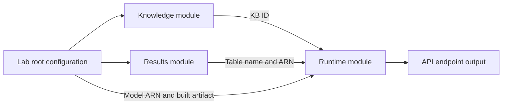

<div dir="ltr" lang="en">

# 07. Terraform: reproduce the architecture, then add modules

[README](../README.md) | [Previous: manual TypeScript rebuild](06-manual-typescript-console.md)

## Start only after the manual version is understood

Terraform is the third phase. It should describe the architecture you have already built and inspected, including the manually created knowledge resources missing from the original CloudFormation template.

This guide is a future implementation plan, not a Terraform configuration or authorization to run apply/destroy. No Terraform files, backend, or managed infrastructure have been created by this documentation step.

## 1. Separate application code from infrastructure

The TypeScript handler contains business logic. The build step creates the JavaScript/ZIP artifact. Terraform configures AWS resources and points the Lambda at that artifact with a content hash so a changed build can trigger an update.

Rebuilding code and changing infrastructure are related operations, but not the same one. GitHub Actions is optional; run the learning workflow locally first.

## 2. Learn the minimum Terraform concepts

- **Provider:** communicates with AWS or another infrastructure API.
- **Resource:** the desired configuration of an object Terraform owns.
- **Data source:** reads an existing object without claiming to manage it.
- **Variable:** an input such as Region, resource prefix, model choice, or artifact location.
- **Output:** a useful result such as API endpoint, bucket name, or KB ID.
- **Reference:** connects one resource's output to another's input and establishes a dependency.
- **State:** maps Terraform resource addresses to actual objects. State is operational data, not a substitute for source code.
- **Plan:** proposed changes calculated from configuration, state, and provider reads.
- **Apply:** performs the approved plan.
- **Module:** a reusable group of configuration with defined inputs/outputs.

Read the [Terraform state overview](https://developer.hashicorp.com/terraform/language/state) while inspecting a small lab example. Do not put credentials or state files in Git.

## 3. Choose ownership before writing resources

Use distinct prefixes for the reference CloudFormation lab, the manual Console lab, and the Terraform lab. IAM names are global within the account and S3 bucket names have broader uniqueness constraints, so a Region change alone is not enough to prevent collisions.

For existing resources, deliberately choose one approach:

- **New lab:** create separate resources, then clean them up after verification. Account for the cost of multiple vector stores.
- **Shared dependency:** reference an existing KB/index through inputs or data sources and leave its lifecycle with its existing owner.
- **Adoption/import:** only after planning ownership transfer. Importing an object does not automatically write correct configuration or detach CloudFormation management.

Never let CloudFormation and Terraform independently manage the same resource. Do not import an existing resource just to make the initial plan look complete.

## 4. Start with one root configuration

A proposed starting structure:

```text
infra/
  versions.tf
  providers.tf
  variables.tf
  main.tf
  outputs.tf
```

Select supported Terraform/provider versions when implementation begins. Declare constraints, commit the provider dependency lock file, and verify that the chosen providers cover the selected Bedrock/OpenSearch features.

Set the Region explicitly from an input and use the agreed AWS profile/provider credential chain for local work. Do not embed access keys. A new provider version is not a reason to silently upgrade a working environment.

A single-user lab may initially use local state to learn the concepts. Before sharing or unattended use, design an appropriately restricted remote backend and locking. If choosing S3, follow the [current S3 backend documentation](https://developer.hashicorp.com/terraform/language/backend/s3), including encryption, access, versioning, and supported locking configuration. The backend is separate from the catalog source bucket and should not be accidentally destroyed with the application.

## 5. Implement in small, explainable increments

### Increment A: source and results

Define the private source bucket, its intended versioning/encryption/public-access configuration, the source object or its explicit upload process, and DynamoDB. Inspect the plan and confirm generated names and outputs before creation.

### Increment B: knowledge storage and access

Define the selected vector-store collection and policies, then the vector index with matching dimensions/mappings. Creating the collection does not automatically imply the required index exists.

Index management may require a different provider/API from collection management. Verify that provider's authentication and network access from the machine running Terraform. Do not add public access or broad admin permissions solely to make a plan succeed.

### Increment C: Knowledge Base and data source

Define the KB service role, required scoped policies, Knowledge Base, embedding-model configuration, vector mappings, and S3 data source. Connect them by references. Record what ingestion work must occur after data changes; do not assume resource creation automatically synchronizes all documents.

Account for IAM/index propagation and resource readiness using supported provider behavior and clear dependencies. Do not hide arbitrary repeated sleeps in the application.

### Increment D: runtime and API

Define the Lambda execution role, logging configuration, Lambda build artifact/reference, environment, API integration, IAM-protected route, stage, and invoke permission. Output the endpoint and caller invoke ARN. Preserve the settings agreed during the manual phase, including known timeout trade-offs.

### Increment E: deployment checks and ingestion

Build the application, validate configuration, review the plan, apply the agreed resources, synchronize the source, and run the same reference scenario. Keep data upload/ingestion ownership explicit: an initialization script is different from a continuously managed pipeline.

## 6. The command lifecycle we will learn

These are future commands, to run only inside the agreed Terraform directory at that phase:

```bash
terraform init
terraform fmt -check
terraform validate
terraform plan -out=lab.tfplan
```

`init` installs/configures providers and backend components; it is not resource deployment. `plan` can read AWS and needs suitable credentials. Review additions, updates, replacements, and deletions, then apply that exact agreed plan:

```bash
terraform apply lab.tfplan
```

A saved plan can become stale after source/state/environment changes. Do not reuse it after changing the intended configuration. State and saved plans can contain sensitive values; keep them out of public repositories and handle them appropriately.

## 7. Add modules after the complete root version works

Useful boundaries might be:

- **knowledge:** source configuration, vector store/index, ingestion configuration, KB role and KB/data source. Output KB ID and relevant identifiers.
- **runtime:** application Lambda, execution role, logging, API integration/route/stage/permissions. Accept KB ID, model ARN, result-table details, and artifact location.
- **results:** the DynamoDB table and its deliberately chosen lifecycle/retention behavior.

The exact split can change when the first implementation exposes actual coupling. Prefer clear responsibilities and narrow inputs over passing every resource property through every module. [HashiCorp's module guidance](https://developer.hashicorp.com/terraform/language/modules/develop) explains the underlying structure.



Moving existing root resources into modules changes Terraform addresses. Plan the move using supported moved blocks/state migration so refactoring does not accidentally destroy/recreate a paid or data-bearing resource.

## 8. Define success and cleanup

Success means the Terraform-managed version passes the same request, grounding, persistence, auth, and error checks as the manual version. A successful apply alone does not prove ingestion or application behavior.

When finished, inspect a destroy plan for the exact lab ownership before applying it. Versioned bucket contents, external/manual resources, shared indices, and a separate remote backend need explicit treatment. Never destroy another phase's resources because their names look similar.

**Final learning checkpoint:** you can create the understood architecture from code, explain the dependencies and state, build/update its TypeScript artifact, verify a request, and remove the owned lab resources deliberately.

## 9. Bridge to the real estate application

Carry forward the configuration, IAM boundaries, request validation, observability, data-ingestion ownership, and cost-control habits. Then design authoritative property lookup tools and customer permissions separately from document retrieval.

A property recommendation must respect current availability, price, location, and access constraints. Indexing documents is useful for context, but it does not replace a live source of truth or authorize a booking. We will design those application-specific tools after this learning stack is understood.

[Previous: manual TypeScript rebuild](06-manual-typescript-console.md) | [Back to learning plan](00-learning-plan.md)

</div>
