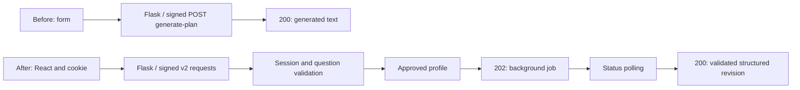
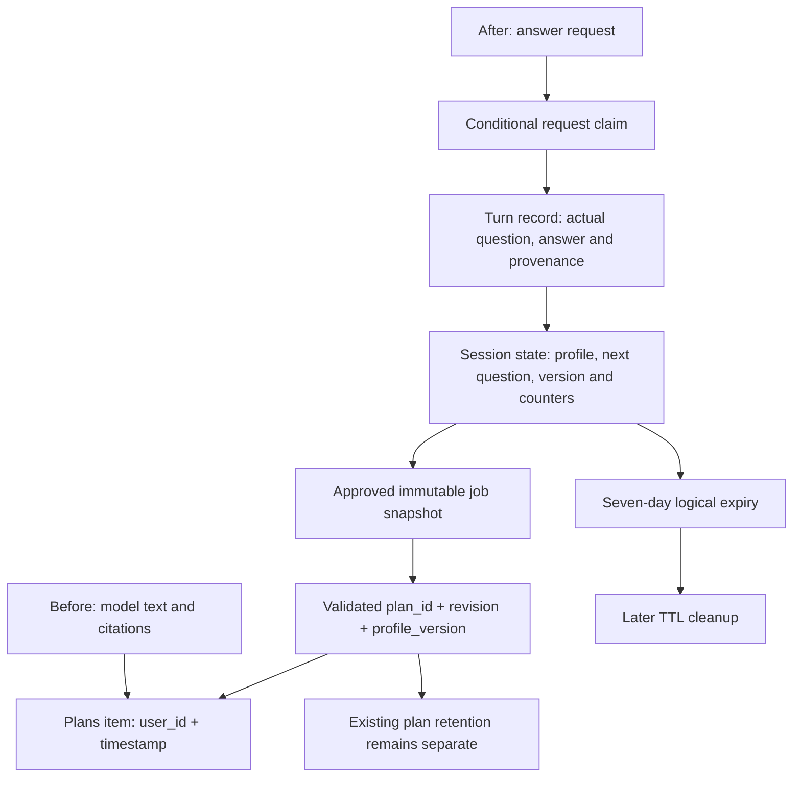

# API and persistence contract

[Documentation](README.md) · [Code reference](code-reference.md) · [Security](security.md)


<!-- REDESIGN_NOTE_START -->
> **Documentation timeline — 2026-11-26:** Existing paragraphs/examples below describe the implemented baseline. Each affected section also records the agreed post-redesign target, **not implemented or deployed**. See [Guided Career Planning Redesign](decisions/guided-career-planning-redesign.md). Existing commands do not deploy that target.
<!-- REDESIGN_NOTE_END -->
## Endpoint and authorization

<!-- REDESIGN_NOTE_START -->
**Before redesign — implemented baseline:**
<!-- REDESIGN_NOTE_END -->

The main stack's ApiEndpoint resolves to `https://<api-id>.execute-api.<region>.amazonaws.com/prod/generate-plan`. The only business route is POST `/generate-plan` under stage `prod`, with HTTP API payload v2 and AWS_IAM authorization. Use the output for the destination deployment; do not copy another account's URL. A GET to this endpoint is not a health route.

Sign calls with SigV4 for execute-api in the API's Region. The caller requires execute-api:Invoke on the route's ApiInvokeArn. Local Flask performs signing server-side using the standard boto3 provider chain. CORS does not replace this authorization. The API's permission to invoke Lambda is a separate resource-based grant scoped to this route.


<!-- REDESIGN_NOTE_START -->
**After redesign — agreed target, not implemented (2026-11-26):** Add proposed /v2 session, answer, review, job and plan routes while preserving POST /generate-plan. New cloud routes retain AWS_IAM; Flask handles same-origin anonymous-session cookies. This does not introduce JWT or employee sign-in.


<!-- REDESIGN_DETAIL_START -->
**Target route inventory (not callable yet):**

- POST /v2/sessions — create an anonymous session (201).
- GET /v2/sessions/{session_id} — resume the saved question/review (200).
- POST /v2/sessions/{session_id}/answers — submit a versioned answer (200; 202 for an in-flight duplicate).
- POST /v2/sessions/{session_id}/review — approve/correct the profile.
- POST /v2/sessions/{session_id}/plans — start a job (202).
- GET /v2/sessions/{session_id}/jobs/{job_id} — poll state/stage (200).
- GET /v2/sessions/{session_id}/plans/{plan_id}?revision=1 — read/download an authorized revision.
- POST /v2/sessions/{session_id}/plans/{plan_id}/revisions — create a revised-plan job (202).



The cloud URL still includes the prod stage. Session proof travels separately from public JSON and is validated in addition to AWS_IAM. Session creation secrets are consumed by Flask to set the cookie, not returned to React.
<!-- REDESIGN_DETAIL_END -->
<!-- REDESIGN_NOTE_END -->
## Request

<!-- REDESIGN_NOTE_START -->
**Before redesign — implemented baseline:**
<!-- REDESIGN_NOTE_END -->

```json
{"current_role":"Cloud Engineer","goal":"Security Engineer"}
```

Both fields are required. `user_id` is optional in the cloud handler; absent values generate a UUID. This field is not authenticated employee identity. The UI currently sends only current_role and goal. Level, track, per-course hours, total-plan hours and prerequisite restrictions are not supported request parameters in the current handler.

The integration wraps the request JSON in the Lambda event's `body` string. The handler does not support every alternate proxy format, such as base64-encoded bodies. It constructs a career-development prompt, invokes RetrieveAndGenerate with top five evidence records and up to 800 output tokens, and persists success before returning.


<!-- REDESIGN_NOTE_START -->
**After redesign — agreed target, not implemented (2026-11-26):** The new answer contract carries question_id, answer, state_version and request_id; session proof is separate. Approved profile versions trigger plan jobs. Question eligibility, allowed fact fields and budgets are server-controlled.


<!-- REDESIGN_DETAIL_START -->
**Target example: submit an answer** to POST /v2/sessions/{session_id}/answers:

```json
{
  "question_id": "cloud_practice",
  "answer": "I have tried Lambda, but my IAM experience is limited",
  "state_version": 6,
  "request_id": "example-turn-007"
}

```

**Target example: approve the current review:**

```json
{"state_version":12,"confirmed_assumption_ids":["example-backend-equivalence"]}
```

**Target example: request generation after approval:**

```json
{"request_id":"example-plan-request-001","profile_version":12}
```

These are separate illustrative requests, not a runnable command sequence. The server derives the snapshot from stored answers; the client cannot replace it by submitting an arbitrary profile. The version must match the approved review. Full [request and analysis schemas](decisions/guided-career-planning-redesign.md#7-proposed-json-contracts-version-10) define the normative shapes.
<!-- REDESIGN_DETAIL_END -->
<!-- REDESIGN_NOTE_END -->
## Successful result

<!-- REDESIGN_NOTE_START -->
**Before redesign — implemented baseline:**
<!-- REDESIGN_NOTE_END -->

```json
{
  "user_id":"generated-or-supplied-id",
  "current_role":"Cloud Engineer",
  "goal":"Security Engineer",
  "career_plan":"Generated plan text",
  "citations":[],
  "timestamp":"UTC-ISO-format"
}
```

Status is 200 and Content-Type is application/json. Citations carry Bedrock's returned structure; this example's empty list is only a shape illustration. Plan text is not a strict JSON curriculum schema. Flask converts numbered text sections into template data and renders the result; it does not validate course IDs, duration totals or citation completeness.


<!-- REDESIGN_NOTE_START -->
**After redesign — agreed target, not implemented (2026-11-26):** New intake returns the persisted next question/review; generation submission returns 202/job_id. Polling reports queued/running/completed/failed, then a structured roadmap with phases/resources/evidence/time/gaps. The old numbered-text formatter remains only for the legacy response.


<!-- REDESIGN_DETAIL_START -->
**Target example: accepted answer and saved next question (200):**

```json
{
  "schema_version": "1.0",
  "state_version": 7,
  "stage": "starting_point",
  "status": "awaiting_answer",
  "next_question": {
    "question_id": "rag_practice",
    "text": "Have you only used a model API, or have you searched documents and inspected retrieved sources?",
    "answer_type": "text",
    "options": [],
    "allow_unknown": true,
    "optional": false
  },
  "review": null
}

```

**Target example: generation accepted (202):**

```json
{"job_id":"example-job-001","status":"queued","profile_version":12}
```

**Target example: job completed (200):**

```json
{"job_id":"example-job-001","status":"completed","stage":"complete","profile_version":12,"plan_id":"example-plan","revision":1}
```

queued/running/completed/failed are job states. Stage indicates work, not a guessed percentage. Fetch the referenced plan separately; an older profile_version remains identifiable after edits.

**Target example: structured plan read (200).** This is a complete contract-shaped foundation segment, deliberately not a complete RAG career roadmap. Its URI/time are illustrative:

```json
{
  "schema_version": "1.0",
  "plan_id": "example-plan",
  "revision": 1,
  "profile_version": 12,
  "goal": "Start building the foundations for a document-grounded RAG application",
  "starting_point": "Self-reported backend experience; AI foundations are needed",
  "assumptions": [
    "Self-reported experience is not a certified assessment"
  ],
  "phases": [
    {
      "phase_id": "p1",
      "title": "AI foundations and evaluation",
      "depends_on": [],
      "skills": [
        "ai_literacy",
        "responsible_evaluation"
      ],
      "outcomes": [
        "Distinguish RAG from training and identify unsupported claims"
      ],
      "resource_ids": [
        "internal:AIML-001"
      ],
      "practice": {
        "description": "Prepare an evaluation checklist and review unsupported-answer examples",
        "estimated_hours": 4
      },
      "completion_criteria": [
        "Explain why convincing wording does not establish answer correctness"
      ]
    }
  ],
  "resources": [
    {
      "resource_id": "internal:AIML-001",
      "kind": "internal",
      "course_id": "AIML-001",
      "title": "AI Literacy and Responsible Evaluation",
      "url": null,
      "duration_hours": 12,
      "prerequisite_status": "none",
      "reason": "Covers AI and evaluation foundations needed before building the application",
      "evidence_ids": [
        "e1"
      ]
    }
  ],
  "evidence": [
    {
      "evidence_id": "e1",
      "source": "internal_catalog",
      "uri": "s3://example-catalog-bucket/internal_courses.md",
      "retrieved_at": "2026-11-26T10:00:00Z",
      "catalog_version": "2.0",
      "parsed_source_sha256": "abdd9581340c582527b90a903cb116fe39e529a4e7d1e247f80eabad1aa69336",
      "course_id": "AIML-001",
      "supported_fields": [
        "title",
        "duration_hours",
        "prerequisites",
        "skills",
        "outcomes"
      ]
    }
  ],
  "time_budget": {
    "weekly_hours": 6,
    "target_weeks": 12,
    "known_course_hours": 12,
    "estimated_practice_hours": 4,
    "unestimated_resource_ids": [],
    "fit_status": "estimated_fit"
  },
  "coverage_gaps": [
    "This example does not cover the remaining cloud and RAG pathway"
  ]
}

```

Do not run this structure through the legacy text-section parser. The canonical [roadmap schema and semantic checks](decisions/guided-career-planning-redesign.md#73-roadmap) govern output.
<!-- REDESIGN_DETAIL_END -->
<!-- REDESIGN_NOTE_END -->
## Persistence

<!-- REDESIGN_NOTE_START -->
**Before redesign — implemented baseline:**
<!-- REDESIGN_NOTE_END -->

DynamoDB table name comes from DynamoDBTable output. The key is `(user_id, timestamp)` and items contain the request fields, career_plan and citations. UTC timestamps currently omit a timezone suffix. PAY_PER_REQUEST billing and DynamoDB Streams are enabled, with no configured stream consumer, TTL or read/history API. A successful model call followed by a PutItem failure returns an error after generation may already be billed. Citation numeric serialization must be checked end to end.


<!-- REDESIGN_NOTE_START -->
**After redesign — agreed target, not implemented (2026-11-26):** Add a sessions table for state, turns, claims and jobs, while retaining final plans with plan_id/revision/profile_version. Seven-day session expiry does not add a TTL to final plans. Each generation job uses an approved immutable snapshot.


<!-- REDESIGN_DETAIL_START -->


Record kinds above are logical responsibilities, not already implemented key names. The new table must support atomic version/claim checks. A replay returns saved results; expiry is checked before reads even if TTL has not deleted an item. A plan revision is saved before a job becomes completed.
<!-- REDESIGN_DETAIL_END -->
<!-- REDESIGN_NOTE_END -->
## Error behavior

<!-- REDESIGN_NOTE_START -->
**Before redesign — implemented baseline:**
<!-- REDESIGN_NOTE_END -->

Missing required fields return 400. Missing KB configuration, Bedrock failures, persistence failures and other caught handler exceptions return 500 with an error body. A 403 at API Gateway can be a missing/invalid signature or missing route permission. Unmatched methods/routes fail at the API rather than generating a plan. Flask surfaces upstream/configuration errors in the page.

The gateway integration timeout is 30 seconds, application Lambda is 60 and Flask's HTTP timeout is 35. A timeout does not guarantee cloud work stopped. There is no idempotency key/duplicate-suppression mechanism, so inspect logs/records before retrying a costly request. API throttling is one request/second with burst two; this does not establish per-user quotas or an account cost cap.

For acceptance, verify a signed success, missing-field failure and unsigned denial, then inspect the stored record and citations. These checks are separate from ingestion/Retrieve tests and are not implied by a successful infrastructure update.

<!-- REDESIGN_NOTE_START -->
**After redesign — agreed target, not implemented (2026-11-26):** The new contract distinguishes input, unauthorized/expired session, version conflict, throttling and temporary provider failure using safe errors. Replay completed request IDs, report in-flight processing, and do not duplicate counts or silently relax constraints.


<!-- REDESIGN_DETAIL_START -->
**Target examples:**

```json
{"code":"STATE_VERSION_CONFLICT","message":"Reload the saved session state before submitting again.","request_id":"example-turn-007"}
```

HTTP 409 denotes stale state. HTTP 410 is reserved for an expired session whose proof was valid; do not leak existence to an unauthorized caller. An in-flight duplicate returns 202/processing rather than starting another model call.

```json
{"job_id":"example-job-001","status":"failed","stage":"validation","error":{"code":"PLAN_VALIDATION_FAILED","message":"The plan could not be validated after the bounded repair attempt."}}
```

A failed background job is represented in the authorized status response, not disguised as a successful plan. Provider failures expose safe messages only. Invalid JSON/schema/references get at most one final-output repair, not a full repeated intake/search workflow.
<!-- REDESIGN_DETAIL_END -->
<!-- REDESIGN_NOTE_END -->
