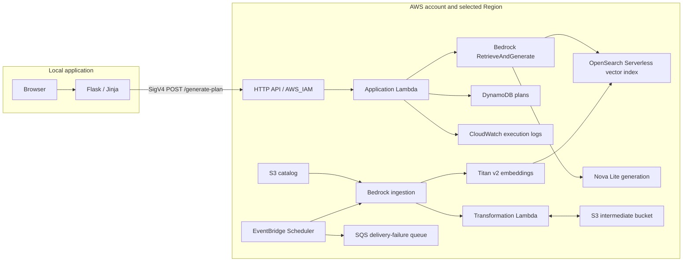
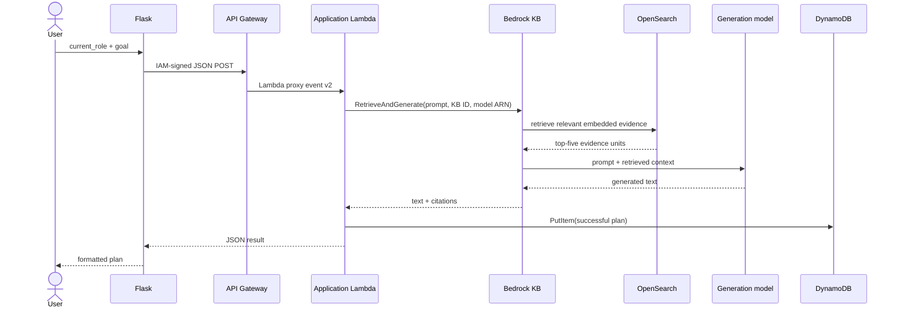
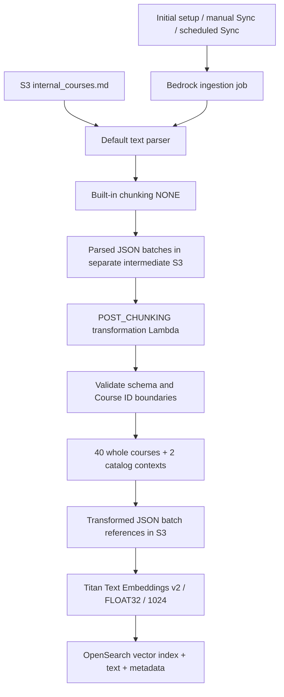
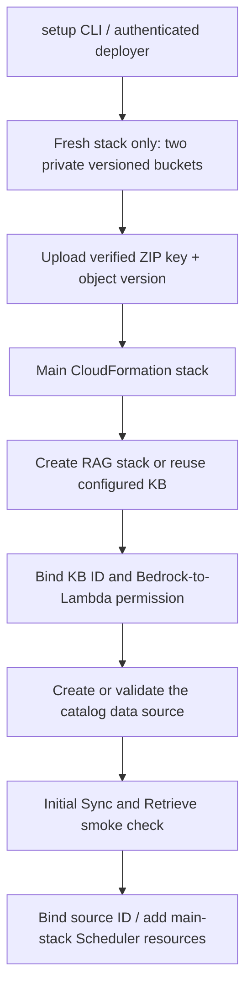
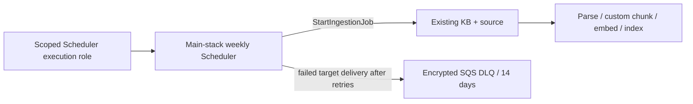
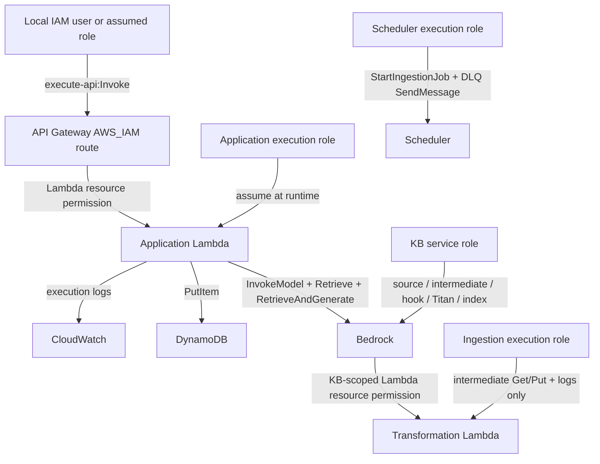

# Architecture

[Documentation](README.md) · [Deployment](deployment.md) · [Code reference](code-reference.md)

## Purpose and boundaries

The application accepts a current role and career goal, retrieves relevant internal courses, generates a development plan and persists successful results. The supplied source is a synthetic 40-course Markdown catalog spanning ten tracks. It is not connected to an ERP, employee directory or course-registration system.

The web application runs locally with Flask. AWS hosts the IAM-protected HTTP API, application Lambda, DynamoDB and knowledge services. The vector store is Amazon OpenSearch Serverless. CloudFormation manages infrastructure; a Python setup command sequences artifact upload, provisioning, KB binding, initial ingestion and retrieval acceptance.

The diagram shows the available deployment architecture, not proof that every optional resource is already running. The main stack has 14 application/ingestion resources before schedule binding and 18 after its four conditional Scheduler resources are created. Fresh deployments also use a companion RAG stack. Existing KB/OpenSearch resources can remain externally owned and be reused.

## Request-time flow

The application Lambda builds the career-coach prompt and requests up to five retrieval results and 800 generated output tokens. Model context includes retrieved evidence and service instructions, so input-token usage is larger than the user's form text. The transformation Lambda is never called by this question-time path.

The API exposes only `POST /generate-plan` under the `prod` stage. A browser GET to the API URL is not a health check. API Gateway authorizes the caller's signed request; its Lambda resource-based permission separately authorizes invoking the backend function. Flask signs requests server-side and does not put AWS credentials in browser JavaScript.

## Knowledge ingestion

`NONE` disables Bedrock's built-in splitting; the custom hook still defines evidence units. One source object remains one source object. The current output contains 42 logical records inside intermediate transport batches, not 40 new source files. Default parsing extracts text; custom chunking identifies records; Titan produces vectors; OpenSearch stores/searches them. No step trains or changes model weights. [Knowledge contracts](knowledge-pipeline.md).

The source bucket stores `internal_courses.md` and versioned deployment ZIPs under `lambda-artifacts/`. Source inclusion is restricted to the catalog prefix. The separate intermediate bucket stores parsed/transformed transport data under `kb-intermediate/`; it is neither the deployment package store nor the vector index. Bedrock requires this bucket to be distinct from the source bucket for this transformation configuration.

## Deployment ownership and order

`CloudFormation.yaml` owns the application API/Lambda/role/table, source/intermediate buckets, ingestion Lambda/role/log group, invocation permissions and conditional weekly schedule/group/role/DLQ. The bootstrap template is the first revision of the same main stack, not another stack owning the buckets. Never apply its bucket-only template to a complete environment.

`infrastructure/knowledge-base.json` owns a new KB, Bedrock role, S3 source, OpenSearch collection/index and encryption/network/data policies. Source creation is gated by `EnableDataSource`; the setup command creates the KB first, updates the main stack's invoke permission, then enables the source. Already configured external resources are validated and reused without being imported into CloudFormation. Record ownership before cleanup.

## Scheduled refresh

The setup CLI performs first-time provisioning and initial Sync synchronously. Scheduler only submits later ingestion jobs; it does not build infrastructure, upload local files or generate plans. Default frequency is Sunday 03:00 `Africa/Cairo`, configurable by expression/timezone parameters. New schedules default DISABLED; an explicit setup flag enables them. Existing settings are preserved unless overridden.

Delivery retries are limited to two attempts within one hour. The DLQ covers API submission failure, not document failure after a job is accepted. Monitor job statistics separately. Turning off the schedule does not stop search capacity charges or an active ingestion job.

## Trust boundaries and permissions

The local caller, application execution role, ingestion execution role, KB service role and optional Scheduler role have separate responsibilities. API Gateway's invoke grant is a Lambda resource permission, not another IAM role. OpenSearch data and network policies are additional authorization layers. [Exact grants and limitations](security.md).

## Persistence and operational limits

DynamoDB uses `user_id` as partition key and `timestamp` as sort key with PAY_PER_REQUEST billing. Successful items contain request fields, generated text and citations. The UUID default is not verified employee identity. Streams are enabled without a consumer; there is no history-reading API or TTL policy.

CloudWatch holds execution/error logs, not the business-plan store. S3 source/intermediate/artifacts are private and encrypted with managed encryption; request/response archival to S3 is not implemented. The ingestion log group has seven-day retention; application logging uses the basic execution policy without explicit retention in this template.

API Gateway times out after 30 seconds, the backend Lambda after 60 and Flask's HTTP call after 35. A client timeout can leave generation running; retries can incur duplicate model work or records. DynamoDB citation-number serialization and generation persistence require end-to-end acceptance. There is no request idempotency, employee sign-in, per-user quota or hard spending cutoff. Exact-level, strict-track and per-course/whole-plan duration constraints are not implemented in the current app even though chunk metadata enables filters.

## Region and model configuration

The setup command requires an explicit Region and derives the account from STS. Lambda uses its runtime role; local profiles do not transfer into AWS. The generation ARN is built from Region and FoundationModelId with an empty account field; KB/IAM ARNs use the destination account pseudo parameter. Inference-profile models require a deliberate parameter/IAM change, not copying an old account's ARN. [Configuration and migration](security.md#region-and-model-portability).

OpenSearch is billed for search/indexing capacity and storage, including a possible persistent capacity floor. Serverless does not make this architecture wholly per-request. [Cost analysis](costs.md).
