# Architecture

> **Current cloud status (2026-11-26):** The reference project infrastructure was destroyed at the user's request. Earlier live results and resource diagrams below are historical. Code, contracts and local artifacts remain available; no reference API is running. See [stopping point and next steps](implementation/next-steps.md).

> **Historical live deployment (2026-11-26, subsequently destroyed):** The reference stack reached UPDATE_COMPLETE with 31 resources and a successful live API-to-worker plan journey. External search, real React UI, cross-model and full cost acceptance remain pending. See [recorded live results](implementation/live-deployment.md). Earlier statements below are dated implementation/design snapshots.

## Current source architecture — reviewed 2026-11-28

The legacy form and `POST /generate-plan` remain compatible in source; the inline handler moved to `career_coach/legacy.py`. The guided path uses a backend-controlled Smart Wizard, not an agent loop. React is a future client of the Flask cookie/SigV4 proxy. Application Lambda owns intake, approval and job dispatch; DynamoDB owns session state, bounded request receipts and immutable approved snapshots. A filtered stream retries pending dispatch to generation SQS; a separate worker retrieves evidence, creates and validates plans and persists revisions before completion. Queue and stream mappings are gated by `GuidedEnabled` (default `false`).

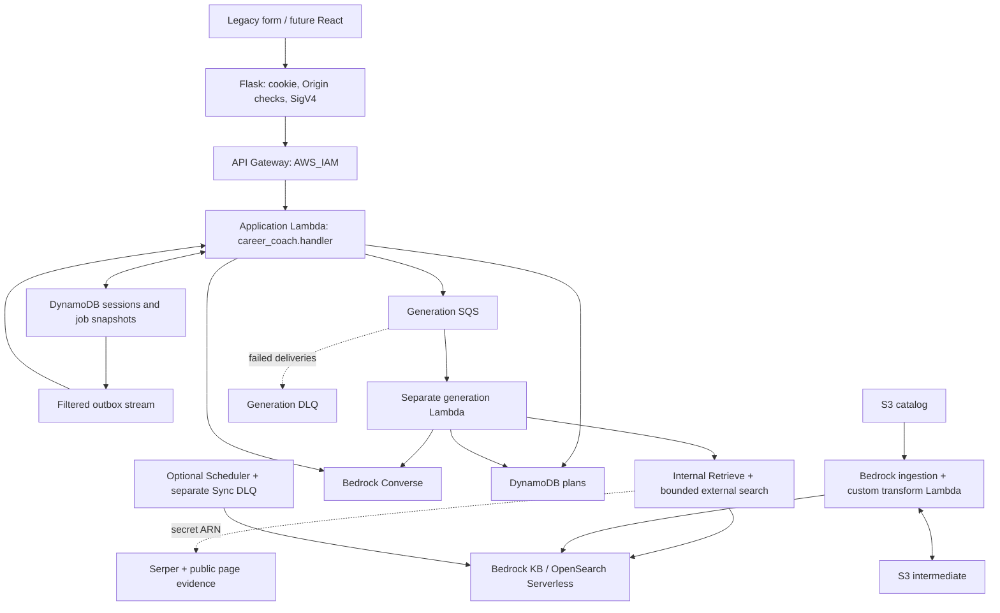

This describes the checked-in architecture, not running infrastructure. The reference stack previously had 31 resources; 13 were added or imported. KB/OpenSearch were externally owned and were not among those 13. Both stack and dedicated external resources were destroyed on 2026-11-26. The historical deployed diagram and measurements are in [live results](implementation/live-deployment.md). Ingestion, embeddings and chunk boundaries were preserved; lower-cost vector storage is future work.

## Historical legacy implementation and redesign proposal

The original before/after explanations and diagrams below are retained for comparison. Use the current section above and the versioned schemas for implementation.

[Documentation](README.md) · [Deployment](deployment.md) · [Code reference](code-reference.md)

<!-- REDESIGN_NOTE_START -->
> **Historical design timeline — 2026-11-26:** The paired before/after sections below preserve the legacy implementation and the proposed redesign as written before execution. Their “not implemented” labels are historical; the current implementation and acceptance limits are recorded above. See [Guided Career Planning Redesign](decisions/guided-career-planning-redesign.md). Existing commands do not deploy that target.
<!-- REDESIGN_NOTE_END -->
## Purpose and boundaries

<!-- REDESIGN_NOTE_START -->
**Before redesign — implemented baseline:**
<!-- REDESIGN_NOTE_END -->

The application accepts a current role and career goal, retrieves relevant internal courses, generates a development plan and persists successful results. The supplied source is a synthetic 40-course Markdown catalog spanning ten tracks. It is not connected to an ERP, employee directory or course-registration system.

The web application runs locally with Flask. AWS hosts the IAM-protected HTTP API, application Lambda, DynamoDB and knowledge services. The vector store is Amazon OpenSearch Serverless. CloudFormation manages infrastructure; a Python setup command sequences artifact upload, provisioning, KB binding, initial ingestion and retrieval acceptance.

**Diagram A — before redesign: current implementation.**

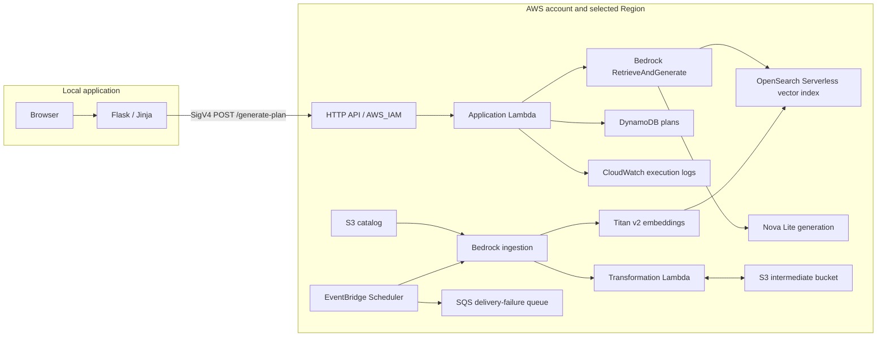

The diagram shows the available deployment architecture, not proof that every optional resource is already running. The main stack has 14 application/ingestion resources before schedule binding and 18 after its four conditional Scheduler resources are created. Fresh deployments also use a companion RAG stack. Existing KB/OpenSearch resources can remain externally owned and be reused.

<!-- REDESIGN_NOTE_START -->
**After redesign — agreed target, not implemented (2026-11-26):** Roadmap-first guidance adds reviewed capabilities and evidenced external resources. React calls Flask; anonymous sessions and asynchronous planning are added without employee accounts or AgentCore.

**Diagram B — after redesign: agreed target, not implemented.**

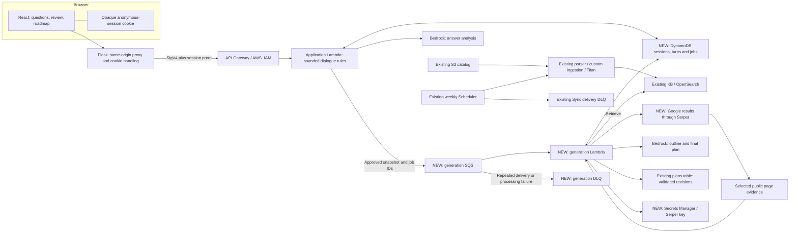

**Visual difference:** Compare retained baseline components with the new or changed components and transitions. The target is not deployment evidence.

<!-- REDESIGN_NOTE_END -->
## Request-time flow

<!-- REDESIGN_NOTE_START -->
**Before redesign — implemented baseline:**
<!-- REDESIGN_NOTE_END -->

**Diagram A — before redesign: current implementation.**

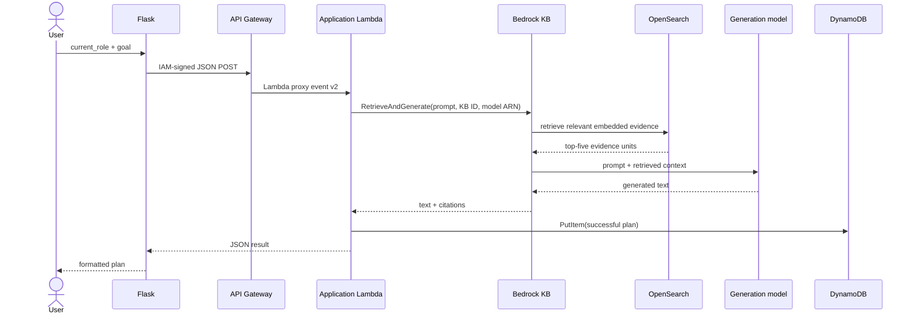

The application Lambda builds the career-coach prompt and requests up to five retrieval results and 800 generated output tokens. Model context includes retrieved evidence and service instructions, so input-token usage is larger than the user's form text. The transformation Lambda is never called by this question-time path.

The API exposes only `POST /generate-plan` under the `prod` stage. A browser GET to the API URL is not a health check. API Gateway authorizes the caller's signed request; its Lambda resource-based permission separately authorizes invoking the backend function. Flask signs requests server-side and does not put AWS credentials in browser JavaScript.

<!-- REDESIGN_NOTE_START -->
**After redesign — agreed target, not implemented (2026-11-26):** Intake becomes versioned question/answer turns with state in DynamoDB. Approved profiles create background jobs returning 202; the worker separates Retrieve from model generation and persists validated revisions.

**Diagram B — after redesign: agreed target, not implemented.**

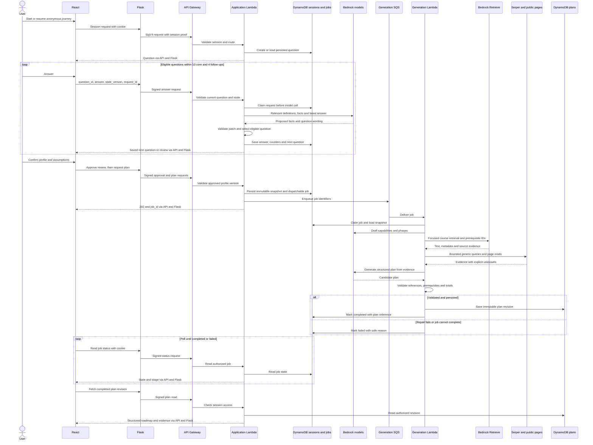

**Visual difference:** One synchronous generation becomes bounded intake, review, a 202 job, polling and an authorized plan read. At most one repair is allowed; claim/replay branches are detailed under persistence.

<!-- REDESIGN_NOTE_END -->
## Knowledge ingestion

<!-- REDESIGN_NOTE_START -->
**Before redesign — implemented baseline:**
<!-- REDESIGN_NOTE_END -->

**Diagram A — before redesign: current implementation.**

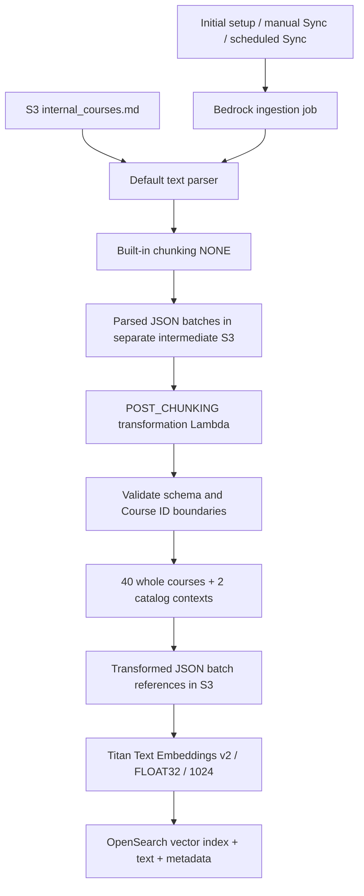

`NONE` disables Bedrock's built-in splitting; the custom hook still defines evidence units. One source object remains one source object. The current output contains 42 logical records inside intermediate transport batches, not 40 new source files. Default parsing extracts text; custom chunking identifies records; Titan produces vectors; OpenSearch stores/searches them. No step trains or changes model weights. [Knowledge contracts](knowledge-pipeline.md).

The source bucket stores `internal_courses.md` and versioned deployment ZIPs under `lambda-artifacts/`. Source inclusion is restricted to the catalog prefix. The separate intermediate bucket stores parsed/transformed transport data under `kb-intermediate/`; it is neither the deployment package store nor the vector index. Bedrock requires this bucket to be distinct from the source bucket for this transformation configuration.

<!-- REDESIGN_NOTE_START -->
**After redesign — agreed target, not implemented (2026-11-26):** The parser/NONE/custom transformation, catalog and Titan-1024 index remain unchanged initially. Application skills configuration is not indexed metadata; later filterable skills would require explicit extraction/reprocessing.

**Diagram B — after redesign: agreed target, not implemented.**

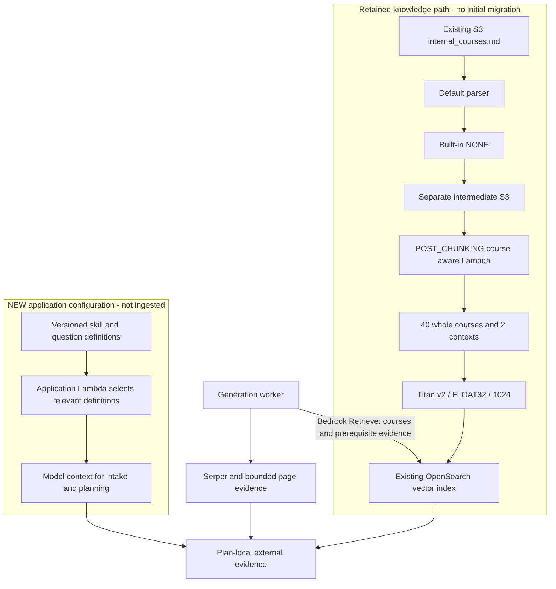

**Visual difference:** The knowledge path is retained. Application configuration and external-evidence paths are separate; neither is automatically ingested.

<!-- REDESIGN_NOTE_END -->
## Deployment ownership and order

<!-- REDESIGN_NOTE_START -->
**Before redesign — implemented baseline:**
<!-- REDESIGN_NOTE_END -->

**Diagram A — before redesign: current implementation.**

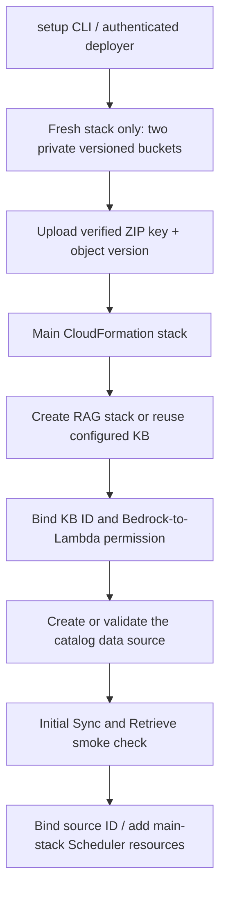

`CloudFormation.yaml` owns the application API/Lambda/role/table, source/intermediate buckets, ingestion Lambda/role/log group, invocation permissions and conditional weekly schedule/group/role/DLQ. The bootstrap template is the first revision of the same main stack, not another stack owning the buckets. Never apply its bucket-only template to a complete environment.

`infrastructure/knowledge-base.json` owns a new KB, Bedrock role, S3 source, OpenSearch collection/index and encryption/network/data policies. Source creation is gated by `EnableDataSource`; the setup command creates the KB first, updates the main stack's invoke permission, then enables the source. Already configured external resources are validated and reused without being imported into CloudFormation. Record ownership before cleanup.

<!-- REDESIGN_NOTE_START -->
**After redesign — agreed target, not implemented (2026-11-26):** Future main-stack changes add sessions, generation SQS/DLQ, worker, scoped roles and application artifacts. Application packaging/setup must support app-only releases without recreating the KB or needlessly running Sync; present resource counts apply only to the baseline.

**Diagram B — after redesign: agreed target, not implemented.**

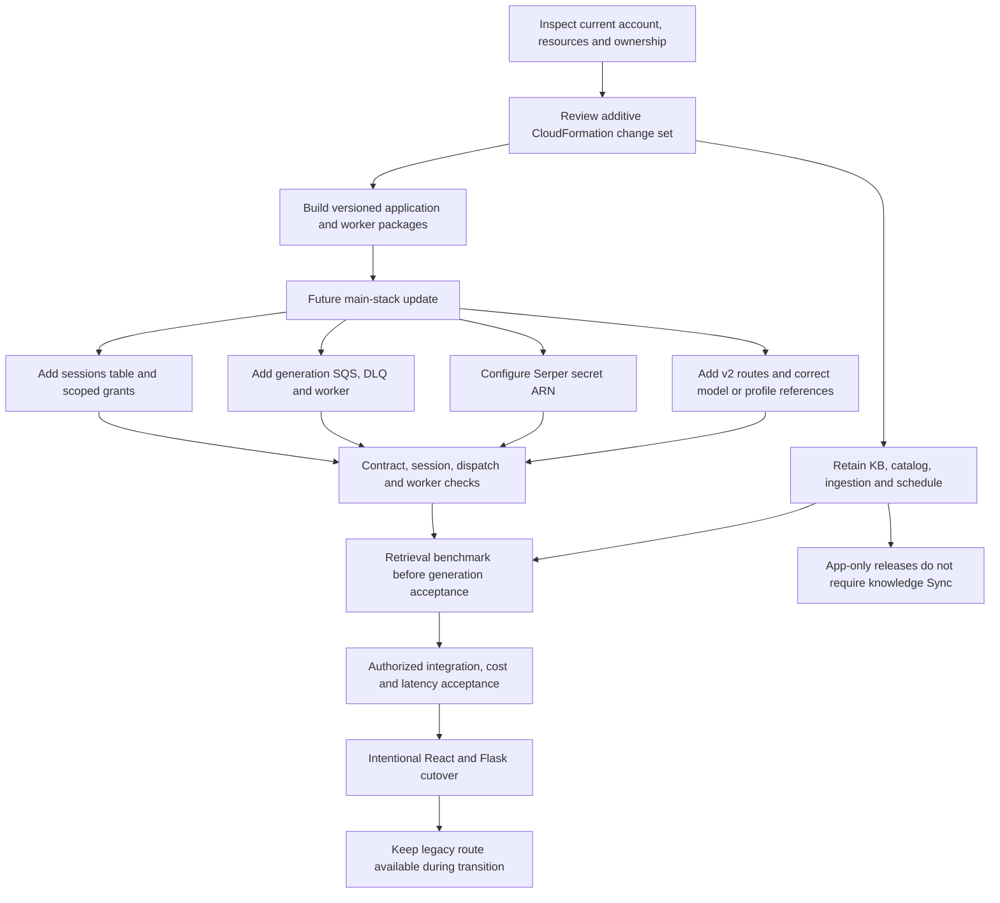

**Visual difference:** Compare retained baseline components with the new or changed components and transitions. The target is not deployment evidence.

<!-- REDESIGN_NOTE_END -->
## Scheduled refresh

<!-- REDESIGN_NOTE_START -->
**Before redesign — implemented baseline:**
<!-- REDESIGN_NOTE_END -->

**Diagram A — before redesign: current implementation.**

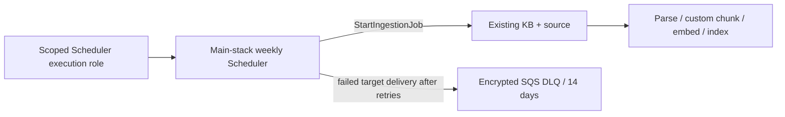

The setup CLI performs first-time provisioning and initial Sync synchronously. Scheduler only submits later ingestion jobs; it does not build infrastructure, upload local files or generate plans. Default frequency is Sunday 03:00 `Africa/Cairo`, configurable by expression/timezone parameters. New schedules default DISABLED; an explicit setup flag enables them. Existing settings are preserved unless overridden.

Delivery retries are limited to two attempts within one hour. The DLQ covers API submission failure, not document failure after a job is accepted. Monitor job statistics separately. Turning off the schedule does not stop search capacity charges or an active ingestion job.

<!-- REDESIGN_NOTE_START -->
**After redesign — agreed target, not implemented (2026-11-26):** The existing weekly knowledge refresh is retained. The proposed generation queue/DLQ handles user plan jobs and is separate from the Scheduler delivery DLQ and ingestion lifecycle.

**Diagram B — after redesign: agreed target, not implemented.**

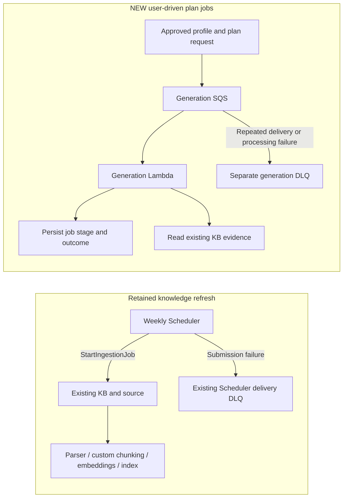

**Visual difference:** Knowledge refresh and plan generation have independent triggers, processing and DLQs.

<!-- REDESIGN_NOTE_END -->
## Trust boundaries and permissions

<!-- REDESIGN_NOTE_START -->
**Before redesign — implemented baseline:**
<!-- REDESIGN_NOTE_END -->

**Diagram A — before redesign: current implementation.**

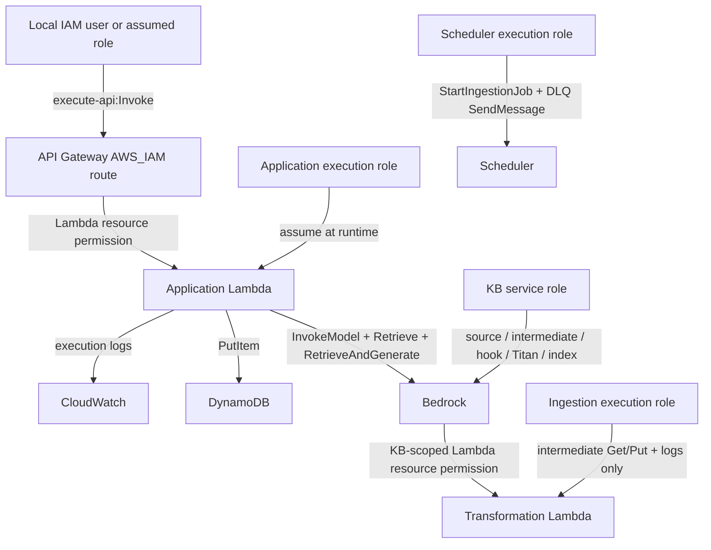

The local caller, application execution role, ingestion execution role, KB service role and optional Scheduler role have separate responsibilities. API Gateway's invoke grant is a Lambda resource permission, not another IAM role. OpenSearch data and network policies are additional authorization layers. [Exact grants and limitations](security.md).

<!-- REDESIGN_NOTE_START -->
**After redesign — agreed target, not implemented (2026-11-26):** Keep SigV4 between Flask and the API. Add server-validated anonymous session proof, scoped session read/write and queue grants, and a separate worker role with evidence/model/secret permissions. Existing PutItem rights do not authorize the new table.

**Diagram B — after redesign: agreed target, not implemented.**

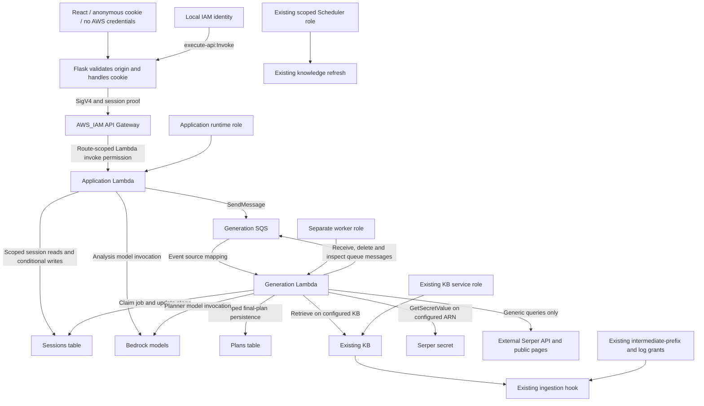

**Visual difference:** Compare retained baseline components with the new or changed components and transitions. The target is not deployment evidence.

<!-- REDESIGN_NOTE_END -->
## Persistence and operational limits

<!-- REDESIGN_NOTE_START -->
**Before redesign — implemented baseline:**
<!-- REDESIGN_NOTE_END -->

DynamoDB uses `user_id` as partition key and `timestamp` as sort key with PAY_PER_REQUEST billing. Successful items contain request fields, generated text and citations. The UUID default is not verified employee identity. Streams are enabled without a consumer; there is no history-reading API or TTL policy.

CloudWatch holds execution/error logs, not the business-plan store. S3 source/intermediate/artifacts are private and encrypted with managed encryption; request/response archival to S3 is not implemented. The ingestion log group has seven-day retention; application logging uses the basic execution policy without explicit retention in this template.

API Gateway times out after 30 seconds, the backend Lambda after 60 and Flask's HTTP call after 35. A client timeout can leave generation running; retries can incur duplicate model work or records. DynamoDB citation-number serialization and generation persistence require end-to-end acceptance. There is no request idempotency, employee sign-in, per-user quota or hard spending cutoff. Exact-level, strict-track and per-course/whole-plan duration constraints are not implemented in the current app even though chunk metadata enables filters.

**Diagram A — before redesign: current implementation.**

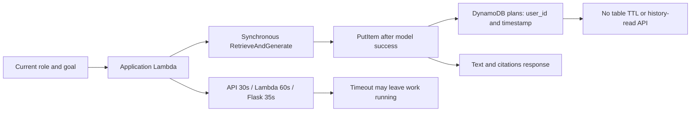

<!-- REDESIGN_NOTE_START -->
**After redesign — agreed target, not implemented (2026-11-26):** Persist authoritative session/turn/job state with seven-day sliding expiry, version checks and request claims. Keep final-plan retention separate. Background jobs avoid waiting for long generation inside the current gateway timeout; immutable snapshots/revisions prevent silent overwrites.

**Diagram B — after redesign: agreed target, not implemented.**

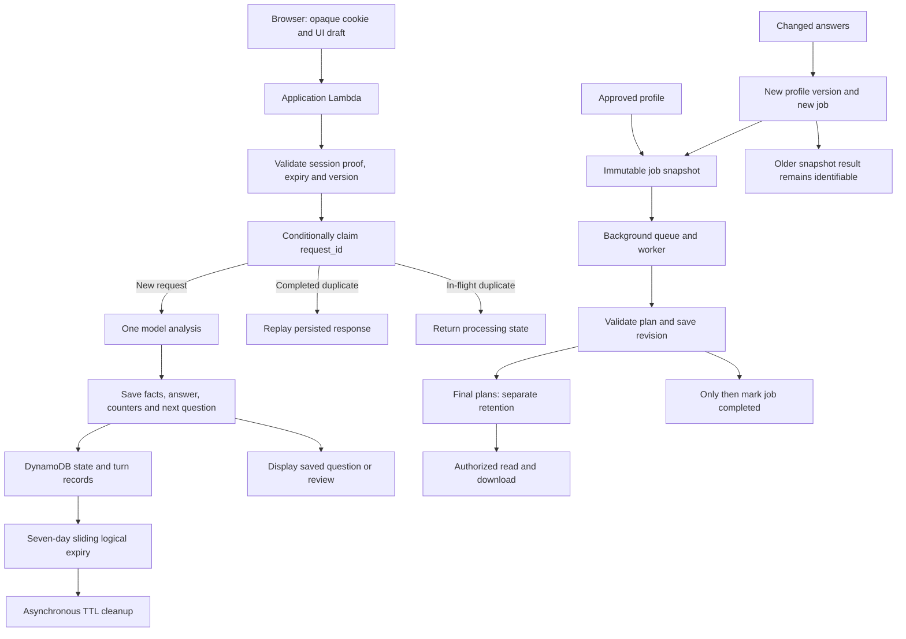

**Visual difference:** Compare retained baseline components with the new or changed components and transitions. The target is not deployment evidence.

<!-- REDESIGN_NOTE_END -->
## Region and model configuration

<!-- REDESIGN_NOTE_START -->
**Before redesign — implemented baseline:**
<!-- REDESIGN_NOTE_END -->

The setup command requires an explicit Region and derives the account from STS. Lambda uses its runtime role; local profiles do not transfer into AWS. The generation ARN is built from Region and FoundationModelId with an empty account field; KB/IAM ARNs use the destination account pseudo parameter. Inference-profile models require a deliberate parameter/IAM change, not copying an old account's ARN. [Configuration and migration](security.md#region-and-model-portability).

OpenSearch is billed for search/indexing capacity and storage, including a possible persistent capacity floor. Serverless does not make this architecture wholly per-request. [Cost analysis](costs.md).

**Diagram A — before redesign: current implementation.**

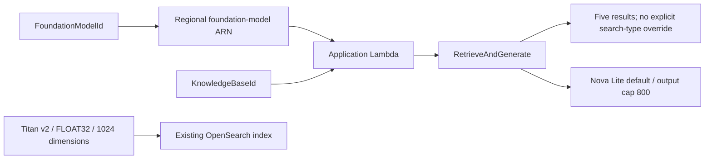

<!-- REDESIGN_NOTE_START -->
**After redesign — agreed target, not implemented (2026-11-26):** Haiku 4.5 is the initial candidate; compare Nova and Sonnet. Start final generation at 2048 tokens and experimental temperature 0.2. Correct model/profile configuration and IAM must be verified; the template currently lists Sonnet 4.5, not 4.6.

**Diagram B — after redesign: agreed target, not implemented.**

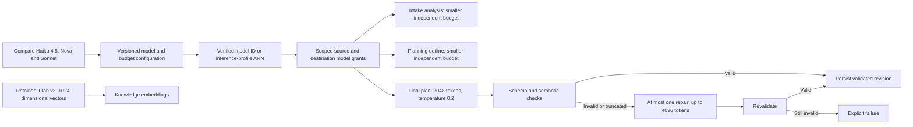

**Visual difference:** Compare retained baseline components with the new or changed components and transitions. The target is not deployment evidence.

<!-- REDESIGN_NOTE_END -->
