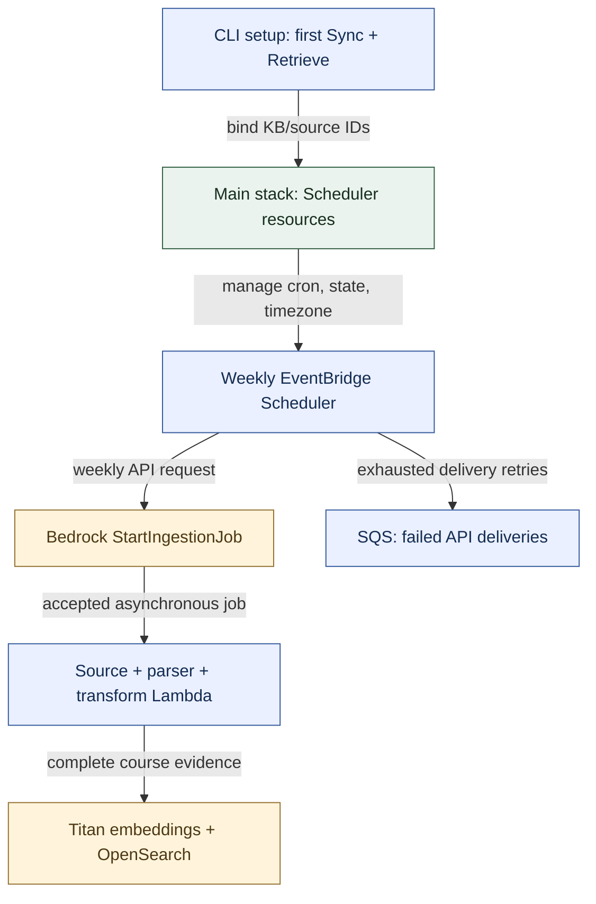

# Reproducible setup and weekly Knowledge Base Sync

This is an optional, version-controlled alternative to repeating the Console wizard. It adds a Python setup command and declarative CloudFormation templates, not a GitHub Actions pipeline or a local crontab. Weekly execution uses AWS EventBridge Scheduler and continues when your computer is off.

**Release validation boundary:** the existing lab completed a real custom-transformation Sync and retrieval evaluation before this automation was added. The automation has local mocked tests and CloudFormation schema validation. The new fresh-account RAG template and main-stack Scheduler have not been deployed by this release; no new live schedule was enabled during publication. A successful preview is not an infrastructure deployment or model-access guarantee.

## 1. Prerequisites and identity

Use Python 3.12, AWS CLI v2, and an IAM user/role with permission to provision this lab. Do not use root. Authenticate using your normal CLI profile or SSO; boto3 uses the standard credential provider chain, including session credentials. The Region is explicitly required on every command. The CLI never accepts access keys or stores them in source files.

```bash
python3 -m venv .venv
source .venv/bin/activate
python -m pip install -r requirements-dev.txt
aws sts get-caller-identity --profile YOUR_PROFILE --region us-east-2
# For an SSO profile, sign in first: aws sso login --profile YOUR_PROFILE
python -m unittest discover -s tests -v
cfn-lint CloudFormation.yaml infrastructure/*.json
```

These examples use Bash/WSL; in PowerShell activate `.venv\Scripts\Activate.ps1` and use `python`. Choose a stack name unique to this account/Region (3–31 lowercase letters/digits/hyphens, starting with a letter). S3 names include account and stack but not Region: do not reuse the same stack name in two Regions of one account. Choose a Region that supports the models, Bedrock KBs, OpenSearch Serverless and the CloudFormation Index resource.

The deployer needs CloudFormation change-set/stack/event operations, S3 creation/versioned read/write, IAM role/policy/tag/pass-role operations, Lambda/logs, DynamoDB, API Gateway, Bedrock KB/data-source/Sync/Retrieve/model-description operations, OpenSearch Serverless policies/collection/data-plane index operations, and Scheduler/SQS operations for the optional schedule. Scope permissions to the selected stack/resources; account policies, permissions boundaries and SCPs may still restrict them. This script does not grant the caller privileges or attach administrator access. Deploy-time permissions belong to the caller, not the application or ingestion runtime roles.

For new RAG provisioning, the current IAM user/role is added to the new collection's data access policy, and also needs IAM `aoss:APIAccessAll` on that collection. Assumed-role sessions are resolved to their IAM role using `iam:GetRole`. A separate pre-existing CloudFormation execution role is not automatically configured by this wrapper; it stops and directs you to explicit RAG-template deployment. Existing externally created KB resources remain external.

## 2. Read-only preview

```bash
python -m ingestion.setup_lab setup --profile YOUR_PROFILE --region us-east-2 --stack-name career-coach-lab
```

Optional account guard: append `--expected-account YOUR_12_DIGIT_ACCOUNT_ID`. Inspect the account, Region, stack status, source/intermediate buckets, configured KB and intended steps. A preview performs read-only AWS calls and saves local evidence under ignored `.lab/setup/<session>/`. It does not upload, create a change set, Sync, or enable a schedule. For a configured KB it checks its data-source contract too; a fresh account's future permissions and provisioning cannot be proved by preview.

## 3. Apply setup and opt in to weekly Sync

```bash
python -m ingestion.setup_lab setup --profile YOUR_PROFILE --region us-east-2 --stack-name career-coach-lab --apply --enable-schedule
```

`--apply` permits cloud changes. `--enable-schedule` explicitly enables Sunday 03:00 in `Africa/Cairo`; use `--schedule-timezone UTC` or another IANA timezone to change it. Use `--schedule-expression 'rate(7 days)'` or a different Scheduler cron expression to change frequency. Without a schedule flag, a new schedule is created DISABLED and an existing schedule keeps its current state/timezone/expression. `--disable-schedule` explicitly disables it. Regional infrastructure, especially OpenSearch, remains billable even when the schedule is disabled. This is not a USD 5 spending cap.

The command performs these steps in order:

1. Parse/validate the local catalog before cloud writes; derive the account from STS, require an explicit Region, reject root, and inspect the main stack and optional schedule. Preserve the current generation model and KB parameter unless a model override is supplied. Before creation, describe the generation and Titan embedding models and require ACTIVE lifecycle; this does not prove inference access or quotas.
2. **Fresh stack only:** create the two versioned private S3 buckets with `infrastructure/bootstrap.json`, using the same logical IDs/names/security as the full main template. Never apply this bucket-only template to a completed full stack: that could remove its other resources. An existing or resumed bootstrap stack proceeds directly to the full template.
3. Build the deterministic three-file ingestion ZIP; upload it to `lambda-artifacts/<sha256>.zip` in the source bucket, verify the actual versioned bytes, and update `CloudFormation.yaml` with the exact key/version. Reuse verified identical objects instead of uploading another version. The intermediate bucket is separate from the source bucket, as Bedrock requires.
4. Upload the catalog as `internal_courses.md`, with a SHA-256 and verified version. This intentionally publishes your local catalog; review local data before `--apply`. Source inclusion is only that key prefix, so ZIPs are not ingested.
5. If the main stack already has a configured KB, validate and reuse it: ACTIVE vector/OpenSearch Serverless KB, Titan v2/FLOAT32/1024, exactly one matching AVAILABLE S3 source, default parser, NONE, the expected transformation function and intermediate URI. No duplicate collection/role/KB is created. A mismatching configuration fails for inspection. An external same-name KB with an unbound main stack also stops rather than guessing which resource to adopt.
6. For a fresh KB, create/update `<stack>-rag` from `infrastructure/knowledge-base.json`: encrypted vector collection, network/data policies, scoped Bedrock role, 1024-dimensional float/faiss/HNSW index and KB. Initially leave `EnableDataSource=false`. Update the main stack's `KnowledgeBaseId` and KB-scoped Lambda invocation permission, then update the RAG stack to `EnableDataSource=true`. This avoids creating a source before the KB can invoke its hook. A partial run after binding can resume source creation.
7. Start Sync (or wait for an already-active job), wait for completion, and require both `COMPLETE` and zero failed documents. Save the entire job, statistics and failure reasons. Do not assume COMPLETE alone means the source indexed correctly.
8. Run a filtered Retrieve smoke check for a known catalog course, retrying bounded reads for index refresh. No generation call is made. This proves initial search visibility/metadata, not complete coverage or ranking quality; repeat the labelled evaluation from the guided runbook before trusting career plans.
9. Update the **same main stack** with `KnowledgeBaseDataSourceId` and `SyncScheduleState`/`SyncScheduleExpression`/`SyncScheduleTimezone`. The conditional `HasSyncBinding` adds the four Scheduler resources from `CloudFormation.yaml`; there is no separate sync stack. Save Outputs and evidence locally. The first schedule binding happens only after initial Sync and the smoke check succeed. On later runs an already-enabled schedule stays active while setup reconciles; disable it first if a maintenance window is required.

CloudFormation operations use create/describe/execute change sets, not an opaque unreviewed update. The script saves and prints each proposal, follows pagination, and rejects any removal or unexpected replacement. Only `IngestionBedrockPermission` replacement is allowed during explicit KB binding. It preserves unspecified parameters, handles “no changes” as success, waits for stack success and saves events on failure. It never deletes a failed baseline stack.

## 4. Stack ownership and policies

- **Main stack:** the existing fourteen application/custom-ingestion resources, plus four Scheduler resources after KB/data-source binding (eighteen total). Bootstrap is a temporary first revision of this same stack, not another permanently owned bucket stack.
- **RAG stack (fresh setup only):** KB, KB role, source, OpenSearch collection/index and security/access policies. Existing Console/API KB resources are reused without importing them into CloudFormation. A reused KB's source/model/store permissions must already be correct.
- **Scheduler inside the main stack:** schedule group, Scheduler execution role, encrypted SQS dead-letter queue and weekly schedule. The extra execution role can only call `bedrock:StartIngestionJob` on this KB and `sqs:SendMessage` on its queue. Trust is scoped to this account and the **schedule-group ARN**, not the individual schedule ARN.

The RAG role trusts Bedrock for this account's KB ARN namespace to avoid a role→KB circular reference; the main stack's Lambda resource permission remains scoped to the actual KB ID. The role reads only the catalog/metadata sidecar, lists appropriate prefixes, reads/writes/cleans intermediate storage, invokes this hook (unqualified and `$LATEST`) and Titan v2, and accesses only this collection. It does not read `lambda-artifacts/`. The ingestion runtime still needs only intermediate Get/Put and execution logs. API Gateway's permission to invoke the application Lambda is unchanged.

The optional new OpenSearch network policy allows its collection endpoint over the public network for this lab; IAM and collection/index data policies still enforce authorization. This is not anonymous public document access. For production, design private endpoints/network policies and operator access deliberately. The KB principal gets DescribeIndex/ReadDocument/WriteDocument; the deployer separately gets index lifecycle operations for CloudFormation. The index's 1024 dimensions must match Titan's configured dimensions. Embedding/indexing is RAG preparation, not training model weights.

## 5. What the weekly job actually does

The schedule calls the universal target `arn:aws:scheduler:::aws-sdk:bedrockagent:startIngestionJob` with the current KB and data-source IDs. Bedrock then reads changed source objects, parses, invokes custom chunking, embeds and indexes. Scheduler does not run your local script, upload local edits, invoke the application API, or generate a plan. No extra ingestion-driver Lambda is needed.

Retries: at most two retry attempts within one hour. Exhausted target-delivery failures go to the encrypted DLQ (14-day retention). No fixed client token is supplied, so later weeks are not deduplicated into the first job. A concurrently running manual Sync can cause a conflict; inspect the job before retrying.

**Delivery success is not ingestion success.** Scheduler's DLQ covers failure to submit the API call, not a document failure occurring inside an accepted job. Monitor Scheduler `TargetErrorCount`/`InvocationDroppedCount`, SQS queue depth, Bedrock ingestion status/statistics and the ingestion Lambda log group. This release does not add alarms, notifications, a job-completion monitor or a guaranteed cost cutoff. Those are separate production work.



## 6. Updating data, manual Sync and status

After editing the catalog, run setup again to validate/upload it and Sync. An unchanged setup reuses verified ZIP/catalog versions, preserves the KB/model and schedule state/timezone/expression, and treats no-op change sets normally. Reusing an already configured KB does not import or rewrite its external infrastructure. For a future RAG-template change, review/update that owned stack explicitly.

```bash
# Sync the objects already uploaded to S3; this command does NOT upload local edits.
python -m ingestion.setup_lab sync --profile YOUR_PROFILE --region us-east-2 --stack-name career-coach-lab --apply
# Read recent jobs and inspect document failures/failureReasons.
python -m ingestion.setup_lab status --profile YOUR_PROFILE --region us-east-2 --stack-name career-coach-lab
# Disable future scheduled requests (existing jobs may continue).
python -m ingestion.setup_lab setup --profile YOUR_PROFILE --region us-east-2 --stack-name career-coach-lab --apply --disable-schedule
```

The last command reconciles code/data and performs Sync before updating the schedule. To disable future triggers **without** running setup/Sync, review an UPDATE change set against `CloudFormation.yaml`, preserving current values of all parameters and overriding only `SyncScheduleState=DISABLED`. Preserve `KnowledgeBaseDataSourceId`: removing the binding would remove Scheduler resources, which the setup wrapper deliberately refuses. Running the full template with a missing ZIP key/version is not a valid standalone deployment.

For a direct Console operation, EventBridge Scheduler → the group/name from main-stack Outputs → edit → disable. That stops future requests; active jobs may continue. This creates a parameter/resource mismatch until a reviewed stack update records `SyncScheduleState=DISABLED`. Prefer the CloudFormation update for normal operations.

## 7. Troubleshooting, rollback and cleanup

Inspect `.lab/setup/<session>/plan.json`, proposed change sets, stack/events JSON, package manifest, Sync result, `retrieval-smoke.json` and `result.json`. Nothing in `.lab/`, `.local-ar/`, CLI credential directories or environment files belongs in Git. Do not paste session credentials into issues.

If a stack rolls back, the command exits with an error and preserves the event evidence. `UPDATE_ROLLBACK_COMPLETE` can be retried after fixing the cause; an initial `ROLLBACK_COMPLETE`, `REVIEW_IN_PROGRESS`, or failed/in-progress state needs deliberate inspection/recovery. It is not automatically deleted. Read AOSS/Bedrock errors for IAM/data/network policy propagation or an index not yet visible; retry only once the failed resource/state is understood. A Retrieve smoke timeout after a successful Sync does not justify automatically re-ingesting documents.

To roll back code, use the earlier ZIP key/object version and a reviewed main-stack UPDATE, preserving the current KB/model. Disabling the schedule does not remove existing indexed knowledge. Do not reapply the bootstrap template to roll back the application.

Cleanup is intentionally manual and ordered: disable/delete future triggers; inspect active ingestion jobs; keep the main-stack Scheduler disabled while deleting only the RAG stack you own (the data source must delete its indexed data while its index/role remain); separately handle any reused Console resources; then review deletion of the main stack/data, including its Scheduler/group/role/DLQ. Versioned S3 buckets need explicit removal of all versions/delete markers before deletion; DynamoDB plan records need a retention/export decision. Removing Lambda or the main stack does not remove a reused billable OpenSearch collection. Never delete a collection another app uses.

## 8. Moving to a different account or Region: model/KB binding

The application code is intentionally unchanged. `MODEL_ARN` currently comes from `!Sub 'arn:aws:bedrock:${AWS::Region}::foundation-model/${FoundationModelId}'`; this is a foundation-model ARN with an **empty account field**, not this lab owner's account hardcoded into the handler. The inline handler passes it as `knowledgeBaseConfiguration.modelArn` in RetrieveAndGenerate. `KnowledgeBaseId` is a separate parameter; CloudFormation inserts the destination account/Region into KB/IAM resource ARNs using pseudo parameters.

If you choose a model that requires an **inference profile**, copying its ARN from the old account is not portable. In that future change, supply the destination account's supported profile ARN as a deployment parameter/environment value, and update IAM for the profile and its destination foundation models/Regions. Do not put an inference-profile ARN into `FoundationModelId` today: the current template builds a foundation-model ARN from that value and its AllowedValues are model IDs. Do not replace the working invocation path merely to remove the word ARN: both model and profile invocation can correctly use ARNs. This release adds documentation, not that runtime/permissions refactor.

Before moving, authenticate the new profile, verify STS account, choose Region/model access and stack name, run preview with the new expected-account guard, then apply setup. New source/intermediate buckets, Lambda ARNs, KB/data-source IDs and ApiEndpoint must come from the destination setup/Outputs, not old-account evidence. Re-test Retrieve **and** generation, citations and DynamoDB persistence there. Indexing/retrieval success alone does not prove generation works. Keep the old environment until the new one passes; cleanup is a separate explicit action.

See [AWS inference-profile invocation](https://docs.aws.amazon.com/bedrock/latest/userguide/inference-profiles-use.html).

## 9. Continue learning and validate the application separately

This automation does not implement the pending strict UI/backend constraints: exact level, strict track, per-course cap and total-plan cap. Metadata only enables deterministic filters. It does not change the prompt, Flask fields or application request shape. After retrieval evaluation, use the main stack's ApiEndpoint to configure Flask and test generation, citations, business persistence and authorization separately.

[Architecture](01-architecture.md) · [Guided runbook and actual lab history](08-guided-execution-us-east-2.md) · [Ingestion code](../ingestion/README.md)

References: [universal Scheduler targets](https://docs.aws.amazon.com/scheduler/latest/UserGuide/managing-targets-universal.html), [schedule-group trust scope](https://docs.aws.amazon.com/scheduler/latest/UserGuide/cross-service-confused-deputy-prevention.html), [StartIngestionJob](https://docs.aws.amazon.com/bedrock/latest/APIReference/API_agent_StartIngestionJob.html), [CloudFormation vector index](https://docs.aws.amazon.com/AWSCloudFormation/latest/TemplateReference/aws-resource-opensearchserverless-index.html), [custom transformations](https://docs.aws.amazon.com/bedrock/latest/userguide/kb-custom-transformation.html).
