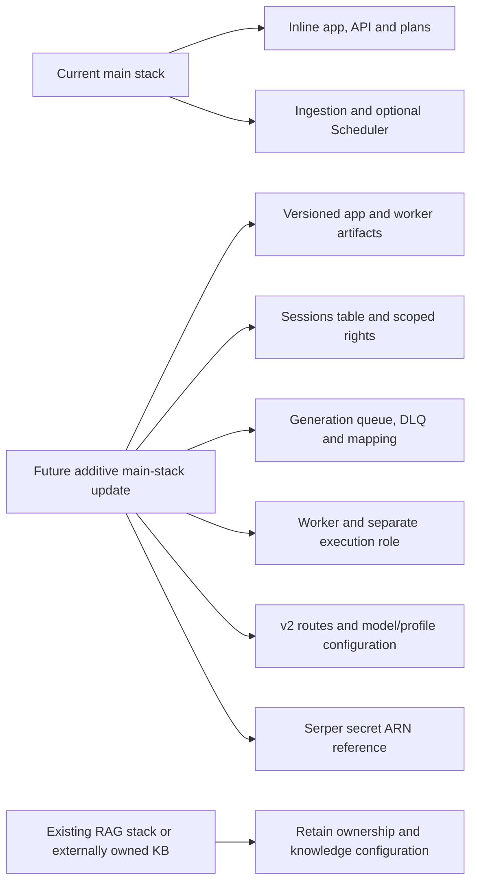

# Code reference

[Documentation](README.md) · [Architecture](architecture.md)


<!-- REDESIGN_NOTE_START -->
> **Documentation timeline — 2026-11-26:** Existing paragraphs/examples below describe the implemented baseline. Each affected section also records the agreed post-redesign target, **not implemented or deployed**. See [Guided Career Planning Redesign](decisions/guided-career-planning-redesign.md). Existing commands do not deploy that target.
<!-- REDESIGN_NOTE_END -->
## Repository layout

<!-- REDESIGN_NOTE_START -->
**Before redesign — implemented baseline:**
<!-- REDESIGN_NOTE_END -->

```text
app.py                         Flask request handling, IAM signing and presentation
CloudFormation.yaml            Main infrastructure and inline application Lambda
templates/index.html           Jinja form and generated-plan presentation
internal_courses.md            Source catalog: 40 courses, ten tracks
ingestion/
  __init__.py                  Package marker for importable Lambda handler
  course_chunker.py            Pure catalog validation and record extraction
  transform.py                 Bedrock transformation-event adapter and S3 I/O
  prepare_lab.py               Deterministic ZIP, manifest and configuration fixtures
  setup_lab.py                 Setup / Sync / status CLI and deployment checks
  README.md                    Package entry points and runtime/build boundary
infrastructure/
  bootstrap.json               First revision of the main stack: two S3 buckets
  knowledge-base.json          Companion RAG resources and gated data source
tests/                         UI/signing, chunking, packaging and setup tests
requirements.txt               Flask, requests and boto3
requirements-dev.txt           Runtime dependencies plus cfn-lint
scripts/estimate_cost.py        Offline usage-based cost calculation
```

The `.local/AR` and `.local/English` directories contain private archived material and are excluded from Git. `.lab/` holds generated deployment evidence; neither is application source.


<!-- REDESIGN_NOTE_START -->
**After redesign — agreed target, not implemented (2026-11-26):** Future application runtime and versioned skills/questions move into a dedicated package with a worker entry point, independent of the ingestion ZIP. These modules and routes are not present yet.


<!-- REDESIGN_DETAIL_START -->
**Proposed package boundaries; these paths do not exist yet and are not deployment instructions:**

```text
app.py                          Retained Flask proxy, cookie and download responsibilities
backend/
  handler.py                    API routing and intake coordination
  worker.py                     Background plan-job entry point
  config/
    skills.json                 Reviewed versioned capability definitions
    questions.json              Objectives, eligibility and fallback wording
  contracts/                    Versioned request/analysis/plan schemas
  dialogue/                     State transitions and patch validation
  sessions/                     Persistence, claims and version checks
  retrieval/                    KB candidates and prerequisite closure
  resources/                    Serper, bounded page evidence and provenance
  planning/                     Outline, generation and semantic validation
ingestion/                      Existing independent ingestion runtime/build tools
tests/                          Baseline tests plus new subsystem/contract fixtures
React frontend                  User-owned UI consuming the Flask contracts
```

This is a responsibility-oriented proposal, not a claim that files/functions are implemented. Keep application and worker artifacts versioned independently of the ingestion ZIP.
<!-- REDESIGN_DETAIL_END -->
<!-- REDESIGN_NOTE_END -->
## Local request handling: app.py

<!-- REDESIGN_NOTE_START -->
**Before redesign — implemented baseline:**
<!-- REDESIGN_NOTE_END -->

`API_URL` is read at process startup; restart Flask after changing it. `request_career_plan()` creates a boto3 session, requires a configured Region and credentials, serializes the exact JSON body, signs it with SigV4 for `execute-api`, and posts it with a 35-second timeout and redirects disabled. Frozen credentials keep the request signature consistent when using temporary sessions.

`index()` handles GET/POST `/`. GET renders the form. POST requires `current_role` and `goal`, calls the signed API, checks the response and displays upstream/configuration errors. `format_career_plan()` turns numbered text sections into the structure expected by Jinja; it is presentation parsing, not schema validation of the model's plan. `section_items` avoids collision with dictionary `.items()` in Jinja. The Flask process listens on port 5001; debug mode requires `FLASK_DEBUG=1`.

`templates/index.html` is the UI template. It is not the `index.py` handler created for Lambda. Only two business fields are submitted; there are no implemented level/track/duration controls or a citation inspector.


<!-- REDESIGN_NOTE_START -->
**After redesign — agreed target, not implemented (2026-11-26):** Flask remains the same-origin server for React, session-cookie handling and SigV4 proxy calls. It gains review/job/status/download support; structured plans must not be validated with the existing text formatter.


<!-- REDESIGN_DETAIL_START -->
```text
BEFORE
index() -> read two form fields -> request_career_plan()
        -> format_career_plan(text) -> Jinja template

AFTER / TARGET
React action -> Flask same-origin route -> opaque cookie handling
             -> signed cloud request -> structured JSON response
React plan view <- authorized plan revision <- Flask
Download <- Markdown/JSON generated from the validated structure
```

Flask owns browser-to-server concerns, not the dialogue engine. The API handler checks session proof and permitted transitions; React cannot decide the next authoritative stage.
<!-- REDESIGN_DETAIL_END -->
<!-- REDESIGN_NOTE_END -->
## Cloud backend: generated index.py

<!-- REDESIGN_NOTE_START -->
**Before redesign — implemented baseline:**
<!-- REDESIGN_NOTE_END -->

`CareerCoachFunction.Properties.Code.ZipFile` in `CloudFormation.yaml` contains the actual Python backend source. CloudFormation packages this inline source as `index.py`; `Handler: index.lambda_handler` resolves that module/function. There is no independently maintained backend `index.py` file in this repository.

The handler parses a proxy event's JSON `body`, requires current role/goal, optionally accepts `user_id` or generates a UUID, builds a career-development prompt, and calls `bedrock-agent-runtime.retrieve_and_generate`. It passes KNOWLEDGE_BASE_ID, MODEL_ARN, top five retrieval results and `maxTokens=800`. It requests internal courses, skills, timeline and additional resources; the prompt is not deterministic enforcement of internal-only or duration/prerequisite rules.

On success, the handler saves user_id/timestamp/current_role/goal/career_plan/citations with DynamoDB `PutItem`, then returns JSON and Content-Type/CORS headers. Missing fields return 400. Bedrock/configuration/persistence exceptions return 500. No plan is saved before model success, and persistence failure can occur after model charges. UTC timestamps have no timezone suffix. The current implementation does not handle every proxy-body format or idempotent retries; citation numeric values need an end-to-end serialization check.


<!-- REDESIGN_NOTE_START -->
**After redesign — agreed target, not implemented (2026-11-26):** The future packaged handler runs bounded intake turns and persists session state; a separate worker generates plans asynchronously. Model analysis proposes patches; code checks eligibility, versions, limits and provenance.


<!-- REDESIGN_DETAIL_START -->
```text
TARGET PSEUDOCODE — not existing function names
on_answer(request):
    verify_session_question_and_version()
    claim_request_or_replay()
    proposal = analyze_once(relevant_definitions, stored_facts, latest_answer)
    accepted_patch = validate_allowed_facts_and_sources(proposal)
    next_question = select_by_rules_or_fallback(accepted_patch)
    commit_turn_state_and_next_question()
    return_persisted_response()

on_plan_job(job_id):
    claim_job_and_load_approved_snapshot()
    outline = draft_capabilities()
    evidence = retrieve_and_search_with_budgets(outline)
    candidate = generate_structured_plan(evidence)
    validate_or_repair_once(candidate)
    persist_revision_then_mark_completed()
```

Generation is not a recursive self-invoking handler or an Agent loop. Failed persistence cannot be reported as completed.
<!-- REDESIGN_DETAIL_END -->
<!-- REDESIGN_NOTE_END -->
## Pure extraction: ingestion/course_chunker.py

<!-- REDESIGN_NOTE_START -->
**Before redesign — implemented baseline:**
<!-- REDESIGN_NOTE_END -->

`chunk_catalog(text)` normalizes line endings, requires a catalog-version declaration and detects `### Course ID: TRACK-NNN` record boundaries. It validates unique IDs, exactly nine single-line fields, allowed levels, the duration grammar and known prerequisite IDs. Text outside the supported structure is rejected instead of silently discarded.

Each course body includes its heading and complete fields. Metadata includes catalog_version, parsed_source_sha256, record_type, course_id/course_name, track, level/level_rank, duration_hours, has_prerequisites and nonempty prerequisites. Catalog preamble and final notes become separate context records. Current output is 40 courses plus two contexts. Each course/context is capped at 6,000 characters as an application guard, not a token/model limit.

The module uses only the standard library and performs no AWS calls. It defines evidence boundaries, not file-upload batching or retrieval. [Schema and decision](knowledge-pipeline.md).


<!-- REDESIGN_NOTE_START -->
**After redesign — agreed target, not implemented (2026-11-26):** Keep the extractor unchanged initially. Do not mistake ID-existence validation for cycle detection or transitive prerequisite closure; those new planning checks belong to application code.


<!-- REDESIGN_DETAIL_START -->
```text
BEFORE / RETAINED
Markdown -> schema checks -> whole-course body + typed metadata

AFTER / NEW APPLICATION RESPONSIBILITY
Retrieved prerequisite IDs -> visited-set expansion -> cycle/missing-ID checks
                           -> explicit equivalence assumptions -> plan-hour totals
```

Example: SEC-201 -> SEC-101 + BKE-101 -> SDE-101. Current extraction checks referenced IDs exist; the future application verifies ordering and the 68-hour closure.
<!-- REDESIGN_DETAIL_END -->
<!-- REDESIGN_NOTE_END -->
## Runtime hook: ingestion/transform.py

<!-- REDESIGN_NOTE_START -->
**Before redesign — implemented baseline:**
<!-- REDESIGN_NOTE_END -->

`lambda_handler()` creates an S3 client and supplies environment variables INTERMEDIATE_BUCKET, INTERMEDIATE_PREFIX and CATALOG_SOURCE_URI to `transform()`.

`transform()` checks event version 1.0, the configured intermediate bucket, the exact original source URI and a nonempty list of input files/batches. Keys must stay under the configured prefix and may not traverse with `..`. It reads Bedrock's parsed JSON batches, accepts TEXT or observed PLAIN_TEXT, requires a consistent content type and rejects unexpected inherited chunk metadata pending an explicit merge policy.

The aggregate parsed input guard is 2,000,000 bytes per source file with at most 20 transport batches. The complete catalog is reassembled before splitting, so course boundaries can span incoming batches. It calls the pure extractor, preserves the input content type, writes transformed JSON under `kb-intermediate/custom/<digest>.json`, and returns S3 batch references in `outputFiles`, preserving original location/file metadata. Input streaming bodies are closed. Failures propagate to ingestion rather than writing partial evidence silently.

The hook requires intermediate GetObject/PutObject and execution logs only. It does not read the original source directly, invoke Titan, write OpenSearch, retrieve courses or serve user requests. Bedrock's service role owns those responsibilities.


<!-- REDESIGN_NOTE_START -->
**After redesign — agreed target, not implemented (2026-11-26):** Keep this hook restricted to ingestion. Neither per-answer model analysis nor external search belongs in it.


<!-- REDESIGN_DETAIL_START -->
```text
RETAINED HOOK INPUT  Bedrock event + intermediate S3 batch references
RETAINED HOOK OUTPUT S3 references to transformed course/context units
NEVER HOOK INPUT    User answers, session cookies or generation jobs
NEVER HOOK TASK     Search Google, update user sessions or build roadmaps
```
<!-- REDESIGN_DETAIL_END -->
<!-- REDESIGN_NOTE_END -->
## Packaging: ingestion/prepare_lab.py

<!-- REDESIGN_NOTE_START -->
**Before redesign — implemented baseline:**
<!-- REDESIGN_NOTE_END -->

`prepare()` validates the source, rejects identical source/intermediate buckets and writes IAM/configuration examples, a manual event fixture, parsed catalog fixture, retrieval/filter examples, a local preview and manifest. Output-directory/preview overrides allow setup sessions to be isolated. The default personal preview is under `.local/AR/experiments/`; generated package files are under `.lab/`.

The ZIP includes only `ingestion/__init__.py`, `course_chunker.py` and `transform.py`. Fixed ZIP timestamps and file modes make identical source produce identical ZIP bytes. The manifest records source/ZIP SHA-256, unit counts and `lambda-artifacts/<sha256>.zip`. Setup/build modules are not deployed in the Lambda ZIP; boto3 is supplied by the Python Lambda runtime.


<!-- REDESIGN_NOTE_START -->
**After redesign — agreed target, not implemented (2026-11-26):** Retain the three-file ingestion ZIP. Add independently versioned application/worker artifacts and configuration through future build/setup changes, not by inserting application code into this ZIP.


<!-- REDESIGN_DETAIL_START -->
```text
BEFORE                     AFTER / TARGET
Ingestion ZIP only         Ingestion ZIP: same three runtime files
Inline application         Application ZIP: handler + rules/config/contracts
No generation worker       Worker artifact: planning/evidence responsibilities
One ingestion hash/version Separate immutable artifact hashes and S3 versions
```

Both app and worker may share reviewed modules, but the build must record their actual contents and versions. Artifact locations remain outside catalog source inclusion.
<!-- REDESIGN_DETAIL_END -->
<!-- REDESIGN_NOTE_END -->
## Infrastructure CLI: ingestion/setup_lab.py

<!-- REDESIGN_NOTE_START -->
**Before redesign — implemented baseline:**
<!-- REDESIGN_NOTE_END -->

`main()` exposes `setup`, `sync` and `status`. Preview is read-only unless `--apply` is supplied. It validates the catalog, account guard, Region/stack name and IAM identity, reads the current stack, and validates an already configured KB's source/model/hook contract before reuse. It describes models before paid provisioning but does not prove model inference access.

`deploy()` creates and pages through a change set, preserves unspecified parameters, saves/prints the proposal, refuses removals/unexpected replacements, executes and waits for a terminal event bearing the same request token. This avoids mistaking a previous successful revision for completion of a new update. Only the KB-scoped ingestion permission may be replaced during explicit binding. No-op changes succeed; failures save events and never auto-delete the baseline.

`upload_if_changed()` verifies a versioned object's metadata **and actual bytes**, reusing matching versions or uploading/checking a new immutable version. `validate_kb()` checks ACTIVE vector/OpenSearch/Titan-1024/FLOAT32 and one exact catalog source with default parser/NONE/expected hook/intermediate location. `sync()` reuses an active job or starts one with a fresh idempotency token, waits and requires COMPLETE plus explicit zero failed documents. `retrieval_smoke()` performs bounded Retrieve reads with a known course_id filter for search visibility; it never generates a plan or measures full ranking quality.

Fresh setup applies the bootstrap revision, uploads ZIP, applies main infrastructure, uploads catalog, provisions the companion RAG stack with source disabled, binds the KB ID/permission, enables the source, Syncs, checks retrieval and binds source ID/Scheduler parameters in the main stack. Partial KB/source setup can resume. Configured external KBs are reused without importing/reconfiguring their infrastructure. A separate pre-existing CloudFormation execution role needs explicit RAG provisioning/data-plane access; the wrapper does not infer its grants.


<!-- REDESIGN_NOTE_START -->
**After redesign — agreed target, not implemented (2026-11-26):** Future tooling must configure app/worker artifacts, scoped sessions/queue/secret resources and correct model/profile references. Existing setup still performs Sync and does not implement an app-only release path.


<!-- REDESIGN_DETAIL_START -->
**Future release modes, not commands supported by the current CLI:**

1. Knowledge release: validate source/extraction changes, upload source, Sync, then retrieval regression.
2. Application release: build app/worker/configuration, review infrastructure/code changes, deploy without unnecessary Sync.
3. Model/profile change: verify exact runtime invocation and permissions, then compare accepted fixtures.

Preserve current setup/resume behavior while adding explicit release support; do not document a fictional app-only flag as available.
<!-- REDESIGN_DETAIL_END -->
<!-- REDESIGN_NOTE_END -->
## Infrastructure templates

<!-- REDESIGN_NOTE_START -->
**Before redesign — implemented baseline:**
<!-- REDESIGN_NOTE_END -->

The main template stores application code inline and ingestion code by S3 key plus exact version. KB ID and FoundationModelId configure the backend. Scheduler is conditional on real KB/source IDs; state/expression/timezone are independent parameters. The separate RAG template declares Titan v2, FLOAT32, 1024 dimensions, a faiss/HNSW OpenSearch index, managed encryption and default parser/NONE/custom transformation. It allows public endpoint connectivity for this configuration while IAM/data-access policies still restrict documents. It does not provide a private-endpoint production network design.


<!-- REDESIGN_NOTE_START -->
**After redesign — agreed target, not implemented (2026-11-26):** Proposed resources include a sessions table, generation queue/DLQ and worker with separate roles. Keep ingestion/Scheduler ownership distinct; preserving baseline names/counts does not prove new resources exist.


<!-- REDESIGN_DETAIL_START -->

<!-- REDESIGN_DETAIL_END -->
<!-- REDESIGN_NOTE_END -->
## Tests and acceptance

<!-- REDESIGN_NOTE_START -->
**Before redesign — implemented baseline:**
<!-- REDESIGN_NOTE_END -->

`test_app.py` covers local form behavior, configuration failures, upstream errors, SigV4 signing and credential/Region requirements. `test_course_ingestion.py` covers complete course/context extraction, metadata/prerequisites, malformed input and the transformation event/S3 contract including PLAIN_TEXT. `test_ingestion_package.py` checks deterministic ZIP contents and bucket/configuration examples. `test_setup_lab.py` covers preview safety, account checks, existing-KB reuse, initial deployment order, scoped Scheduler payload, parameter preservation, no-op/rollback/deletion/replacement handling, active-job reuse and delayed index visibility.

Run `python -m unittest discover -s tests -v` and `cfn-lint CloudFormation.yaml infrastructure/*.json`. Local mocks/schema checks do not prove new-account provisioning, the scheduled target or end-to-end generation. Deployment and operations documents define those acceptance steps.

The Scheduler universal target input uses `KnowledgeBaseId` and `DataSourceId` (PascalCase). This differs from boto3 Bedrock request arguments. Live CreateSchedule validation exposed the difference; the template and regression assertion were corrected before the successful reference deployment. Creation/enabled-state verification does not establish a future scheduled execution.

<!-- REDESIGN_NOTE_START -->
**After redesign — agreed target, not implemented (2026-11-26):** Add contracts, state/idempotency/expiry, question budgets, evidence retrieval, safe fetching, job recovery and plan validation tests. Existing local tests and historical ingestion checks do not accept this redesign.


<!-- REDESIGN_DETAIL_START -->
**Proposed acceptance groups:**

- Contract fixtures: valid request/analysis/plan; unknown fields and invented references rejected.
- Dialogue: ten core/four follow-ups/two per axis; skipping, ambiguity and invalidated review.
- Sessions: expiry before TTL cleanup, duplicate claims, stale versions, concurrency and cookie access.
- Evidence: equal-k retrieval comparison, prerequisite closure, constrained/failing search and safe page reads.
- Jobs: incomplete dispatch, SQS replay, lease expiry, failed save and profile edits during generation.
- Roadmaps: deterministic totals/references versus separately assessed progression and usefulness.

Keep existing ingestion/setup/UI tests as regression coverage. New fixture success is not proof of live provider access or quality.
<!-- REDESIGN_DETAIL_END -->
<!-- REDESIGN_NOTE_END -->
