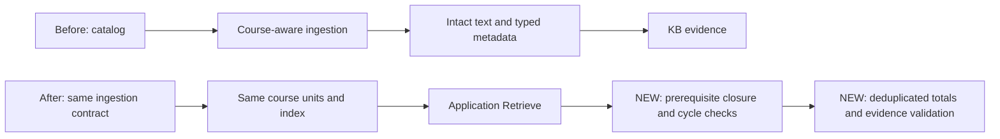

# Decision: course-aware custom chunking

> **Execution update — 2026-11-28:** This preserved design/plan is not the execution ledger. Phases 1–8 passed local acceptance; a limited phase-9 live journey passed before the reference infrastructure was destroyed on 2026-11-26. External search, React, model comparison and full cost acceptance remain pending. See [version history](../implementation/version-history.md) and [runtime](../implementation/guided-runtime.md). Earlier current/future wording below describes the pre-execution snapshot.

[Documentation](../README.md) · [Knowledge pipeline](../knowledge-pipeline.md) · [Implementation](../code-reference.md)

**Status:** implemented. Bedrock default parser + built-in NONE + POST_CHUNKING transformation Lambda.

## Context and measured source

The catalog contains 40 courses, ten tracks and nine fixed fields per course. Course ID headings identify record boundaries. Each evidence body includes its Course ID heading and complete fields. Reproducible whitespace-word counts are 77–97 words with median 82. These are words, not model tokens; tokenizer lengths were not measured. The retrieval objective combines career-transition planning with precise course/prerequisite queries.

Reproduce the measurements from the source implementation:

```python
from pathlib import Path
from statistics import median
from ingestion.course_chunker import chunk_catalog
courses = [c for c in chunk_catalog(Path("internal_courses.md").read_text()) if c["contentMetadata"]["record_type"] == "course"]
lengths = [len(c["contentBody"].split()) for c in courses]
print(len(courses), min(lengths), max(lengths), median(lengths))
```

The original text fields can be extracted; they simply were not independent filterable metadata before transformation. Course title/level/prerequisite relationships should stay together rather than depend on a token window crossing the right boundary.

## Alternatives

Default/fixed windows are simple and useful baselines, but can split one course across evidence units or combine multiple courses. A larger fixed window does not guarantee record alignment. Overlap can improve cross-boundary context while duplicating unrelated course text. Hierarchical splitting can return broader parent context but does not guarantee that a parent equals one course. Semantic splitting can follow topic shifts, adds embedding-related processing, and still does not guarantee fixed record boundaries. These are structural reasons for this choice, not benchmark results proving those alternatives perform worse.

Automatically exporting one source file per course and using NONE is a valid alternative, including for large catalogs when automated. Keeping one source file is an ingestion contract choice, not a claim that many source objects are impossible or inherently unscalable.

## Decision

The custom hook detects Course ID boundaries, validates schema and prerequisites, and returns each entire course with typed metadata. There is no overlap between courses. Two separate context units preserve the catalog-wide preamble and final notes. Current output is 42 evidence units inside intermediate transport batches, not forty new source files. Chunking decides evidence units; batching decides transport grouping.

The runtime limits parsed data to 2 MB/20 batches and individual course/context records to 6,000 characters. Invalid, unsupported and oversized records fail rather than truncate. Growth beyond this contract needs deliberate bounded processing and within-course splitting. No ten-thousand-course capacity claim is made.

## Consequences and validation

Retrieval can filter by course_id, exact level, track and numeric duration without losing the corresponding complete text. Total-plan duration, prerequisite closure and out-of-scope refusal still need application logic. Metadata alone does not implement those requirements.

Local tests verify distinct complete records, invalid-schema failures, metadata, deterministic packaging and Bedrock event adaptation. The reference environment's real ingestion produced 40 course units plus two contexts and passed its initial labelled retrieval/filter checks. That is implementation evidence, not a comparative chunking benchmark or end-to-end generation acceptance. A new catalog/embedding/index configuration requires renewed coverage and ranking evaluation.

[AWS transformation contract](https://docs.aws.amazon.com/bedrock/latest/userguide/kb-custom-transformation.html) defines NONE/custom-hook integration.

## Relationship to the agreed redesign (2026-11-26)

**Before redesign — implemented:** The course-aware ingestion decision and its evidence above remain the baseline.

**After redesign — agreed, not implemented:** [Guided Career Planning Redesign](guided-career-planning-redesign.md) changes intake, retrieval, planning and validation while retaining this parser/NONE/custom-transformation design initially. Prerequisite closure and plan-hour checks belong to application logic. Future filterable skill metadata would require a separately reviewed extraction/reprocessing change; this decision does not claim that such metadata exists.

**Before/after boundary example (design only):**



The new checks run at plan time, not inside the ingestion hook. A direct prerequisite list is not a complete dependency graph; an internal course ID must still resolve to actual catalog evidence.
