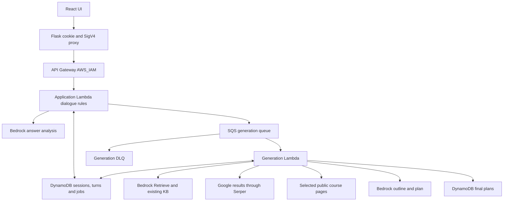

# Guided Career Planning Redesign

[Documentation](../README.md) · [Current architecture](../architecture.md) · [Current API](../api.md) · [Knowledge pipeline](../knowledge-pipeline.md)

**Status: agreed design; not implemented. Recorded: 2026-11-26.**
This English reference documents future behavior. It does not deploy resources, change code or run Sync. Examples are illustrative, not live responses. Existing behavior remains documented alongside dated redesign notes.

## 1. Purpose and boundaries

The roadmap comes first: capabilities, progression, practice and completion criteria. Courses support it. Prefer suitable internal courses, supplementing gaps with evidenced external resources. Catalog coverage is not the boundary of the technology industry.

Version one supports creating, reviewing, saving, downloading and revising plans. Progress tracking, accounts/JWT, cross-device recovery, a complete job-to-skill matrix and agent loops are excluded. The user builds React; Flask remains the server-side cookie/SigV4 proxy and Application Lambda owns dialogue and planning. Never expose AWS credentials or search keys to browser code.

## 2. Implemented baseline and evidence

The form currently sends current_role and goal to POST /generate-plan under prod. The inline CloudFormation handler calls RetrieveAndGenerate with five results and maxTokens=800, without filters, reranking or overrideSearchType. Do not describe it as explicitly forced SEMANTIC. Its prompt asks for courses, skills, a 3–6-month timeline and additional resources. Code does not enforce prerequisite closure, total hours or catalog-only output. Successful text/citations are persisted; dialogue sessions, structured roadmap validation and a citation inspector are absent.

The synthetic version-2.0 catalog contains forty courses in ten tracks. Default parser, built-in NONE and POST_CHUNKING transformation yield forty course units and two contexts. Titan v2 uses 1024 dimensions, unrelated to generation output tokens. Skills/audiences/outcomes remain text; IDs/levels/hours/prerequisites have metadata.

During design review eight local ingestion tests passed and forty course bodies matched saved output. Saved AWS evidence dated 2026-11-25 showed COMPLETE ingestion, zero failed documents, 42 indexed records and expected IDs in Top-5 for thirteen labelled cases, plus a fourteenth out-of-coverage case. This is historical limited evidence, not a new live inspection, comparative benchmark or generation acceptance.

## 3. Why a Smart Wizard

A model call after each conversational answer does not imply InvokeAgent or an agent loop. The existing bedrock-agent-runtime client name does not establish Agent usage.

A single form is simple but can overload users; a rules-only wizard has predictable branching. The selected Smart Wizard keeps objectives, eligibility, budgets and stopping rules in code while the model interprets answers and proposes wording. An agent loop would delegate more tool/step selection to the model; neither Bedrock Agents nor AgentCore is required here. More calls do not guarantee better plans. Language interpretation remains probabilistic; code controls routing and limits.

## 4. Journey and question policy

### 4.1 Objectives and limits

Direction/practical goal → current capabilities → learning constraints → review → roadmap.

Allow up to ten core questions and four follow-ups, at most two follow-ups per axis. Review is outside the information-question budget. Stop early, skip answered objectives and let one answer fill multiple slots.

Core objectives: current work, direction, practical outcome, three goal-relevant capability objectives, weekly hours, deadline/flexibility, language and budget/subscriptions. Backend/cloud/RAG questions are not universal requirements for other goals.

Versioned question definitions include ID, axis, purpose, allowed fields, eligibility/dependencies, answer type, fallback wording and completion/follow-up rules. Support “not sure”; uncertainty is not lack of skill. Follow-ups require consequential missing information. Check budgets before issuing/persisting a question; re-delivery does not increase counters. At the cap, expose unknowns and assumptions. An unresolved goal requires an explicit user choice during review before specialized generation, not extra uncounted questioning. Edits invalidate dependent facts and prior approval.

Experience remains self-reported, with optional practical examples rather than pass/fail tests. Model confidence is not calibrated evidence of correctness.

### 4.2 Backend → GenAI/RAG evaluation fixture

1. Current work: Node.js backend developer for three years.
2. Goal: “Move into AI.”
3. One direction follow-up: applications with models, model training, infrastructure or exploration? Applications.
4. Desired outcome: document Q&A with sources.
5. Independent practice: production Node.js APIs and SQL.
6. Cloud practice: tried Lambda; limited IAM/deployment.
7. AI practice: model API only, no RAG.
8. Weekly time: six hours.
9. Deadline: twelve weeks, flexible.
10. Content language: English.
11. Budget: prefer internal/free resources; an existing subscription is available.

Ten core questions plus one follow-up, then review. Show declared experience, gaps, 72-hour capacity and editable assumptions.

AIML-001=12 hours, CLD-001=12 and AIML-201=24: 48 course hours. An additional 24 practice hours is a planning estimate, not guaranteed completion. AIML-201 requires AIML-001, BKE-201 and CLD-001. Substituting experience for BKE-201 and its chain requires explicit user-confirmed assumptions, not just title or tenure. Deduplicate prerequisites.

### 4.3 Results

Each phase shows purpose, rationale, capabilities, practice, completion criteria, resources, time and evidence. “Less time,” “I know this skill” and “replace this resource” create immutable revisions showing consequences. Downloads retain assumptions and sources.

## 5. Skills configuration

Small versioned configuration lives with the Application Lambda package, separate from the handler, not in another database or KB. Code loads/selects relevant definitions and includes them in model context; the model does not open files.

```json
{
  "schema_version": "1.0",
  "skill_id": "rag_retrieval",
  "label": "Evidence retrieval for a RAG application",
  "capability": "Inspects retrieved evidence and evaluates its relevance to the question",
  "aliases": [
    "retrieval evaluation"
  ],
  "related_course_ids": [
    "AIML-201"
  ],
  "question_objectives": [
    "Understand experience inspecting document-search results"
  ]
}
```

Begin with reviewed shared capabilities from the catalog, not exhaustive role requirements. Novel plan-local skills remain drafts and never automatically modify shared configuration. Broader goals require evidence and explicit coverage limits.

Skills Covered supports gap matching but is free text: no filtering on nonexistent skill_ids. Audience/track are relevance signals, level describes the course rather than the learner, prerequisites govern foundations, durations support arithmetic, descriptions/outcomes support practice, and IDs/versions/hashes provide provenance. Do not duplicate course hours or prerequisite truth in configuration.

No ingestion changes initially. Future filterable metadata requires extraction changes and reprocessing verified by Retrieve. Publishing Lambda alone does not update the index; incremental Sync can skip unchanged sources. Changing chunkingConfiguration requires a new source; embedding-dimension changes need a compatible index/migration. Not every field addition requires recreating the KB.

## 6. Architecture and anonymous sessions



Lambda remains stateless. Reuse clients/static configuration, never user state in execution memory. DynamoDB is authoritative; the browser retains cookie and display/draft state.

### 6.1 Access and lifecycle

Use a high-entropy opaque cookie token validated server-side, not session_id/user_id alone. This authorizes an anonymous session, not employee identity; no accounts/JWT. Use HttpOnly, SameSite=Lax and Secure under HTTPS, explicit localhost HTTP development behavior and Origin checks on mutations. No tokens in URLs/logs. React calls same-origin Flask; Flask forwards session proof in signed cloud requests.

Resume in the same browser for seven days after activity. Enforce expiry on reads/writes; TTL cleanup is asynchronous. Starting fresh remains available. Cookie loss/device change does not recover old sessions. Existing final-plan retention remains without a new TTL, but expired session proof cannot access retained plans; downloads provide user retention.

### 6.2 Records

Separate state, turns and jobs in a new sessions table, avoiding unbounded item growth. Temporary records receive session-related TTLs. Persist stage, current question, profile/provenance, assumptions/unknowns, counters, state/definition versions, approved review and linked jobs/plans.

Turns retain displayed wording/ID, answer, request ID, timestamps, provenance and processing result. Avoid full-answer CloudWatch logging. Distinguish user_reported, inferred and user-confirmed assumptions; edits invalidate derived decisions.

### 6.3 Turn cycle

Validate session, expiry, question and version; check request_id and conditionally claim processing before a model call. Reject reused IDs with different content. Replay completed results; report processing for in-flight duplicates; reject stale versions.

Send relevant definitions, structured facts, current question and latest answer, not the entire transcript/catalog. One analysis call proposes facts/wording; code validates and selects an eligible next question or fallback. Persist answer/state/counters/next question with a new version before display. Failure cannot silently approve partial facts or skip a question.

Claims expire with bounded recovery. Idempotency prevents duplicate application and limits duplicate work; exactly-once external billing is not guaranteed after a lost response.

## 7. Proposed JSON contracts, version 1.0

JSON Schema draft 2020-12 structures plus semantic rules follow. Allowed fact keys/types/values are versioned question configuration, not arbitrary model choices.

### 7.1 Dialogue

Request schema and example; session proof is separate:

```json
{
  "$schema": "https://json-schema.org/draft/2020-12/schema",
  "$id": "urn:aicc:answer-request:1",
  "type": "object",
  "additionalProperties": false,
  "required": [
    "question_id",
    "answer",
    "state_version",
    "request_id"
  ],
  "properties": {
    "question_id": {
      "type": "string",
      "minLength": 1
    },
    "answer": {
      "type": "string",
      "minLength": 1,
      "maxLength": 4000
    },
    "state_version": {
      "type": "integer",
      "minimum": 1
    },
    "request_id": {
      "type": "string",
      "minLength": 1,
      "maxLength": 128
    }
  }
}
```

```json
{
  "question_id": "cloud_practice",
  "answer": "I have tried Lambda, but my IAM experience is limited",
  "state_version": 6,
  "request_id": "example-turn-007"
}
```

Response schema and example:

```json
{
  "$schema": "https://json-schema.org/draft/2020-12/schema",
  "$id": "urn:aicc:dialogue-response:1",
  "type": "object",
  "additionalProperties": false,
  "required": [
    "schema_version",
    "state_version",
    "stage",
    "status",
    "next_question",
    "review"
  ],
  "properties": {
    "schema_version": {
      "const": "1.0"
    },
    "state_version": {
      "type": "integer",
      "minimum": 1
    },
    "stage": {
      "enum": [
        "direction",
        "starting_point",
        "constraints",
        "review",
        "planning",
        "complete"
      ]
    },
    "status": {
      "enum": [
        "awaiting_answer",
        "review_required",
        "ready_to_generate",
        "planning",
        "complete"
      ]
    },
    "next_question": {
      "oneOf": [
        {
          "type": "null"
        },
        {
          "type": "object",
          "additionalProperties": false,
          "required": [
            "question_id",
            "text",
            "answer_type",
            "options",
            "allow_unknown",
            "optional"
          ],
          "properties": {
            "question_id": {
              "type": "string",
              "minLength": 1
            },
            "text": {
              "type": "string",
              "minLength": 1
            },
            "answer_type": {
              "enum": [
                "text",
                "single_choice",
                "multiple_choice",
                "number"
              ]
            },
            "options": {
              "type": "array",
              "items": {
                "type": "string"
              }
            },
            "allow_unknown": {
              "type": "boolean"
            },
            "optional": {
              "type": "boolean"
            }
          }
        }
      ]
    },
    "review": {
      "oneOf": [
        {
          "type": "null"
        },
        {
          "type": "object",
          "required": [
            "summary",
            "assumptions",
            "unresolved"
          ],
          "additionalProperties": false,
          "properties": {
            "summary": {
              "type": "string"
            },
            "assumptions": {
              "type": "array",
              "items": {
                "type": "string"
              }
            },
            "unresolved": {
              "type": "array",
              "items": {
                "type": "string"
              }
            }
          }
        }
      ]
    }
  }
}
```

```json
{
  "schema_version": "1.0",
  "state_version": 7,
  "stage": "starting_point",
  "status": "awaiting_answer",
  "next_question": {
    "question_id": "rag_practice",
    "text": "Have you only used a model API, or have you searched documents and inspected retrieved sources?",
    "answer_type": "text",
    "options": [],
    "allow_unknown": true,
    "optional": false
  },
  "review": null
}
```

React serializes choices/numbers into the documented text representation; server-side question rules validate it. awaiting_answer requires a question; review_required requires a review and no question. Review approval binds to state_version and is invalidated by edits.

### 7.2 Model analysis

```json
{
  "$schema": "https://json-schema.org/draft/2020-12/schema",
  "$id": "urn:aicc:answer-analysis:1",
  "type": "object",
  "additionalProperties": false,
  "required": [
    "facts",
    "unresolved",
    "suggested_followup_id",
    "suggested_question_text"
  ],
  "properties": {
    "facts": {
      "type": "array",
      "items": {
        "type": "object",
        "additionalProperties": false,
        "required": [
          "key",
          "value",
          "source_question_id",
          "basis"
        ],
        "properties": {
          "key": {
            "type": "string",
            "minLength": 1
          },
          "value": {
            "type": [
              "string",
              "number",
              "boolean",
              "null"
            ]
          },
          "source_question_id": {
            "type": "string",
            "minLength": 1
          },
          "basis": {
            "enum": [
              "user_reported",
              "inferred"
            ]
          }
        }
      }
    },
    "unresolved": {
      "type": "array",
      "items": {
        "type": "string"
      }
    },
    "suggested_followup_id": {
      "type": [
        "string",
        "null"
      ]
    },
    "suggested_question_text": {
      "type": [
        "string",
        "null"
      ]
    }
  }
}
```

```json
{
  "facts": [
    {
      "key": "aws_lambda_practice",
      "value": "has_tried",
      "source_question_id": "cloud_practice",
      "basis": "user_reported"
    },
    {
      "key": "iam_practice",
      "value": "limited",
      "source_question_id": "cloud_practice",
      "basis": "user_reported"
    }
  ],
  "unresolved": [],
  "suggested_followup_id": null,
  "suggested_question_text": null
}
```

The model cannot edit counters, version, TTL, ownership or approval. Accept only authorized fields/values with actual session sources. inferred is not user confirmation. If wording conflicts with the question code permits after merging facts, use fallback without another model call.

### 7.3 Roadmap

Resources and evidence are referenced entities, not facts parsed later from prose.

```json
{
  "$schema": "https://json-schema.org/draft/2020-12/schema",
  "$id": "urn:aicc:career-plan:1",
  "type": "object",
  "additionalProperties": false,
  "required": [
    "schema_version",
    "plan_id",
    "revision",
    "profile_version",
    "goal",
    "starting_point",
    "assumptions",
    "phases",
    "resources",
    "evidence",
    "time_budget",
    "coverage_gaps"
  ],
  "properties": {
    "schema_version": {
      "const": "1.0"
    },
    "plan_id": {
      "type": "string",
      "minLength": 1
    },
    "revision": {
      "type": "integer",
      "minimum": 1
    },
    "profile_version": {
      "type": "integer",
      "minimum": 1
    },
    "goal": {
      "type": "string",
      "minLength": 1
    },
    "starting_point": {
      "type": "string"
    },
    "assumptions": {
      "type": "array",
      "items": {
        "type": "string"
      }
    },
    "phases": {
      "type": "array",
      "minItems": 1,
      "items": {
        "$ref": "#/$defs/phase"
      }
    },
    "resources": {
      "type": "array",
      "items": {
        "$ref": "#/$defs/resource"
      }
    },
    "evidence": {
      "type": "array",
      "items": {
        "$ref": "#/$defs/evidence"
      }
    },
    "time_budget": {
      "type": "object",
      "additionalProperties": false,
      "required": [
        "weekly_hours",
        "target_weeks",
        "known_course_hours",
        "estimated_practice_hours",
        "unestimated_resource_ids",
        "fit_status"
      ],
      "properties": {
        "weekly_hours": {
          "type": [
            "number",
            "null"
          ],
          "exclusiveMinimum": 0
        },
        "target_weeks": {
          "type": [
            "number",
            "null"
          ],
          "exclusiveMinimum": 0
        },
        "known_course_hours": {
          "type": "number",
          "minimum": 0
        },
        "estimated_practice_hours": {
          "type": "number",
          "minimum": 0
        },
        "unestimated_resource_ids": {
          "type": "array",
          "items": {
            "type": "string"
          }
        },
        "fit_status": {
          "enum": [
            "estimated_fit",
            "exceeds",
            "unknown"
          ]
        }
      }
    },
    "coverage_gaps": {
      "type": "array",
      "items": {
        "type": "string"
      }
    }
  },
  "$defs": {
    "phase": {
      "type": "object",
      "additionalProperties": false,
      "required": [
        "phase_id",
        "title",
        "depends_on",
        "skills",
        "outcomes",
        "resource_ids",
        "practice",
        "completion_criteria"
      ],
      "properties": {
        "phase_id": {
          "type": "string",
          "minLength": 1
        },
        "title": {
          "type": "string",
          "minLength": 1
        },
        "depends_on": {
          "type": "array",
          "items": {
            "type": "string"
          }
        },
        "skills": {
          "type": "array",
          "minItems": 1,
          "items": {
            "type": "string"
          }
        },
        "outcomes": {
          "type": "array",
          "minItems": 1,
          "items": {
            "type": "string"
          }
        },
        "resource_ids": {
          "type": "array",
          "items": {
            "type": "string"
          }
        },
        "practice": {
          "type": "object",
          "additionalProperties": false,
          "required": [
            "description",
            "estimated_hours"
          ],
          "properties": {
            "description": {
              "type": "string"
            },
            "estimated_hours": {
              "type": "number",
              "minimum": 0
            }
          }
        },
        "completion_criteria": {
          "type": "array",
          "minItems": 1,
          "items": {
            "type": "string"
          }
        }
      }
    },
    "resource": {
      "type": "object",
      "additionalProperties": false,
      "required": [
        "resource_id",
        "kind",
        "course_id",
        "title",
        "url",
        "duration_hours",
        "prerequisite_status",
        "reason",
        "evidence_ids"
      ],
      "properties": {
        "resource_id": {
          "type": "string",
          "minLength": 1
        },
        "kind": {
          "enum": [
            "internal",
            "external"
          ]
        },
        "course_id": {
          "type": [
            "string",
            "null"
          ]
        },
        "title": {
          "type": "string",
          "minLength": 1
        },
        "url": {
          "type": [
            "string",
            "null"
          ],
          "format": "uri"
        },
        "duration_hours": {
          "type": [
            "number",
            "null"
          ],
          "minimum": 0
        },
        "prerequisite_status": {
          "enum": [
            "none",
            "included",
            "user_confirmed_equivalence",
            "unresolved"
          ]
        },
        "reason": {
          "type": "string",
          "minLength": 1
        },
        "evidence_ids": {
          "type": "array",
          "minItems": 1,
          "items": {
            "type": "string"
          }
        }
      }
    },
    "evidence": {
      "type": "object",
      "additionalProperties": false,
      "required": [
        "evidence_id",
        "source",
        "uri",
        "retrieved_at",
        "catalog_version",
        "parsed_source_sha256",
        "course_id",
        "supported_fields"
      ],
      "properties": {
        "evidence_id": {
          "type": "string",
          "minLength": 1
        },
        "source": {
          "enum": [
            "internal_catalog",
            "search_snippet",
            "course_page"
          ]
        },
        "uri": {
          "type": "string",
          "format": "uri"
        },
        "retrieved_at": {
          "type": "string",
          "format": "date-time"
        },
        "catalog_version": {
          "type": [
            "string",
            "null"
          ]
        },
        "parsed_source_sha256": {
          "type": [
            "string",
            "null"
          ]
        },
        "course_id": {
          "type": [
            "string",
            "null"
          ]
        },
        "supported_fields": {
          "type": "array",
          "minItems": 1,
          "items": {
            "type": "string"
          }
        }
      }
    }
  }
}
```

This complete shape example covers only a foundation segment, not an entire career-transition plan. URI/time are illustrative, not live retrieval evidence.

```json
{
  "schema_version": "1.0",
  "plan_id": "example-plan",
  "revision": 1,
  "profile_version": 12,
  "goal": "Start building the foundations for a document-grounded RAG application",
  "starting_point": "Self-reported backend experience; AI foundations are needed",
  "assumptions": [
    "Self-reported experience is not a certified assessment"
  ],
  "phases": [
    {
      "phase_id": "p1",
      "title": "AI foundations and evaluation",
      "depends_on": [],
      "skills": [
        "ai_literacy",
        "responsible_evaluation"
      ],
      "outcomes": [
        "Distinguish RAG from training and identify unsupported claims"
      ],
      "resource_ids": [
        "internal:AIML-001"
      ],
      "practice": {
        "description": "Prepare an evaluation checklist and review unsupported-answer examples",
        "estimated_hours": 4
      },
      "completion_criteria": [
        "Explain why convincing wording does not establish answer correctness"
      ]
    }
  ],
  "resources": [
    {
      "resource_id": "internal:AIML-001",
      "kind": "internal",
      "course_id": "AIML-001",
      "title": "AI Literacy and Responsible Evaluation",
      "url": null,
      "duration_hours": 12,
      "prerequisite_status": "none",
      "reason": "Covers AI and evaluation foundations needed before building the application",
      "evidence_ids": [
        "e1"
      ]
    }
  ],
  "evidence": [
    {
      "evidence_id": "e1",
      "source": "internal_catalog",
      "uri": "s3://example-catalog-bucket/internal_courses.md",
      "retrieved_at": "2026-11-26T10:00:00Z",
      "catalog_version": "2.0",
      "parsed_source_sha256": "abdd9581340c582527b90a903cb116fe39e529a4e7d1e247f80eabad1aa69336",
      "course_id": "AIML-001",
      "supported_fields": [
        "title",
        "duration_hours",
        "prerequisites",
        "skills",
        "outcomes"
      ]
    }
  ],
  "time_budget": {
    "weekly_hours": 6,
    "target_weeks": 12,
    "known_course_hours": 12,
    "estimated_practice_hours": 4,
    "unestimated_resource_ids": [],
    "fit_status": "estimated_fit"
  },
  "coverage_gaps": [
    "This example does not cover the remaining cloud and RAG pathway"
  ]
}
```

Check unique/existing references, acyclic graphs and deduplicated hours. Internal resources require real IDs and matching catalog version/hash; external resources require evidence-derived allowed URLs and null course_id. Every selected resource needs a phase, reason and evidence. A citation is not proof of every claim: supported_fields must agree with source content.

Durations are sourced or null, never inferred from level. Code recomputes hours/practice/fit. Unknown durations prevent complete time-fit claims; estimated_fit is not a readiness guarantee. included requires prerequisite inclusion/order; user_confirmed_equivalence requires approved assumptions; unresolved stays visible. Valid JSON does not establish advice quality or competence.

## 8. Interfaces and compatibility

Proposed cloud routes under /v2 inside the existing stage are proxied by Flask. All retain AWS_IAM and server-validated session proof.

- POST /v2/sessions: 201, first question; Flask sets the token cookie without exposing it to React.
- GET /v2/sessions/{session_id}: saved state/question/review.
- POST /v2/sessions/{session_id}/answers: answer contract; 200 completed or 202 processing for an in-flight duplicate.
- POST /v2/sessions/{session_id}/review: state_version, confirmed_assumption_ids; approve/correct without guessing an unresolved goal.
- POST /v2/sessions/{session_id}/plans: request_id and approved profile_version; 202 and job_id.
- GET /v2/sessions/{session_id}/jobs/{job_id}: state, work stage and completed plan/revision; no invented percentages.
- GET /v2/sessions/{session_id}/plans/{plan_id}?revision=1: authorized structured plan, also used for Markdown/JSON download.
- POST /v2/sessions/{session_id}/plans/{plan_id}/revisions: request_id, base_revision, approved profile_version and change request; 202 plus new job, preserving history.

Errors have safe code/message/request_id: 400 input, 403 unauthorized, 404 missing authorized-scope resource, 409 conflict, 410 expired authorized session, 429 rate limit and 503 temporary service failure. Do not return provider exceptions or secrets.

Keep POST /generate-plan and its text contract/model budgets intact during migration. Structured output must not pass through the old numbered-text regex.

## 9. Retrieval and external evidence

### 9.1 Responsibilities

Approved profile → draft capabilities/phases → retrieve → match/rank → prerequisite closure → generate → validate/save. The outline is not an authoritative occupational standard. Missing resources cause explicit gaps or outline changes, never invented courses. Models help interpret relevance and explain; code owns IDs, filters, bounds, arithmetic and dependencies.

### 9.2 Internal retrieval

Initial experiment, not current production configuration:

```json
{
  "vectorSearchConfiguration": {
    "numberOfResults": 15,
    "overrideSearchType": "SEMANTIC",
    "filter": {
      "equals": {
        "key": "record_type",
        "value": "course"
      }
    }
  }
}
```

Build focused queries from goal/gaps. Retain text, metadata, locations, rank, score and settings for evaluation; scores are not calibrated relevance probabilities or universal refusal thresholds.

Deduplicate course ID/version/hash and flag mixed versions. Fetch prerequisites by ID with visited sets and explicitly configured depth/request bounds before activation; reaching bounds reports incomplete coverage. Handle catalog_context separately, not as courses or occupational-readiness proof.

No strict track/level filters by default. Respect explicit hard constraints and expose conflicts rather than silently relaxing them. A per-course duration limit does not enforce total hours; direct prerequisites are not closure. Defer Hybrid/reranking/embedding/chunking changes until measured; verify actual mapping/text support before HYBRID.

### 9.3 Google via Serper

Use Serper, an independent provider of Google results; no Gemini or obsolete Custom Search integration. Search after identifying goal/gaps, not every answer. Cap each plan/revision at three search requests, five candidates per request and five selected public-page reads. Retries consume budget; no unbounded paging or reformulation.

Send generic topic/level/language queries, never raw answers or personal/company/document information. Prefer provider/original technical pages. Search rank is not pedagogical rank.

Bound fetch time, bytes and redirects; block local/private/link-local/metadata destinations and validate DNS/redirects. No JavaScript/browser execution, login bypass or CAPTCHA circumvention. Inaccessible pages remain limited-evidence snippet candidates.

Treat content as untrusted data, not prompt/tool instructions. Extract only supported title/provider/skills/hours/prerequisites/language/price; unknowns stay unknown. Retrieval time differs from published course-update time. Retain needed evidence excerpts, links and field provenance, not default full-page archives or a permanent external catalog. Search failure allows explicit partial coverage, not memory-based “verified” courses.

## 10. Background generation and models

### 10.1 Jobs

Current API/Lambda/Flask limits are 30/60/35 seconds. Add SQS, a dedicated generation worker and a separate generation DLQ. Persist job/approved immutable snapshot, enqueue identifiers and return 202. No tokens/secrets/transcripts in messages.

States are queued/running/completed/failed; work stages include retrieval/external_search/generation/validation. Initial worker timeout 180 seconds, batch size one, zero batch window, visibility timeout at least 1080 seconds; measure before acceptance.

Job claims prevent parallel generation and completed-job redelivery does not regenerate. DynamoDB and SQS dispatch are not atomic: persist recoverable dispatch state; repeated request IDs reuse jobs and retry missing dispatch. An enqueue failure is not guaranteed delivery.

Bound lease/retry recovery and detect stalled jobs. DLQ state does not replace business status. Edits do not mutate in-flight snapshots; identify results built from older profiles. completed follows validation and final save. Store plan ID/revision/profile version alongside existing table keys.

### 10.2 Models and budgets

Haiku 4.5 is the initial candidate; compare Nova/Sonnet on equal profiles/evidence. The local template lists Nova Lite v1, Haiku 4.5 and Sonnet 4.5, not Sonnet 4.6.

Start final plans at 2048 output tokens, experimental temperature 0.2, without simultaneous topP tuning or default extended thinking. Intake/outline budgets are smaller independent measured settings; output caps are not context limits.

Allow one repair of truncated/invalid final output, optionally at 4096 tokens. Do not rerun the entire retrieval flow for JSON repair. Subsequent failure is explicit, not partial success.

Support foundation-model IDs and inference-profile ARNs correctly, including destination-model permissions. Do not insert a profile ARN inside a foundation-model ARN. Template/Console availability is not successful runtime-role invocation evidence.

### 10.3 Permissions, secrets and packaging

Scope handler rights to sessions, analysis and queue submission. Scope worker rights to snapshots/jobs, plan writes, Retrieve/model calls and the Serper secret. Do not inherit deployer/ingestion administration.

Keep Serper in Secrets Manager and pass its ARN, not plaintext. No tokens/secrets/raw answers in logs. Package application runtime/config separately from ingestion, update setup/artifact handling and permit app-only releases without unnecessary KB recreation/Sync. Artifacts stay outside source inclusion.

## 11. Evaluation and acceptance

### 11.1 Dialogue/sessions/contracts

Test the fixture, expert multi-slot answers, uncertainty and non-backend goals. Verify question caps/skipping/edits/ambiguity, invalid fields/questions/source-free facts, cookie/expiry/resume/new-session behavior, duplicate/concurrent/stale submissions, ID reuse with different content and failures around model calls/state commits. Validate schemas, references, DynamoDB numbers and bounded item sizes.

### 11.2 Retrieval before generation

Preserve the original prompt/settings/catalog/model/ranks as baseline, not an altered SEMANTIC approximation. Include Arabic/English equivalents, exact IDs, direct/transitive prerequisites, transitions, impossible constraints, catalog gaps and out-of-product goals.

SEC-201 should match identity/authentication/authorization, with SEC-101 and BKE-101, whose prerequisite is SDE-101. Complete closure is 68 hours without equivalence: twenty per course does not mean twenty total. RAG goals should consider AIML-201 and its chains, not automatically require fine-tuning. Missing IDs/impossible filters cannot invent courses or relax constraints. Internal gaps trigger external evidence or explicit partial coverage; nontechnical requests are not forced into technical roadmaps.

Compare factors separately. Recall@k and MRR@k require equal k; measure precision/relevance, duplicates, closure and coverage. A fifteen-result pool alone does not demonstrate better ranking. Explain Top-5/Top-10 evaluation of larger pools. Verify Hybrid mapping and rerank equal pools with cost/latency. Historical fourteen-case evidence is not a redesign benchmark.

### 11.3 Search/worker/plan

Exercise empty/rate-limited/failed searches, duplicate links, forbidden redirects, huge/login/CAPTCHA pages, prompt injection, unknown prices/hours and fabricated citations. Test SQS redelivery, claim/dispatch/provider/save failures, DLQ, concurrent profile edits and bounded repair. No false completion or undetected permanently running job.

Evaluate progression/practice/criteria independently of JSON. Acceptance requires zero invented internal IDs or hard-constraint violations in the labelled set, traceable evidence and reproducible arithmetic; do not claim success without recorded results.

## 12. Observability, costs and rollout

For the concrete execution order, phase-specific acceptance and new-chat handoffs, use [Implementation Phases](../implementation/guided-career-planning-redesign-phases.md). That execution breakdown supplements this design without marking any component implemented.

Measure turn/provider/token costs where available, job waiting/work stages, completion/abandonment/follow-up counts and total journey cost including failures/repairs. Correlate request/job IDs without raw user logs. Persistent OpenSearch costs remain.

Do not reuse the [one-request Nova estimate](../costs.md) for this design. Include intake/outline/final/repair, Serper/page reading, Lambda/API/DynamoDB/SQS/Secrets Manager/logs and existing infrastructure. Do not assume credits or unmeasured price/quality/latency.

1. Documentation, contracts, journey fixtures and temporal status notes.
2. Reviewed definitions/engine, application packaging, sessions and intake APIs; setup independent of ingestion.
3. Retrieve, search/page evidence, queue/worker, validation and immutable revisions.
4. React contracts and Flask proxy/download/waiting/error integration; no legacy text parser as validator.
5. Local/infrastructure checks, then separately authorized live retrieval-before-generation and cost/latency acceptance, followed by intentional cutover. Update implemented status only after evidence.

Future rollback restores prior application/worker artifacts and the legacy route/UI, stops new jobs as needed and does not delete the KB or retained data. Publishing these documents does not deploy anything.

### 12.1 Pre-activation readiness

Record reviewed skills/questions, prerequisite depth/request limits, intake/outline/timeouts, fetch limits/domains, SQS retry/claim recovery, verified account model/profile configuration and an acceptable measured cost budget. These readiness settings are not hidden prompt decisions or model-selected limits.

## 13. Official references

- [Transformation](https://docs.aws.amazon.com/bedrock/latest/userguide/kb-custom-transformation.html), [Sync](https://docs.aws.amazon.com/bedrock/latest/userguide/kb-data-source-sync-ingest.html), [source updates](https://docs.aws.amazon.com/bedrock/latest/APIReference/API_agent_UpdateDataSource.html).
- [Retrieval](https://docs.aws.amazon.com/bedrock/latest/APIReference/API_KnowledgeBaseVectorSearchConfiguration.html), [Converse](https://docs.aws.amazon.com/bedrock/latest/userguide/conversation-inference.html), [profiles](https://docs.aws.amazon.com/bedrock/latest/userguide/inference-profiles-use.html).
- [Lambda](https://docs.aws.amazon.com/lambda/latest/dg/best-practices.html), [DynamoDB locking](https://docs.aws.amazon.com/amazondynamodb/latest/developerguide/BestPractices_OptimisticLocking.html), [TTL](https://docs.aws.amazon.com/amazondynamodb/latest/developerguide/TTL.html), [SQS visibility](https://docs.aws.amazon.com/lambda/latest/dg/services-sqs-configure.html).
- [Serper](https://serper.dev/), [Google API status](https://developers.google.com/custom-search/v1/overview).

Recheck support/availability/pricing at deployment; references do not prove successful project integration.

