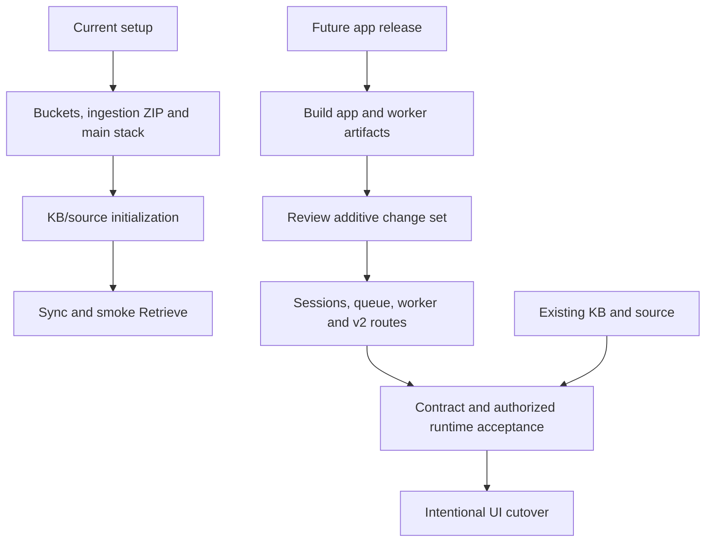
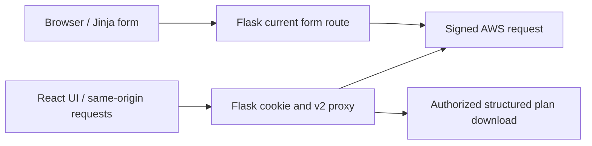

# Deployment and local startup

[Documentation](README.md) · [Security](security.md) · [Operations](operations.md) · [Cost model](costs.md)


<!-- REDESIGN_NOTE_START -->
> **Documentation timeline — 2026-11-26:** Existing paragraphs/examples below describe the implemented baseline. Each affected section also records the agreed post-redesign target, **not implemented or deployed**. See [Guided Career Planning Redesign](decisions/guided-career-planning-redesign.md). Existing commands do not deploy that target.
<!-- REDESIGN_NOTE_END -->
## Prerequisites

<!-- REDESIGN_NOTE_START -->
**Before redesign — implemented baseline:**
<!-- REDESIGN_NOTE_END -->

Use Python 3.12, AWS CLI v2 and an authenticated IAM user/role profile. The target account/Region must support Bedrock Knowledge Bases, the selected generation model, Titan Text Embeddings v2, OpenSearch Serverless and the CloudFormation Index resource. Root is unsupported for KB creation. Review [deployer permissions](security.md) and the persistent OpenSearch cost before applying.

Examples use Bash/WSL and `us-east-2` (Ohio). Replace YOUR_PROFILE and, optionally, supply `--expected-account YOUR_12_DIGIT_ACCOUNT_ID`. No account ID, access key or session token belongs in committed configuration. In PowerShell use the corresponding venv activation and environment-variable syntax.

```bash
git clone https://github.com/r-khaled/AI-career-coach.git
cd AI-career-coach
python3 -m venv .venv
source .venv/bin/activate
python -m pip install -r requirements-dev.txt
# SSO profiles: authenticate first with aws sso login --profile YOUR_PROFILE
aws sts get-caller-identity --profile YOUR_PROFILE --region us-east-2
python -m unittest discover -s tests -v
cfn-lint CloudFormation.yaml infrastructure/*.json
```

The default stack name is `career-coach-lab`; the CLI accepts 3–31 lowercase letters/digits/hyphens starting with a letter. Bucket names include account/stack but not Region. Use different stack names for environments in two Regions of the same account to prevent global S3-name collisions.


<!-- REDESIGN_NOTE_START -->
**After redesign — agreed target, not implemented (2026-11-26):** Future deployment additionally requires a Serper account/secret ARN, verified model/profile invocation, packaged application/worker artifacts and permissions for sessions/queue/worker/secret access. No new deployment is authorized by this documentation.


<!-- REDESIGN_DETAIL_START -->
**Target readiness checklist:**

- Verified Haiku/Nova/Sonnet model or profile configuration for the exact runtime role.
- Serper account, budget and Secrets Manager ARN; no key in templates or browser code.
- Versioned application/worker/configuration artifacts separate from ingestion.
- Sessions, queue/DLQ, worker and route permissions in a reviewed additive change set.

These are future prerequisites; installing today's requirements does not create them.
<!-- REDESIGN_DETAIL_END -->
<!-- REDESIGN_NOTE_END -->
## 1. Inspect the deployment plan

<!-- REDESIGN_NOTE_START -->
**Before redesign — implemented baseline:**
<!-- REDESIGN_NOTE_END -->

```bash
python -m ingestion.setup_lab setup --profile YOUR_PROFILE --region us-east-2 --stack-name career-coach-lab
```

This validates the local catalog and performs read-only account/stack/KB checks. It saves a plan under ignored `.lab/setup/<session>/`, without uploads, change sets, Sync or scheduling. Confirm account, Region, buckets, model/KB bindings and intended steps. Read-only preview cannot prove all future provisioning permissions or inference access.


<!-- REDESIGN_NOTE_START -->
**After redesign — agreed target, not implemented (2026-11-26):** Future change review must cover new resources, narrowly scoped grants, artifact versions, model/profile configuration and retained baseline resources. Do not assume the current preview includes these additions.


<!-- REDESIGN_DETAIL_START -->
```text
BEFORE REVIEW             TARGET REVIEW ADDITIONS
Catalog + ingestion ZIP   App/worker artifact hashes and versions
KB/source binding         Existing KB retained; no implicit recreation
Optional knowledge Sync   Explicit decision whether knowledge changed
Existing IAM roles        Sessions, queue, worker, secret and model-profile scopes
Baseline resource counts  Proposed additions and retained resource identities
```
<!-- REDESIGN_DETAIL_END -->
<!-- REDESIGN_NOTE_END -->
## 2. Provision and initialize

<!-- REDESIGN_NOTE_START -->
**Before redesign — implemented baseline:**
<!-- REDESIGN_NOTE_END -->

```bash
python -m ingestion.setup_lab setup --profile YOUR_PROFILE --region us-east-2 --stack-name career-coach-lab --apply --enable-schedule
```

This is the first-use automation entry point. It creates/reconciles infrastructure, uploads the catalog, initializes knowledge and configures recurring refresh; the recipient does not need to repeat the Console wizard. It does not perform a relational database migration: CloudFormation creates the DynamoDB schema and Bedrock ingestion populates the search index.

The sequence is:

1. Validate the catalog/account/Region and describe the models. Preserve existing model and KB parameters unless explicitly overridden.
2. For a new stack, apply the two-bucket bootstrap revision. Never apply the bootstrap-only template to a completed full stack.
3. Build a deterministic ingestion ZIP, upload and verify its exact S3 version/hash, and apply the main template. Both source/intermediate buckets are private, encrypted and versioned.
4. Upload and verify `internal_courses.md`. This intentionally publishes the local source content. Source inclusion excludes code artifacts.
5. Validate/reuse a configured KB, or provision `<stack>-rag` with the OpenSearch index/role/KB and data source initially gated off.
6. Update the main stack's `KnowledgeBaseId`, including the Bedrock-to-hook permission, then enable/validate the data source. Partial setup can resume.
7. Start/wait for Sync, require COMPLETE and explicit zero failed documents, then perform a bounded filtered Retrieve smoke check.
8. Bind `KnowledgeBaseDataSourceId` and schedule parameters in the main stack. Its four conditional Scheduler resources become available only after both IDs are configured.

Every infrastructure update creates/describes a change set, saves/prints all changes, rejects removals/unexpected replacement and waits for a terminal event belonging to that execution request. Only the ingestion invoke permission can be replaced during explicit KB binding. Unspecified parameters keep previous values and no-op changes succeed. Failure preserves stack/events evidence; the tool does not delete a failed baseline.

Existing external KBs are not imported into CloudFormation. Reuse requires ACTIVE vector/OpenSearch Serverless, Titan v2/FLOAT32/1024 and one AVAILABLE source matching the catalog/default parser/NONE/hook/intermediate configuration. A mismatched or unbound same-name KB stops for inspection. An existing stack using a separate CloudFormation execution role requires explicit RAG provisioning and data-plane grants for that role.


<!-- REDESIGN_NOTE_START -->
**After redesign — agreed target, not implemented (2026-11-26):** Future packaging/setup will add sessions and generation resources while reusing the existing KB. Keep app deployment separate from knowledge initialization; current commands still deploy the baseline and run Sync.


<!-- REDESIGN_DETAIL_START -->

<!-- REDESIGN_DETAIL_END -->
<!-- REDESIGN_NOTE_END -->
## Existing stacks and repeated setup

<!-- REDESIGN_NOTE_START -->
**Before redesign — implemented baseline:**
<!-- REDESIGN_NOTE_END -->

Use the setup CLI as the deployment entry point; the full main template is not the first step of a fresh installation. Its two ingestion artifact parameters are required. Omitting them prevents a valid change set, and referencing absent objects can cause resource-creation failure/rollback. A valid direct main-stack deployment still does not upload the catalog, create/reuse the KB, run Sync or bind a weekly schedule automatically. Setup performs those stages around its CloudFormation calls.

For an existing compatible environment, use the same profile/account, Region and stack name:

```bash
python -m ingestion.setup_lab setup --profile YOUR_PROFILE --region us-east-2 --stack-name career-coach-lab
python -m ingestion.setup_lab setup --profile YOUR_PROFILE --region us-east-2 --stack-name career-coach-lab --apply --enable-schedule
```

Supported reconciliation includes a new environment, a successful bucket-only bootstrap revision, the supported main stack with KB still unbound, a partial owned RAG deployment between KB binding and source creation, and a main stack already connected to a matching external KB. Existing stacks must be CREATE_COMPLETE, UPDATE_COMPLETE or UPDATE_ROLLBACK_COMPLETE. Verified matching object versions are reused; unspecified parameters and schedule settings remain; no-op change sets are accepted. The explicit enable flag intentionally sets the schedule to ENABLED.

This is infrastructure reconciliation, not an entirely side-effect-free retry: setup still checks/uploads changed content, starts or waits for Sync, performs Retrieve and writes local evidence. Use `sync --apply` when only refreshing already-uploaded data.

The wrapper is not an arbitrary legacy-stack importer or drift-repair tool. It checks both expected buckets before applying the full template to an existing stack; a legacy baseline lacking the intermediate bucket stops at that check. Missing/renamed/nonversioned/wrong-Region buckets need an explicit migration. Existing external same-name KBs without a main-stack binding, incompatible sources/models, distinct CloudFormation execution-role arrangements, failed/in-progress stacks and missing manually deleted resources may also stop rather than be adopted/recreated automatically. Inspect saved evidence and resolve the actual condition before rerunning; do not delete the base stack as a generic fix.

The read-only preview creates no AWS change set. With `--apply`, change sets are saved/printed and checked by the wrapper, then executed automatically without an interactive human-review pause. If human review before each execution is required, perform the documented bootstrap/package/main/RAG/binding stages explicitly with create/describe/execute change-set commands instead of treating preview as that approval checkpoint.


<!-- REDESIGN_NOTE_START -->
**After redesign — agreed target, not implemented (2026-11-26):** Review the future migration/change set against exact account ownership and retained parameters; avoid deleting/recreating the KB or using bootstrap as rollback. The current wrapper is not yet a redesign migrator.


<!-- REDESIGN_DETAIL_START -->
**Target migration checklist:** preserve exact resource ownership and current parameters; stage new packages/resources; validate the new path alongside the old route; switch intentionally; retain a package/route rollback. A rerun must distinguish incomplete dispatch/configuration from a request to recreate knowledge. Existing setup commands above remain baseline commands, not this migration procedure.
<!-- REDESIGN_DETAIL_END -->
<!-- REDESIGN_NOTE_END -->
## 3. Schedule configuration

<!-- REDESIGN_NOTE_START -->
**Before redesign — implemented baseline:**
<!-- REDESIGN_NOTE_END -->

`--enable-schedule` opts into Sunday 03:00 Africa/Cairo. Without a schedule flag, a new schedule is DISABLED and existing state/expression/timezone remain unchanged. Override frequency/timezone when required:

```bash
python -m ingestion.setup_lab setup --profile YOUR_PROFILE --region us-east-2 --apply --enable-schedule --schedule-expression 'cron(0 2 ? * MON *)' --schedule-timezone UTC
```

Use `--disable-schedule` for reconciliation with scheduling disabled. Setup still reconciles data and Syncs before its final schedule update; use [schedule-only operations](operations.md#verify-scheduling) when an immediate maintenance disable is required. An already-enabled schedule continues running during later setup unless deliberately disabled beforehand.

Scheduler is part of the main CloudFormation stack. It calls StartIngestionJob for an **existing** KB/source; it is not the first-time provisioning mechanism. The CLI completes the first initialization immediately rather than waiting for the first weekly trigger. [Exact ingestion behavior](knowledge-pipeline.md).


<!-- REDESIGN_NOTE_START -->
**After redesign — agreed target, not implemented (2026-11-26):** Keep weekly knowledge refresh independent. The new user-generation SQS/DLQ is not configured by SyncScheduleState and must not reuse the Scheduler delivery DLQ.


<!-- REDESIGN_DETAIL_START -->
```text
Knowledge refresh: Scheduler -> StartIngestionJob -> existing source/index
User plan creation: approved snapshot -> generation SQS -> worker
Separate DLQs: knowledge target-delivery failures != plan delivery/processing failures
Separate controls: SyncScheduleState does not pause generation jobs
```
<!-- REDESIGN_DETAIL_END -->
<!-- REDESIGN_NOTE_END -->
## 4. Verify knowledge before generation

<!-- REDESIGN_NOTE_START -->
**Before redesign — implemented baseline:**
<!-- REDESIGN_NOTE_END -->

```bash
python -m ingestion.setup_lab status --profile YOUR_PROFILE --region us-east-2 --stack-name career-coach-lab
```

Inspect job statistics/failureReasons, transformed output and expected Course IDs. The provided catalog should produce 40 course units and two contexts. COMPLETE may coexist with failed documents; the CLI explicitly rejects that. Search can lag successful ingestion, so the smoke check retries reads for index refresh without automatically starting another ingestion job.

The automated smoke check filters on one known course ID. It verifies visibility/metadata, not complete coverage, ranking quality, prerequisites or plan correctness. Evaluate representative career-transition questions and exact course/prerequisite questions, inspect complete returned evidence and test filters before generation. Instructions and an SDK Retrieve example are in [knowledge pipeline](knowledge-pipeline.md#retrieval-acceptance).


<!-- REDESIGN_NOTE_START -->
**After redesign — agreed target, not implemented (2026-11-26):** Retain COMPLETE/zero-failed-document checks, then benchmark the proposed retrieval separately at equal k. Course-body integrity alone does not validate ranking or career planning.


<!-- REDESIGN_DETAIL_START -->
**Target gate order:**

1. Preserve current catalog-body/metadata checks.
2. Capture exact original retrieval baseline and labelled IDs.
3. Evaluate focused SEMANTIC/course-only retrieval at equal k.
4. Verify prerequisite closure and constraint behavior.
5. Only then compare generated plans with evidence and time checks.
<!-- REDESIGN_DETAIL_END -->
<!-- REDESIGN_NOTE_END -->
## 5. Start Flask

<!-- REDESIGN_NOTE_START -->
**Before redesign — implemented baseline:**
<!-- REDESIGN_NOTE_END -->

Grant the local caller `execute-api:Invoke` on the main stack's ApiInvokeArn. IAM permission to deploy resources is distinct from permission to call the API. See [caller policy](security.md#local-caller).

```bash
export AWS_PROFILE=YOUR_PROFILE
export AWS_DEFAULT_REGION=us-east-2
export API_URL="$(aws cloudformation describe-stacks --stack-name career-coach-lab --profile "$AWS_PROFILE" --region "$AWS_DEFAULT_REGION" --query "Stacks[0].Outputs[?OutputKey=='ApiEndpoint'].OutputValue | [0]" --output text)"
python app.py
```

Open `http://localhost:5001` and submit a current role and goal. API_URL is loaded at startup; restart after changing it. The Flask server signs the cloud request; do not put IAM credentials in the page. There is no deployed public frontend or automatic user sign-in.


<!-- REDESIGN_NOTE_START -->
**After redesign — agreed target, not implemented (2026-11-26):** React will call same-origin Flask, which owns cookies and signed API access. Do not expose credentials or direct unsigned IAM-only API calls from browser code.


<!-- REDESIGN_DETAIL_START -->


React build/hosting integration is not implemented. Keep cloud credentials server-side; do not infer that a direct browser fetch to an AWS_IAM route works.
<!-- REDESIGN_DETAIL_END -->
<!-- REDESIGN_NOTE_END -->
## 6. Application acceptance

<!-- REDESIGN_NOTE_START -->
**Before redesign — implemented baseline:**
<!-- REDESIGN_NOTE_END -->

Confirm a real response contains plan text/citations, the DynamoDB item is written, and Lambda logs show successful execution. Test missing fields and an unsigned request separately. A proxy timeout may leave model work running; inspect before retrying. KB retrieval acceptance alone does not establish generation-model availability, citation serialization or persistence correctness. The current app does not enforce exact-level, strict-track or duration constraints.


<!-- REDESIGN_NOTE_START -->
**After redesign — agreed target, not implemented (2026-11-26):** Add same-browser session resume/expiry, question/review flow, 202 job polling, validated roadmap/download/revisions, provider failure and deduplication acceptance. Separately measure latency and complete-journey cost.


<!-- REDESIGN_DETAIL_START -->
**Target user walkthrough:** start a fresh session; answer/resume; edit an earlier fact and reapprove; submit once and observe 202; poll a bounded job; read/download the validated revision; request a change and retain the old revision. Also exercise duplicate submission, expiry, search failure and failed validation. Record actual latency, provider use and cost rather than treating the 180-second worker limit as observed duration.
<!-- REDESIGN_DETAIL_END -->
<!-- REDESIGN_NOTE_END -->
## Parameters, outputs and portability

<!-- REDESIGN_NOTE_START -->
**Before redesign — implemented baseline:**
<!-- REDESIGN_NOTE_END -->

Main parameters are FoundationModelId, KnowledgeBaseId, IngestionCodeS3Key/IngestionCodeS3ObjectVersion, KnowledgeBaseDataSourceId and SyncScheduleState/SyncScheduleExpression/SyncScheduleTimezone. The setup command derives bucket/function values from Outputs and uses account/Region references. A FoundationModelId override must be a supported model ID, not an inference-profile ARN. Keep a working generation configuration unless intentionally changing it.

Read ApiEndpoint/ApiInvokeArn, bucket names, ingestion function ARN/role/log group, intermediate URI, DynamoDB table and conditional SyncScheduleName/SyncScheduleGroup/SyncDeadLetterQueueUrl/state/expression/timezone from Outputs. Companion RAG Outputs contain KB/source IDs, collection and role ARNs. Never reuse those resource IDs across accounts. [Region/model portability](security.md#region-and-model-portability).

CloudFormation provisioning is not a test result. Local tests/schema validation and the existing deployment's ingestion verification do not prove that a new account or scheduled target has passed live acceptance. Preserve the run evidence and verify each destination environment.

<!-- REDESIGN_NOTE_START -->
**After redesign — agreed target, not implemented (2026-11-26):** Future outputs/configuration must identify session/queue/worker resources, secret ARN and correct model/profile IDs. Current FoundationModelId remains a foundation-model parameter; do not place a profile ARN inside its constructed ARN.


<!-- REDESIGN_DETAIL_START -->
```text
CURRENT INPUTS              FUTURE CONFIGURATION RESPONSIBILITIES
FoundationModelId           Separate verified intake/planner ID or profile ARN
Ingestion artifact version  Separate app/worker versions
KnowledgeBaseId/source      Retain current binding
No sessions/worker          New resource names/ARNs and scoped grants
No external-search secret   Secret ARN only, never key plaintext
```

This is a requirements mapping, not a claim that new parameter/output names already exist. Model-profile ARN handling must not reuse the old ARN concatenation blindly.
<!-- REDESIGN_DETAIL_END -->
<!-- REDESIGN_NOTE_END -->
