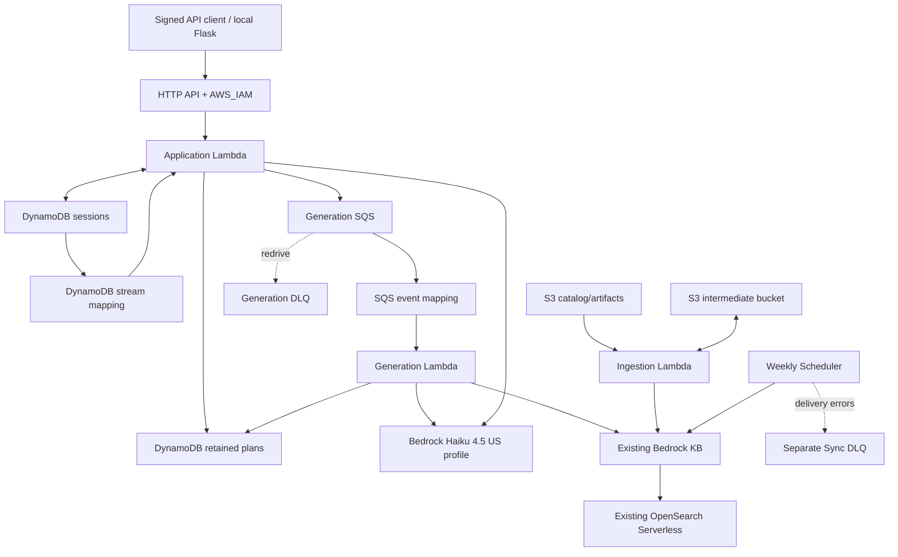

# Reference deployment and live checks

> **Current cloud status (2026-11-26):** The reference project infrastructure was destroyed at the user's request. Earlier live results and resource diagrams below are historical. Code, contracts and local artifacts remain available; no reference API is running. See [stopping point and next steps](next-steps.md).

The authorized reference stack `career-coach-lab` in `us-east-2` reached
`UPDATE_COMPLETE`. AWS returned 31 stack resources. This is evidence for this
reference environment, not a guarantee for another account.

At the time of the test, the guided API and both event-source mappings were enabled. Live checks passed
session creation/resume, IAM rejection of unsigned reads, answer replay, model
intake, review, asynchronous 202 submission, SQS worker completion, validated
plan persistence and an authorized 200 plan read. The successful generation job
took 16 seconds. Its full model journey recorded 13 calls, 38,712 input tokens
and 4,021 output tokens. These are one synthetic journey, not load-test results
or the total bill for diagnosis and failed attempts.

Live retrieval separately verified SEC-201 and its complete prerequisite chain
at 68 hours in 6.09 seconds. The generated RAG fixture correctly returned
`exceeds`: 132 course hours plus 22 practice hours against 72 available hours.
External coverage remains explicitly unavailable because no Serper secret was
present. Real React UI acceptance, cross-model comparison and full invoiced
cost acceptance remain pending. No KB Sync/reindex or knowledge migration was
performed. The legacy endpoint remained deployed during the test; it was removed with the subsequent teardown.

Deployment initially rolled back because SQS rejected a policy statement with
multiple resources. Source/DLQ policies were separated; the retained sessions
table was imported rather than duplicated, and the corrected deployment passed.
Live tests also led to numeric metadata compatibility, explicit intake/outline
contracts, and compact source-reference plan drafts. Code binds identities,
attaches original evidence and orders known prerequisites before validating the
unchanged public plan schema. The final local suite passed 166 tests.

## Historically deployed architecture — before teardown

IAM roles, log groups, resource policies and Lambda invoke permissions support
these nodes. Bedrock/KB/OpenSearch are existing managed services; React hosting
and a Serper secret were not added.

## Added or imported logical resources

SessionsTable; GenerationQueue; GenerationDeadLetterQueue;
GenerationQueuePolicy; GenerationDeadLetterQueuePolicy;
GenerationWorkerFunction; GenerationWorkerRole; GenerationWorkerLogGroup;
DispatchOutboxMapping; GenerationQueueMapping; SessionCreateRoute;
SessionProxyRoute; V2LambdaApiPermission.

The remaining 18 stack resources are retained baseline resources. The update
modified the application function, application IAM role and API integration;
a subsequent function-only release updated the generation worker. Exact
physical identifiers and statuses are saved privately in
`.lab/redesign/deployed-resources.md` and `live-after-resources.json`.

## Remaining acceptance and historical rollback

Provide an existing Serper secret ARN before external live acceptance. Model
comparison needs an additional bounded run; diagnostic calls consumed the
initial model-call allowance. Full cost acceptance must include failures,
repairs, Lambda/API/DynamoDB/SQS and persistent OpenSearch, not token usage alone.
No production React screens exist. Keep legacy fallback until these checks and
an intentional UI cutover are approved. A reviewed `GuidedEnabled=false` update
pauses new guided routes and consumers while retaining resources and data.

## Subsequent teardown

On 2026-11-26 the user requested complete project destruction. The main stack, dedicated external KB/OpenSearch and their policies/roles, versioned project buckets, retained sessions table and project logs were removed and absence was verified. The deployed diagram above is preserved as history. The AWS-managed SYSTEM deleted-table backup expires 2026-12-31 at no additional cost; it is not a running table. Code and local catalog remain, but deleted cloud artifacts/IDs cannot be reused. A new deployment and additional paid tests require new authorization.
