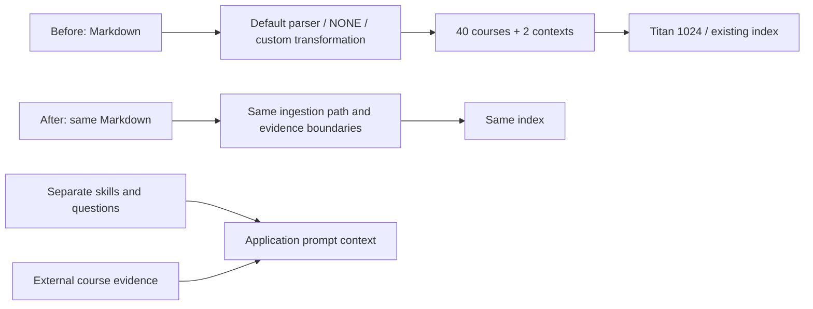
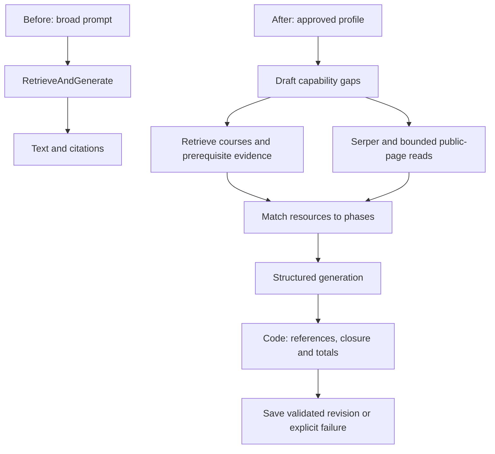

# Knowledge pipeline and data contracts

> **Current cloud status (2026-11-26):** The reference project infrastructure was destroyed at the user's request. Earlier live results and resource diagrams below are historical. Code, contracts and local artifacts remain available; no reference API is running. See [stopping point and next steps](implementation/next-steps.md).

## Current retained pipeline and new evidence layer — reviewed 2026-11-28

Catalog schema, whole-course extraction, custom chunking, Titan embeddings and index settings were preserved by the guided redesign. Ingestion remains a separate three-file runtime ZIP. The old `RetrieveAndGenerate` legacy route retains five results and its original prompt; guided planning uses `InternalRetriever` and separate generation.

Guided Retrieve explicitly requests SEMANTIC, 15 results and `record_type=course`. Exact-ID prerequisite expansion uses visited IDs, depth 10 and 30 SDK requests, exposes missing/cyclic/conflicting evidence and counts shared courses once. It preserves source text, metadata, rank, score, configuration and fetch time; context records are not course candidates. SEC-201 closes to 68 hours without equivalence, both in offline fixtures and a historical live check.

External Serper snippets and selected course pages use the same resource/evidence contracts but distinct provenance. Unknown price/duration/prerequisites remain unknown; external search does not alter ingestion or create a permanent external catalog. The equal-k English/Arabic retrieval harness uses synthetic ranks; a live captured original baseline and ranking improvement remain unproven. The former KB/index were destroyed; this document records source behavior, not an active knowledge service.

## Historical legacy implementation and redesign proposal

The original before/after explanations and diagrams below are retained for comparison. Use the current section above and the versioned schemas for implementation.

[Documentation](README.md) · [Architecture](architecture.md) · [Chunking decision](decisions/course-aware-chunking.md)


<!-- REDESIGN_NOTE_START -->
> **Historical design timeline — 2026-11-26:** The paired before/after sections below preserve the legacy implementation and the proposed redesign as written before execution. Their “not implemented” labels are historical; the current implementation and acceptance limits are recorded above. See [Guided Career Planning Redesign](decisions/guided-career-planning-redesign.md). Existing commands do not deploy that target.
<!-- REDESIGN_NOTE_END -->
## Source catalog

<!-- REDESIGN_NOTE_START -->
**Before redesign — implemented baseline:**
<!-- REDESIGN_NOTE_END -->

`internal_courses.md` contains 40 synthetic courses across ten tracks with a catalog-version declaration. Each record starts with `### Course ID: TRACK-NNN` and has nine fields: Course Name, Track, Level, Estimated Duration, Prerequisites, Description, Target Audience, Skills Covered, and Learning Outcome and Assessment.

The source is one object, not a directory of per-course files. Source inclusion is `internal_courses.md`; deployment artifacts under `lambda-artifacts/` are not source documents. The transformation adapter validates the exact source URI, so adding arbitrary objects or another catalog requires an intentional contract/configuration change.


<!-- REDESIGN_NOTE_START -->
**After redesign — agreed target, not implemented (2026-11-26):** Keep the current source/schema initially. Reviewed application-level skill definitions and plan-local drafts are separate from catalog truth and are not automatically written into shared data or the KB.


<!-- REDESIGN_DETAIL_START -->
```text
RETAINED KNOWLEDGE         NEW APPLICATION DATA
internal_courses.md        Reviewed skill/question definitions in app package
40 synthetic courses      User-reported capabilities in session state
Catalog version + hash    Plan-local draft skills and external evidence
No automatic write-back   No new KB schema implied by these additions
```
<!-- REDESIGN_DETAIL_END -->
<!-- REDESIGN_NOTE_END -->
## Parsing and custom evidence boundaries

<!-- REDESIGN_NOTE_START -->
**Before redesign — implemented baseline:**
<!-- REDESIGN_NOTE_END -->

The KB uses the default text parser and built-in chunking NONE with a POST_CHUNKING transformation hook. The parser converts source content into text/JSON batches. Bedrock writes those batches to the separate intermediate bucket and passes their references to Lambda. Lambda reassembles the parsed catalog, validates its structure and emits one complete unit per Course ID, plus two catalog-wide context units.

This custom extraction keeps names, descriptions, level, duration and prerequisites together and adds typed metadata. It does not call the embedding model itself. Chunking defines the evidence units; batching groups those units for transport. Current output is 42 records in intermediate JSON, not 40 new source objects. There is no overlap across courses.

The supported guards are 6,000 characters per course/context, aggregate parsed input of 2,000,000 bytes per source file and at most 20 incoming batches. These are implementation guards, not token measurements or the Titan input limit. Oversized or unsupported schemas fail rather than truncate. Ten-thousand-course scaling has not been established; it needs bounded processing, within-course policy and load/quality tests.


<!-- REDESIGN_NOTE_START -->
**After redesign — agreed target, not implemented (2026-11-26):** Course-aware chunking and two catalog contexts remain intact. No Sync or embedding/index migration is required merely to add the wizard, prompts or skill configuration.


<!-- REDESIGN_DETAIL_START -->

<!-- REDESIGN_DETAIL_END -->
<!-- REDESIGN_NOTE_END -->
## Metadata

<!-- REDESIGN_NOTE_START -->
**Before redesign — implemented baseline:**
<!-- REDESIGN_NOTE_END -->

Course units include these types:

- `record_type`: string `course`; context units use `catalog_context` and a context_kind.
- `course_id`, `course_name`, `track`, `level`, `catalog_version`, `parsed_source_sha256`: strings.
- `level_rank`: numeric rank Foundation=1, Intermediate=2, Advanced=3.
- `duration_hours`: positive integer extracted from the defined duration grammar.
- `has_prerequisites`: boolean; `prerequisites`: nonempty string list when required.

The original Markdown fields are text until extraction produces indexed metadata. Their presence inside a document does not automatically make them filterable. Unexpected inherited chunk metadata is rejected pending a deliberate merge policy. The parsed-source hash identifies the normalized text, distinct from the original object-byte hash in the build manifest.

Metadata supports exact filters, but the current application does not send strict business filters. Exact level, strict track, per-course hours and total-plan hours require explicit request validation, retrieval filters and deterministic post-validation. A course outside the allowed track must not be silently added to cover prerequisites; requirements not covered by the selected constraints must be reported.


<!-- REDESIGN_NOTE_START -->
**After redesign — agreed target, not implemented (2026-11-26):** Use record_type=course for candidates, IDs/version/hash for deduplication and prerequisites for closure. Skills/audiences/outcomes remain text, not new filter keys. Track/level are soft signals unless explicitly constrained; total hours are an application aggregate.


<!-- REDESIGN_DETAIL_START -->
**Target consumption example:**

```json
{"course_id":"SEC-201","record_type":"course","level":"Intermediate","duration_hours":20,"prerequisites":["SEC-101","BKE-101"]}
```

This is a subset of existing metadata, not a new schema. The application expands BKE-101 to SDE-101 and checks equivalence/ordering. Skills Covered remains source text; a filter on skill_ids would require a separately implemented metadata change.
<!-- REDESIGN_DETAIL_END -->
<!-- REDESIGN_NOTE_END -->
## Embeddings and vector index

<!-- REDESIGN_NOTE_START -->
**Before redesign — implemented baseline:**
<!-- REDESIGN_NOTE_END -->

Titan Text Embeddings v2 (`amazon.titan-embed-text-v2:0`) produces FLOAT32 vectors of 1024 dimensions. The companion template creates an OpenSearch Serverless faiss/HNSW index with matching vector dimension, stored text and stored metadata. Field mappings are `vector`, `text` and `metadata` in new template-managed deployments; reused existing indices can have different physical names if their Bedrock configuration is valid. Do not change dimensions without matching/rebuilding the index.

42 raw vectors occupy `42 × 1024 × 4 = 172,032` bytes before index/text/metadata/replica overhead; this is not the measured billable footprint. Embedding tokens are billed during ingestion of changed content and during query embedding. OpenSearch stores/searches the vectors; the original documents remain in S3. Neither indexing nor saved conversations updates model weights.


<!-- REDESIGN_NOTE_START -->
**After redesign — agreed target, not implemented (2026-11-26):** Keep Titan v2 FLOAT32/1024. Generation output-token limits are independent. Hybrid/reranking require supported actual mappings and measured comparison before adoption.


<!-- REDESIGN_DETAIL_START -->
```text
RETAINED   Titan v2 FLOAT32 vectors: 1024 dimensions
CHANGED    Final generation budget: 800 legacy -> 2048 target output tokens
EXPERIMENT Hybrid/reranking only after mapping/support checks and equal-pool evaluation
NOT IMPLIED Larger output budget -> new embedding dimensions or re-indexing
```
<!-- REDESIGN_DETAIL_END -->
<!-- REDESIGN_NOTE_END -->
## Initial, manual and scheduled refresh

<!-- REDESIGN_NOTE_START -->
**Before redesign — implemented baseline:**
<!-- REDESIGN_NOTE_END -->

First-use setup provisions/reuses the KB, binds its service-to-Lambda permission, creates/validates the data source and starts Sync immediately. Manual `sync --apply` works on content already in S3 and does not upload local edits. Weekly Scheduler calls StartIngestionJob for the same source; Bedrock detects changes and performs the ingestion stages. An unchanged weekly source is not assumed to be fully re-embedded every week, although listing/checking/control-plane work remains.

Bedrock service-role access is separate from hook-runtime access. The KB role reads source, manages intermediate content, invokes the hook and Titan and accesses the vector index. Lambda only reads/writes the permitted intermediate prefix and logs. Source and intermediate buckets must be different. [Permissions](security.md).


<!-- REDESIGN_NOTE_START -->
**After redesign — agreed target, not implemented (2026-11-26):** Retain the current source-refresh lifecycle. App-only releases must not unnecessarily trigger ingestion. Changing extracted metadata requires deliberate reprocessing verified by Retrieve; publishing new hook code alone does not refresh existing records.


<!-- REDESIGN_DETAIL_START -->
```text
Change                         Target action
Question wording/rules         App/config release; no knowledge Sync
Prompt/output budget           App/model configuration release; no knowledge Sync
Catalog content                Validate, upload, Sync, verify Retrieve
Extracted metadata             Update extraction + ensure reprocessing + verify
Chunking configuration         Reviewed data-source migration
Embedding dimensions           Compatible index and deliberate migration
```
<!-- REDESIGN_DETAIL_END -->
<!-- REDESIGN_NOTE_END -->
## Retrieval acceptance

<!-- REDESIGN_NOTE_START -->
**Before redesign — implemented baseline:**
<!-- REDESIGN_NOTE_END -->

Run Retrieve before RetrieveAndGenerate. Example SDK request, using the KB ID produced by setup:

```python
import boto3
runtime = boto3.Session(profile_name="YOUR_PROFILE", region_name="us-east-2").client("bedrock-agent-runtime")
response = runtime.retrieve(
    knowledgeBaseId="KB_ID_FROM_SETUP",
    retrievalQuery={"text": "Which course covers identity, authentication and authorization?"},
    retrievalConfiguration={"vectorSearchConfiguration": {
        "numberOfResults": 5,
        "filter": {"equals": {"key": "record_type", "value": "course"}},
    }},
)
for result in response["retrievalResults"]:
    print(result.get("metadata"), result["content"]["text"])
```

Check all expected IDs/complete bodies, distinct results, required prerequisites, source citations and metadata types. Use a labelled set spanning tracks and transition queries; include unsupported questions and impossible filter combinations. Semantic search can return nearest neighbours for unsupported roles; it does not guarantee refusal.

For strict filtering, combine record_type, exact level and track with a numeric duration_hours limit using `andAll`, `equals` and `lessThanOrEquals`. An Intermediate filter means Intermediate only, not Foundation automatically. Total-plan duration is an aggregate application constraint; a per-record duration filter does not enforce it.

A COMPLETE job with failed documents is not accepted. Index visibility can lag Sync; inspect count/output and retry bounded reads before changing chunking or re-ingesting. The built-in setup smoke check is one filtered known-ID check; it must not be reported as a full benchmark.


<!-- REDESIGN_NOTE_START -->
**After redesign — agreed target, not implemented (2026-11-26):** Preserve the unmodified baseline and compare at equal k. Proposed initial retrieval explicitly selects SEMANTIC, 15 results and course records; evaluate Arabic/English queries, precise IDs, closure, conflicts and out-of-coverage behavior before generation.


<!-- REDESIGN_DETAIL_START -->
**Baseline:** retain the actual five-result, no-explicit-search-type request from the application. **Target experiment:**

```json
{
  "vectorSearchConfiguration": {
    "numberOfResults": 15,
    "overrideSearchType": "SEMANTIC",
    "filter": {
      "equals": {
        "key": "record_type",
        "value": "course"
      }
    }
  }
}

```

Evaluate SEC-201 identity queries, AIML-201 RAG queries, Arabic/English equivalents, impossible constraints and sparse internal coverage. Compare Recall@5/MRR@5 on both runs; a larger pool can also be measured at equal Top-10 where both configurations retrieve ten. Never compare Recall@5 to Recall@15 as a ranking improvement.
<!-- REDESIGN_DETAIL_END -->
<!-- REDESIGN_NOTE_END -->
## Generation boundary

<!-- REDESIGN_NOTE_START -->
**Before redesign — implemented baseline:**
<!-- REDESIGN_NOTE_END -->

The application calls RetrieveAndGenerate with top five evidence records and maxTokens 800. Generation receives the prompt and retrieved context, then returns text/citations for persistence. The ingestion hook does not run here. Lower request limits, prompt changes or a different generation model do not change the already indexed chunks. Parser/chunking/embedding changes require a deliberate data-source/index migration and retrieval regression evaluation.

References: [custom transformation contract](https://docs.aws.amazon.com/bedrock/latest/userguide/kb-custom-transformation.html), [Titan v2 model](https://docs.aws.amazon.com/bedrock/latest/userguide/titan-embedding-models.html).

<!-- REDESIGN_NOTE_START -->
**After redesign — agreed target, not implemented (2026-11-26):** Split Retrieve from outline/final model calls. Search Google through Serper after gap identification, inspect bounded public pages and label snippets/unknowns. Generation runs in a background worker and validates IDs, dependencies, evidence and totals before success.


<!-- REDESIGN_DETAIL_START -->

<!-- REDESIGN_DETAIL_END -->
<!-- REDESIGN_NOTE_END -->
