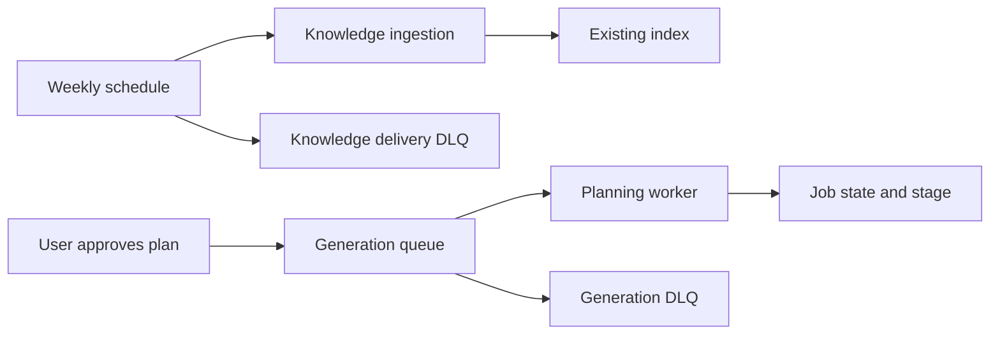
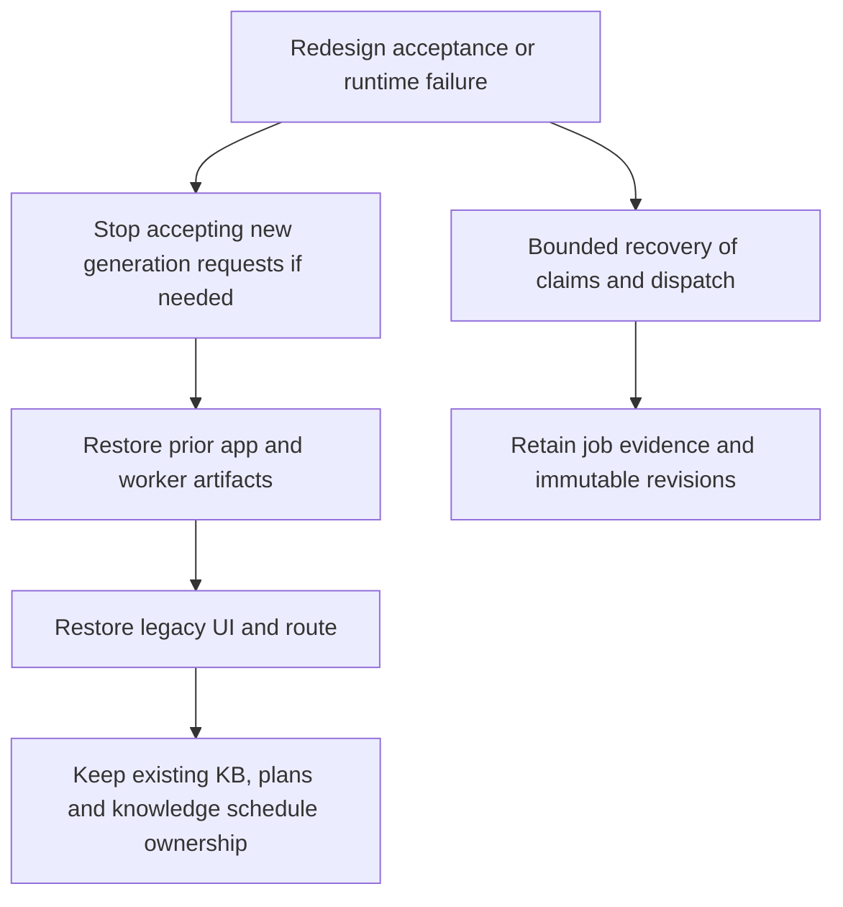

# Operations

> **Current cloud status (2026-11-26):** The reference project infrastructure was destroyed at the user's request. Earlier live results and resource diagrams below are historical. Code, contracts and local artifacts remain available; no reference API is running. See [stopping point and next steps](implementation/next-steps.md).

> **Historical live deployment (2026-11-26, subsequently destroyed):** The reference stack reached UPDATE_COMPLETE with 31 resources and a successful live API-to-worker plan journey. External search, real React UI, cross-model and full cost acceptance remain pending. See [recorded live results](implementation/live-deployment.md). Earlier statements below are dated implementation/design snapshots.


## Current operating boundary — reviewed 2026-11-28

The reference environment was destroyed, not paused. Historical pause/rollback commands below apply only after a new deployment. Source-level legacy fallback is preserved; there is no live fallback endpoint now. Rebuild from source and catalog, not deleted artifact versions. Keep ingestion Sync separate from application/worker releases.

Job statuses are queued/running/completed/failed with a stage; there is no fabricated progress percentage. Immutable approved snapshots preserve profile versions; completed results can be stale after edits. Conditional leases and bounded recovery prevent parallel work; saved-plan reconciliation avoids regeneration after a lost acknowledgement. Dispatch outbox/stream retries cover the DynamoDB/SQS gap. Inspect stalled jobs and DLQ before authorized replay; do not blindly create another paid generation.

A future full teardown must account for Retain tables, versioned bucket contents, external KB/OpenSearch and their dedicated policies/roles, logs and schedules, as well as the main stack. Stack deletion alone does not establish zero ongoing cost. The private reference teardown verified those removals. One AWS-managed deleted-table SYSTEM backup expires 2026-12-31 at no additional cost. No destructive script has been added as an automatic public setup action.

## Historical legacy implementation and redesign proposal

The original before/after explanations and diagrams below are retained for comparison. Use the current section above and the versioned schemas for implementation.

[Documentation](README.md) · [Deployment](deployment.md) · [Costs](costs.md)


<!-- REDESIGN_NOTE_START -->
> **Historical design timeline — 2026-11-26:** The paired before/after sections below preserve the legacy implementation and the proposed redesign as written before execution. Their “not implemented” labels are historical; the current implementation and acceptance limits are recorded above. See [Guided Career Planning Redesign](decisions/guided-career-planning-redesign.md). Existing commands do not deploy that target.
<!-- REDESIGN_NOTE_END -->

## Current guided deployment and operation

`python -m ingestion.setup_lab setup --profile YOUR_PROFILE --region us-east-2` inspects AWS and prints a plan. Adding `--apply` uploads the three artifact types, executes CloudFormation change sets, creates or validates the KB/data source and runs Sync plus one retrieval smoke check; it does not pause for manual change-set approval. The new stack resources are included, but `GuidedEnabled` defaults to `false`: guided routes and event source mappings remain disabled. Existing stack parameters are preserved where the wrapper supplies previous values. The wrapper does not configure every guided model/profile/secret parameter or create a Serper secret. Explicitly review those settings and model access before a separately authorized activation and live tests. The historical reference passed a limited live journey; external search, React, comparison and full cost acceptance remain incomplete. It was subsequently destroyed.

For application-only or worker-only changes, `app-release` and `worker-release` preview the selected function release; `--apply` uploads and deploys the corresponding artifact and refuses other resource changes. These releases do not run Sync. They cannot introduce the initial additive guided infrastructure. To pause guided intake and both consumers after deployment, use a reviewed CloudFormation update setting `GuidedEnabled=false`; retain the legacy route and data. A prolonged DynamoDB outage can leave messages in the generation DLQ and a job state stale; after service recovery inspect the job and queue before any authorized redrive. Do not delete retained resources as part of rollback.

Budget for session read/write renewal, outline/final/repair model calls, internal Retrieve, bounded Serper/page requests, SQS/DLQ, worker duration and the existing OpenSearch capacity floor. Budgets and caps are not measured journey cost or a guaranteed spending limit. See [runtime implementation](implementation/guided-runtime.md) and [React integration](react-integration.md).
## Verify deployment state

<!-- REDESIGN_NOTE_START -->
**Before redesign — implemented baseline:**
<!-- REDESIGN_NOTE_END -->

Read the target account/Region and stack status before operating. Code present in a repository is not proof that resources were deployed.

```bash
aws sts get-caller-identity --profile YOUR_PROFILE --region us-east-2
aws cloudformation describe-stacks --stack-name career-coach-lab --profile YOUR_PROFILE --region us-east-2
aws cloudformation list-stack-resources --stack-name career-coach-lab --profile YOUR_PROFILE --region us-east-2
```

The main stack has 14 baseline/ingestion resources before schedule binding and 18 after its Scheduler/group/role/DLQ are created. An early read-only check on 2026-11-26 found 14 resources and no Scheduler. A subsequent authorized setup deployment completed with UPDATE_COMPLETE and 18 resources, a successful Sync with zero document failures, and a passing filtered Retrieve smoke check. Scheduler is now ENABLED for Sunday 03:00 Africa/Cairo in that reference environment. Live target IDs, role policy/trust and encrypted fourteen-day DLQ were verified. The future weekly execution has not yet been observed. These are dated acceptance records, not guarantees about another account; pushing Git alone does not deploy resources.


<!-- REDESIGN_NOTE_START -->
**After redesign — agreed target, not implemented (2026-11-26):** Keep dated baseline evidence. After actual redesign deployment, separately inspect sessions/worker/queue/roles and runtime acceptance; Git documentation updates are not rollout evidence.


<!-- REDESIGN_DETAIL_START -->
**Target evidence bundle:** new change-set/resource identities, app/worker artifact versions, scoped roles, session lifecycle results, job dispatch/queue/worker results, retrieval benchmark, validated plan revision and measured cost/latency. Preserve existing dated ingestion/Scheduler evidence separately; do not overwrite it with future claims.
<!-- REDESIGN_DETAIL_END -->
<!-- REDESIGN_NOTE_END -->
## Verify scheduling

<!-- REDESIGN_NOTE_START -->
**Before redesign — implemented baseline:**
<!-- REDESIGN_NOTE_END -->

Read SyncScheduleName, SyncScheduleGroup and SyncScheduleState from main-stack Outputs. If these Outputs are absent, the source-ID binding has not provisioned Scheduler. If present, inspect the actual schedule rather than assuming a default:

```bash
aws scheduler get-schedule --name SCHEDULE_NAME_FROM_OUTPUTS --group-name GROUP_FROM_OUTPUTS --profile YOUR_PROFILE --region us-east-2
```

Check State=ENABLED, expression/timezone and target input KB/source IDs, role ARN, retry policy and DLQ. First-use setup is `python -m ingestion.setup_lab setup ... --apply --enable-schedule`; it performs initial Sync immediately and binds Scheduler afterward. Scheduled execution only refreshes an already uploaded source. An existing enabled schedule continues during later setup unless deliberately disabled.

For maintenance, create a reviewed main-stack UPDATE preserving all current parameters and override only SyncScheduleState=DISABLED. Do not remove KnowledgeBaseDataSourceId: that condition removes the schedule resources and the wrapper refuses unintended removal. The complete template also needs the current artifact key/version. Console disable is possible under EventBridge Scheduler but must be reconciled with CloudFormation parameters. Disabling future triggers does not cancel an active job or remove search capacity charges.


<!-- REDESIGN_NOTE_START -->
**After redesign — agreed target, not implemented (2026-11-26):** The knowledge schedule continues unchanged. Monitor the proposed generation queue separately; pausing weekly Sync does not pause plan jobs, and pausing jobs does not stop ingestion/search charges.


<!-- REDESIGN_DETAIL_START -->

<!-- REDESIGN_DETAIL_END -->
<!-- REDESIGN_NOTE_END -->
## Publish catalog changes

<!-- REDESIGN_NOTE_START -->
**Before redesign — implemented baseline:**
<!-- REDESIGN_NOTE_END -->

Edit and validate `internal_courses.md`, then run setup again to upload the versioned source and Sync. The source schema is strict and the hook supports one exact URI. Do not place source files in the intermediate bucket or ingest the whole artifacts bucket.

```bash
python -m unittest discover -s tests -v
python -m ingestion.setup_lab setup --profile YOUR_PROFILE --region us-east-2 --apply
```

Matching ZIP/catalog bytes are reused after verification. Existing model/KB/schedule settings are preserved unless explicitly overridden. An initial upload performed outside the tool may need one new version to record its verified hash metadata.


<!-- REDESIGN_NOTE_START -->
**After redesign — agreed target, not implemented (2026-11-26):** Continue validating/uploading/Syncing source changes. Review application skill-course mappings against new IDs without copying durations/prerequisites into configuration.


<!-- REDESIGN_DETAIL_START -->
**Target release checklist:** validate catalog; publish/Sync changed knowledge; check IDs/version/hash; review affected skill-to-course references; rerun retrieval fixtures. Do not copy course hours/prerequisites into skills configuration. An already running job retains its profile snapshot and must not silently mix conflicting catalog evidence versions.
<!-- REDESIGN_DETAIL_END -->
<!-- REDESIGN_NOTE_END -->
## Manual Sync and status

<!-- REDESIGN_NOTE_START -->
**Before redesign — implemented baseline:**
<!-- REDESIGN_NOTE_END -->

```bash
# Refresh S3 content already uploaded; local edits are NOT uploaded by this action.
python -m ingestion.setup_lab sync --profile YOUR_PROFILE --region us-east-2 --apply
python -m ingestion.setup_lab status --profile YOUR_PROFILE --region us-east-2
```

Sync waits for an existing active ingestion job or starts a new one, then requires COMPLETE plus explicit zero failed documents. Inspect statistics/failureReasons and expected course IDs/output. The reference catalog yields 40 course units and two context units. A successful ingestion may precede search visibility; the CLI retries bounded filtered Retrieve calls without automatically re-ingesting. It does not call generation.


<!-- REDESIGN_NOTE_START -->
**After redesign — agreed target, not implemented (2026-11-26):** These commands remain knowledge operations, not dialogue/job status APIs. The future job endpoint reports plan-generation state independently.


<!-- REDESIGN_DETAIL_START -->
```text
BEFORE / RETAINED: sync/status CLI -> knowledge ingestion statistics
AFTER / ADDITION: GET /v2/sessions/{session_id}/jobs/{job_id} -> plan job status
A COMPLETE ingestion job is not a completed plan.
A completed plan job is not proof the next scheduled Sync ran.
```
<!-- REDESIGN_DETAIL_END -->
<!-- REDESIGN_NOTE_END -->
## Update ingestion code

<!-- REDESIGN_NOTE_START -->
**Before redesign — implemented baseline:**
<!-- REDESIGN_NOTE_END -->

Change the pure extractor/adapter deliberately, run contract/package tests and cfn-lint, then run setup. It builds the three-file deterministic ZIP and supplies a new hash-derived key plus exact S3 object version to CloudFormation. Overwriting content at an unchanged key does not by itself signal a Lambda code update. Source schema or embedding/chunking changes require a data migration/retrieval regression plan, not just a function-code release. Do not change the working model invocation while publishing an ingestion-only update.


<!-- REDESIGN_NOTE_START -->
**After redesign — agreed target, not implemented (2026-11-26):** No initial ingestion rewrite is needed. Release app/worker/configuration separately; only extraction/schema/index changes need knowledge reprocessing and retrieval regression.


<!-- REDESIGN_DETAIL_START -->
```text
Question/config change -> application artifact release
Planning/search change -> application/worker artifact release
Extractor change       -> ingestion artifact release + reprocessing decision
Embedding/chunk change -> knowledge migration and retrieval regression
No initial redesign change requires replacing the course-aware hook.
```
<!-- REDESIGN_DETAIL_END -->
<!-- REDESIGN_NOTE_END -->
## Evidence and monitoring

<!-- REDESIGN_NOTE_START -->
**Before redesign — implemented baseline:**
<!-- REDESIGN_NOTE_END -->

Each setup session stores the plan, package manifest/fixtures, paged change sets, stack/events snapshots, Sync job/statistics, retrieval smoke result and final Outputs in ignored `.lab/setup/<session>/`. Archive them according to your data policy. The repository excludes credentials, environment files, `.lab/` and `.local/`.

CloudWatch's ingestion group is `/aws/lambda/<stack>-ingestion-transform` with seven-day retention. Application logs are in its own Lambda log group with no explicit template retention. DynamoDB holds successful plans, not execution logs. Scheduler delivery metrics and the encrypted SQS DLQ reveal submission failures; accepted ingestion jobs can still fail documents and require independent status checks. No job-completion monitor/alarms are created by this revision.

Inspect API/Lambda errors and Bedrock usage together for timeouts. The 30-second API timeout is shorter than Lambda's 60 seconds; a 504 is not proof that model work stopped. Avoid automatic duplicate generation retries.


<!-- REDESIGN_NOTE_START -->
**After redesign — agreed target, not implemented (2026-11-26):** Add privacy-preserving request/job/stage correlation, claim/dispatch failures, queue age/DLQ, session expiry and model/search budgets. Never log cookies, secrets or raw answers by default; collect actual cost/latency evidence.


<!-- REDESIGN_DETAIL_START -->
**Target telemetry example (illustrative, not emitted today):**

```json
{"request_id":"example-plan-request-001","job_id":"example-job-001","stage":"retrieval","status":"running","search_requests_used":0,"page_reads_used":0}
```

Measure queue age, dispatch/claim recovery, stage durations and actual token/search usage. Retain provider evidence with the authorized plan, not cookies, secret values or complete user answers in logs.
<!-- REDESIGN_DETAIL_END -->
<!-- REDESIGN_NOTE_END -->
## Failure diagnosis

<!-- REDESIGN_NOTE_START -->
**Before redesign — implemented baseline:**
<!-- REDESIGN_NOTE_END -->

- IAM tag/pass-role failures: inspect CloudFormation Events and the **deployer** identity's grants, not runtime permissions. CAPABILITY_NAMED_IAM acknowledges named roles; it does not grant caller permissions.
- KB creation failure: inspect API/CloudTrail errors, Bedrock role trust, model access, collection/index existence and IAM/data/network policies. IAM global events are inspected in us-east-1. Do not repeat quick-create and accumulate collections.
- Source creation failure: verify separate source/intermediate buckets, correct prefix and hook ARN; check both KB-role invocation grants and the function's KB/account-scoped resource permission.
- Transformation failure: inspect Lambda logs and actual parsed JSON. Supported text types are TEXT/PLAIN_TEXT; schema, sizes, metadata and original URI must match the contract.
- COMPLETE with failed documents: read failureReasons and failed count. This is not accepted indexing success.
- Empty Retrieve: inspect ingestion/output/count/filter types and index refresh before altering chunking. Unsupported queries can return semantic neighbours; refusal is application logic.
- Scheduler creation rejects missing KnowledgeBaseId/DataSourceId: the universal target requires PascalCase input keys `KnowledgeBaseId` and `DataSourceId`, even though boto3 Bedrock calls use lower-camel-case keys. Wait for rollback completion, correct the payload and rerun setup against the same stack; do not delete the baseline.
- Local API_URL error: read ApiEndpoint and restart Flask. A GET to the POST-only endpoint is not an application test. A 403 can be unsigned/wrong-Region/denied execute-api invocation.


<!-- REDESIGN_NOTE_START -->
**After redesign — agreed target, not implemented (2026-11-26):** Add expired-session versus TTL cleanup, stale versions, duplicate claims, orphaned dispatch, worker deadlines, blocked/limited-evidence pages, Serper limits and invalid/truncated plan diagnosis. Unknown evidence must not be turned into verified claims.


<!-- REDESIGN_DETAIL_START -->
**Target diagnosis order:**

- Session rejected: validate proof and logical expiry before blaming TTL cleanup.
- Duplicate/stale answer: inspect saved request result, question and version before calling the model again.
- Job queued but not delivered: inspect dispatch record and queue submission outcome.
- Job stalled: inspect claim deadline, worker logs, delivery retries and the separate generation DLQ.
- External evidence limited: distinguish snippet-only evidence, blocked page, rate limit and unknown details.
- Invalid plan: inspect failed reference/closure/time checks and the single repair result; never mark partial output successful.
<!-- REDESIGN_DETAIL_END -->
<!-- REDESIGN_NOTE_END -->
## Rollback and recovery

<!-- REDESIGN_NOTE_START -->
**Before redesign — implemented baseline:**
<!-- REDESIGN_NOTE_END -->

The wrapper refuses removals and unexpected replacements, saves proposals before execution and confirms a terminal event from the new request. No-op changes are accepted. An UPDATE_ROLLBACK_COMPLETE stack can be retried after fixing the cause; initial ROLLBACK_COMPLETE, REVIEW_IN_PROGRESS, failed rollback or in-progress states require deliberate inspection/recovery. The tool never deletes the baseline automatically.

For code rollback, create a reviewed UPDATE using the earlier ZIP key/object version while preserving current model/KB/source/schedule parameters. Do not apply bootstrap.json as rollback: it omits application resources. Reusing an external KB does not rewrite its ownership/configuration; update an owned RAG stack explicitly when needed.


<!-- REDESIGN_NOTE_START -->
**After redesign — agreed target, not implemented (2026-11-26):** Restore previous application/worker versions and legacy routing; stop new generation jobs if necessary. Recover claims/dispatch in bounded fashion and preserve KB, sessions and immutable plan history.


<!-- REDESIGN_DETAIL_START -->

<!-- REDESIGN_DETAIL_END -->
<!-- REDESIGN_NOTE_END -->
## Cleanup

<!-- REDESIGN_NOTE_START -->
**Before redesign — implemented baseline:**
<!-- REDESIGN_NOTE_END -->

Disable future schedule triggers and inspect active jobs first. Keep the main stack's schedule disabled while deleting only the companion RAG stack you own; source deletion must finish while its index/role still exist. Reused external KB/collection resources need separate owner-approved deletion. Removing the main stack does not remove them or stop their bill.

Before deleting main infrastructure, decide retention/export for DynamoDB records and logs. Versioned buckets must have all versions/delete markers deliberately removed; emptying only current objects is insufficient. Review a deletion plan against exact account/Region/resource IDs. Main-stack cleanup includes its Scheduler/group/role/DLQ. There is no automatic teardown timer, and retained object/log versions may remain billable.

<!-- REDESIGN_NOTE_START -->
**After redesign — agreed target, not implemented (2026-11-26):** Treat generation jobs/queue/DLQ and temporary session TTL separately from retained plans, knowledge resources and Scheduler. Do not delete user-plan records as part of ordinary code rollback.


<!-- REDESIGN_DETAIL_START -->
**Separate retention decisions:** temporary sessions/turns/jobs expire logically before eventual TTL deletion; final plans retain the existing policy; generation queue/DLQ cleanup is independent from knowledge Scheduler/DLQ cleanup. Export/retain business evidence deliberately. A code rollback is not authorization to delete these resources or records.
<!-- REDESIGN_DETAIL_END -->
<!-- REDESIGN_NOTE_END -->
