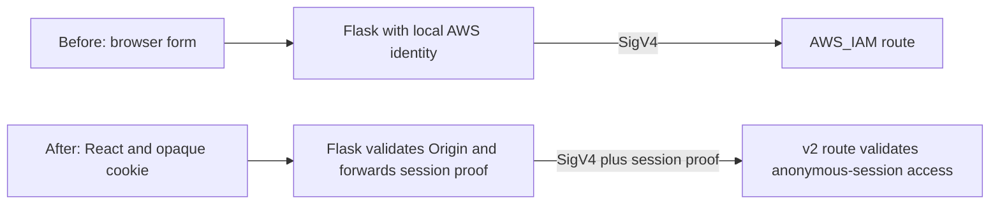
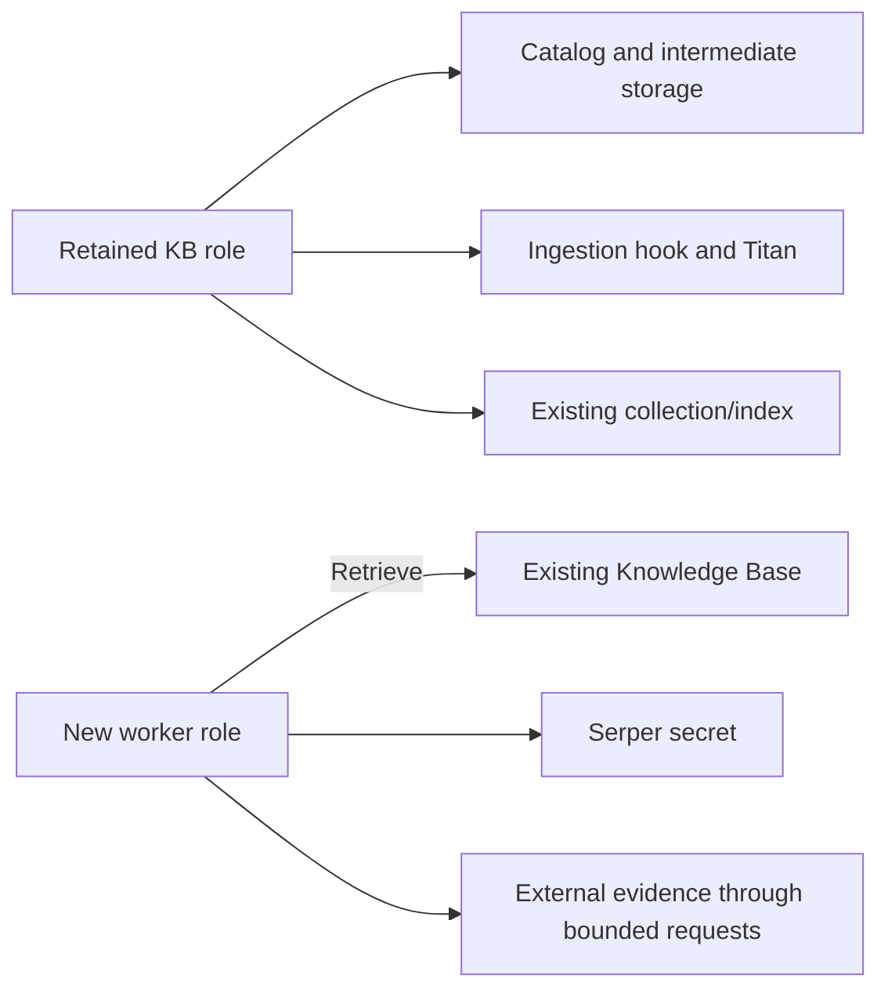

# Security and configuration

> **Current cloud status (2026-11-26):** The reference project infrastructure was destroyed at the user's request. Earlier live results and resource diagrams below are historical. Code, contracts and local artifacts remain available; no reference API is running. See [stopping point and next steps](implementation/next-steps.md).

> **Historical live deployment (2026-11-26, subsequently destroyed):** The reference stack reached UPDATE_COMPLETE with 31 resources and a successful live API-to-worker plan journey. External search, real React UI, cross-model and full cost acceptance remain pending. See [recorded live results](implementation/live-deployment.md). Earlier statements below are dated implementation/design snapshots.


## Current guided security boundary — reviewed 2026-11-28

Flask owns same-origin cookie lifecycle and signs AWS requests server-side. The session proof is inside an HttpOnly, SameSite=Lax cookie (Secure outside explicit localhost HTTP development), omitted from browser JSON, and hashed in persistence. Mutating browser requests require the configured exact Origin; IDs alone grant no access. API Gateway retains AWS_IAM. Logical seven-day expiry is enforced before access independently of TTL cleanup.

Application and worker IAM are separate. Only the worker reads the configured Serper secret ARN; external queries use reviewed generic topics, never raw user answers. Page fetching validates DNS/redirect destinations and pins public addresses with TLS hostname verification; private, loopback, link-local and metadata destinations fail closed. Page text is untrusted evidence. Model proposals pass strict allowed fields/provenance validation; code chooses questions and validates plan references/totals.

The model adapter preserves full profile ARNs, and deployment parameters allow exact destination foundation-model ARNs. Secret creation, credentials, login/JWT and new frontend hosting are outside this release. Offline security fixtures are not a penetration test or full live isolation acceptance. Public version tags exclude `.local/`, `.lab/`, `.aws/`, `.env` and credentials.

## Historical legacy implementation and redesign proposal

The original before/after explanations and diagrams below are retained for comparison. Use the current section above and the versioned schemas for implementation.

[Documentation](README.md) · [Deployment](deployment.md) · [Operations](operations.md)


<!-- REDESIGN_NOTE_START -->
> **Historical design timeline — 2026-11-26:** The paired before/after sections below preserve the legacy implementation and the proposed redesign as written before execution. Their “not implemented” labels are historical; the current implementation and acceptance limits are recorded above. See [Guided Career Planning Redesign](decisions/guided-career-planning-redesign.md). Existing commands do not deploy that target.
<!-- REDESIGN_NOTE_END -->
## Local caller

<!-- REDESIGN_NOTE_START -->
**Before redesign — implemented baseline:**
<!-- REDESIGN_NOTE_END -->

Flask uses the local boto3 credential provider chain to sign requests for API Gateway's `execute-api` service in the configured Region. Use an IAM user or temporary role/SSO session, never root for KB creation. Profile names select local configuration; they do not grant permissions. Credentials are not copied into Lambda or browser JavaScript.

The caller needs this identity-policy grant, substituting the exact ApiInvokeArn from main-stack Outputs:

```json
{"Version":"2012-10-17","Statement":[{"Effect":"Allow","Action":"execute-api:Invoke","Resource":"API_INVOKE_ARN_FROM_OUTPUTS"}]}
```

`POST /generate-plan` uses AWS_IAM. There is no JWT authorizer or employee identity layer. The current user_id is application input/default UUID, not a verified user identity. A production web identity design would need separate authentication and per-user authorization.


<!-- REDESIGN_NOTE_START -->
**After redesign — agreed target, not implemented (2026-11-26):** Keep existing AWS_IAM/SigV4. Add an opaque anonymous-session cookie validated server-side, not employee login/JWT. A public session ID or supplied user_id is not sufficient proof of access.


<!-- REDESIGN_DETAIL_START -->


The cookie is not an employee login. Both layers are needed: AWS_IAM authorizes the server caller; session proof restricts that caller's browser requests to the correct anonymous session.
<!-- REDESIGN_DETAIL_END -->
<!-- REDESIGN_NOTE_END -->
## Application execution role

<!-- REDESIGN_NOTE_START -->
**Before redesign — implemented baseline:**
<!-- REDESIGN_NOTE_END -->

The application role trusts Lambda and has basic CloudWatch execution logging, PutItem on the plans table, InvokeModel on the selected foundation model, Retrieve on the configured KB and RetrieveAndGenerate on `*` because that action lacks resource-level scoping. Logs record execution/errors; DynamoDB records successful requests/plans. The role does not need deployment/IAM-policy administration or access to ingestion artifacts.

API Gateway invokes the application through a separate Lambda resource-based permission restricted to the API/stage/POST route. This is not the application's execution role and not an extra IAM role for the browser.


<!-- REDESIGN_NOTE_START -->
**After redesign — agreed target, not implemented (2026-11-26):** Existing PutItem rights cover only the plans table. Add narrowly scoped session read/write/conditional operations, analysis model calls and queue submission; the worker has its own evidence/model/secret/plan permissions.


<!-- REDESIGN_DETAIL_START -->
```text
BEFORE
Application: PutItem -> existing plans table
Application: selected model invocation + configured KB access

AFTER / TARGET ROLE SPLIT
Intake handler: scoped session reads/claims/updates + analysis model + SendMessage
Generation worker: consume queue + read snapshot/update job + Retrieve
                   + planner model + final-plan persistence + GetSecretValue
Not allowed: assuming current plans-table PutItem grants authorize the new table
```

Actual DynamoDB actions/transactions must match the implementation. IAM examples are deliberately not populated with wildcard resource grants or fabricated account ARNs.
<!-- REDESIGN_DETAIL_END -->
<!-- REDESIGN_NOTE_END -->
## Ingestion execution role

<!-- REDESIGN_NOTE_START -->
**Before redesign — implemented baseline:**
<!-- REDESIGN_NOTE_END -->

The hook role trusts Lambda and can GetObject/PutObject only under the intermediate bucket's `kb-intermediate/*`, plus writes to its dedicated log group/streams. It cannot read arbitrary source/artifact objects, call Bedrock models, write DynamoDB or access OpenSearch. The group is created by CloudFormation with seven-day retention. The function's additional resource permission trusts Bedrock for the destination account and exact configured KB ARN; bind that ID before source creation/Sync.


<!-- REDESIGN_NOTE_START -->
**After redesign — agreed target, not implemented (2026-11-26):** Retain ingestion-only privileges. Do not grant the hook access to session data, external-search secrets or generation queues.


<!-- REDESIGN_DETAIL_START -->
```text
RETAINED ALLOW: intermediate-prefix GetObject/PutObject and ingestion log writes
STILL EXCLUDED: sessions, final plans, Serper secret, generation queue, model planning
NEW APPLICATION WORK belongs to handler/worker roles, not the transformation hook.
```
<!-- REDESIGN_DETAIL_END -->
<!-- REDESIGN_NOTE_END -->
## KB service role and vector policies

<!-- REDESIGN_NOTE_START -->
**Before redesign — implemented baseline:**
<!-- REDESIGN_NOTE_END -->

The companion RAG role trusts Bedrock scoped to this account's KB ARN namespace, avoiding a role→KB circular reference. Source read is limited to the catalog and metadata sidecar, with scoped bucket listing. Intermediate Get/Put/Delete/list is scoped to its prefix. It can invoke the exact hook both unqualified and `$LATEST`, invoke Titan v2 and access the exact collection via aoss:APIAccessAll.

IAM access alone is insufficient: the OpenSearch data policy separately grants the KB principal index DescribeIndex/ReadDocument/WriteDocument. The deployer separately receives index lifecycle rights used by CloudFormation. The provided network policy permits collection endpoint connectivity over the public network; that does not authorize anonymous data access. Private endpoints/operator access are a separate production network design. Existing external KB roles/policies must already satisfy the contract and are not silently rewritten by setup.


<!-- REDESIGN_NOTE_START -->
**After redesign — agreed target, not implemented (2026-11-26):** Retain current KB/index boundaries. External web retrieval belongs to the worker, not KB-role administration or automatic catalog ingestion.


<!-- REDESIGN_DETAIL_START -->


No web page or model output can modify IAM, KB ownership or index policies.
<!-- REDESIGN_DETAIL_END -->
<!-- REDESIGN_NOTE_END -->
## Scheduler execution role

<!-- REDESIGN_NOTE_START -->
**Before redesign — implemented baseline:**
<!-- REDESIGN_NOTE_END -->

When bound, the main stack adds a dedicated role trusted by scheduler.amazonaws.com with source account and **schedule-group ARN** conditions. It can StartIngestionJob on this KB and SendMessage to this DLQ only. It does not invoke generation, upload data or inherit the deployer's privileges. The encrypted SQS DLQ retains delivery failures for fourteen days; accepted-job document failures require separate monitoring.


<!-- REDESIGN_NOTE_START -->
**After redesign — agreed target, not implemented (2026-11-26):** Retain StartIngestionJob and its own delivery DLQ. New plan-job permissions belong to application/worker roles, not the knowledge Scheduler role.


<!-- REDESIGN_DETAIL_START -->
```text
RETAINED Scheduler role: StartIngestionJob on the configured KB
                        SendMessage to the knowledge-delivery DLQ
SEPARATE worker role:   generation queue consumption and plan work
SEPARATE handler role:  enqueue approved user jobs
Do not reuse the knowledge-delivery DLQ for plan-generation failures.
```
<!-- REDESIGN_DETAIL_END -->
<!-- REDESIGN_NOTE_END -->
## Deployment identity

<!-- REDESIGN_NOTE_START -->
**Before redesign — implemented baseline:**
<!-- REDESIGN_NOTE_END -->

The provisioner needs scoped CloudFormation, versioned S3, IAM role/policy/tag/pass-role, Lambda, Logs, DynamoDB, API Gateway, Bedrock, OpenSearch, Scheduler and SQS permissions for the chosen stacks/resources. IAM tagging/PassRole failures belong to the caller's permissions, not runtime roles. The script does not attach AdministratorAccess or elevate itself. Account SCPs/boundaries can still deny operations.

For a new index, the current IAM principal needs data-policy access and aoss:APIAccessAll; assumed-role sessions are resolved to IAM-role ARNs using iam:GetRole. A distinct CloudFormation execution role needs its own explicit data-plane setup. Keep privileges separate from application service identities.


<!-- REDESIGN_NOTE_START -->
**After redesign — agreed target, not implemented (2026-11-26):** Future deployer changes must cover new resources and artifact versions explicitly; runtime identities still must not inherit provisioning privileges.


<!-- REDESIGN_DETAIL_START -->
**Future change-review checklist:** verify added table/queue/worker/resource policies; bind artifact versions and secret ARN; inspect exact model/profile and destination-Region permissions; retain existing identities and data ownership. PassRole/tag/provisioning privileges remain deployment responsibilities, not runtime privileges.
<!-- REDESIGN_DETAIL_END -->
<!-- REDESIGN_NOTE_END -->
## Data protection and controls

<!-- REDESIGN_NOTE_START -->
**Before redesign — implemented baseline:**
<!-- REDESIGN_NOTE_END -->

Both buckets block public ACLs/policies, use managed encryption and enable versioning. Deployment objects and source reads have separate prefixes/scopes; intermediate content lives in a different bucket. Versioning retains old content until deliberately removed; no lifecycle expiration or customer-managed KMS key is created. Use only synthetic catalog data in this configuration unless adding appropriate privacy/retention controls.

API throttling is one request/second with burst two; CORS is permissive, not an authorization mechanism. CloudWatch access logging, WAF, employee sign-in, alarms, idempotency, per-user quotas and a hard spending cutoff are not included. Application log retention is not explicitly bounded by this template. [Operational controls](operations.md) and [cost controls](costs.md).


<!-- REDESIGN_NOTE_START -->
**After redesign — agreed target, not implemented (2026-11-26):** Use HttpOnly/SameSite/Secure production cookies, Origin checks, seven-day logical expiry, secret-ARN configuration and redacted logs. External queries contain generic skills, not private answers. Bound page reads and block private/metadata/redirect destinations; web content cannot issue tool instructions.


<!-- REDESIGN_DETAIL_START -->
```text
Browser -> HttpOnly session cookie -> same-origin Flask -> server validation
Session reads/writes -> reject expired proof before TTL cleanup
Search queries -> generic topic/level/language only
Page reads -> public approved destinations; bounded bytes/time/redirects
Fetched text -> untrusted evidence, never executable tool/prompt instructions
Logs/errors -> safe identifiers and stages, not secrets/cookies/raw answers
```

Test private/link-local/metadata destinations and redirects, not just obvious localhost strings. Inaccessible pages remain limited-evidence candidates; do not bypass access controls.
<!-- REDESIGN_DETAIL_END -->
<!-- REDESIGN_NOTE_END -->
## Region and model portability

<!-- REDESIGN_NOTE_START -->
**Before redesign — implemented baseline:**
<!-- REDESIGN_NOTE_END -->

The setup Region is explicit and the account comes from STS, optionally checked by --expected-account. CloudFormation's AWS::Region/AWS::AccountId resolve for the destination. Local AWS_DEFAULT_REGION must match the API. IAM names can collide across Regions; S3 names are global, so use distinct stack names per account/Region.

The working handler uses `MODEL_ARN = arn:aws:bedrock:${AWS::Region}::foundation-model/${FoundationModelId}` with an empty account field. KB ARNs contain the destination account separately. A literal source-account ID is not embedded in this model ARN. FoundationModelId supports Nova Lite v1 and the listed Sonnet/Haiku 4.5 IDs, but model availability/access and inference mode must be validated in the destination; the alternative model list is not a compatibility test.

A model requiring an inference profile needs a deliberately parameterized destination-account profile ARN plus profile/foundation-model/destination-Region permissions. Do not pass that profile ARN into the current model-ID parameter, which constructs a foundation-model ARN. This documentation does not modify the working generation invocation. [AWS profile invocation](https://docs.aws.amazon.com/bedrock/latest/userguide/inference-profiles-use.html).

For an account move, deploy and bind new buckets, functions, KB/source IDs and API Outputs using the destination profile, re-evaluate retrieval, then test generation/citations/persistence before retiring old resources. Private evidence and environment files stay outside Git; never copy credentials into docs/issues.

<!-- REDESIGN_NOTE_START -->
**After redesign — agreed target, not implemented (2026-11-26):** Verify the exact runtime role and model/profile path, including cross-Region permissions. Haiku is a candidate, not access proof; no assumption that existing template values implement profile-aware invocation.


<!-- REDESIGN_DETAIL_START -->
**Target verification sequence:**

1. Select the intended intake/planner model or inference profile in the target account/Region.
2. Verify the runtime role can invoke that exact path and any required destination models.
3. Pass IDs/ARNs using the correct API fields; never concatenate a profile ARN into a foundation-model ARN.
4. Run controlled fixtures and record model/profile identity with results.

Keep legacy settings independently usable during rollout; do not infer Sonnet 4.6 support from the currently listed Sonnet 4.5 parameter.
<!-- REDESIGN_DETAIL_END -->
<!-- REDESIGN_NOTE_END -->
